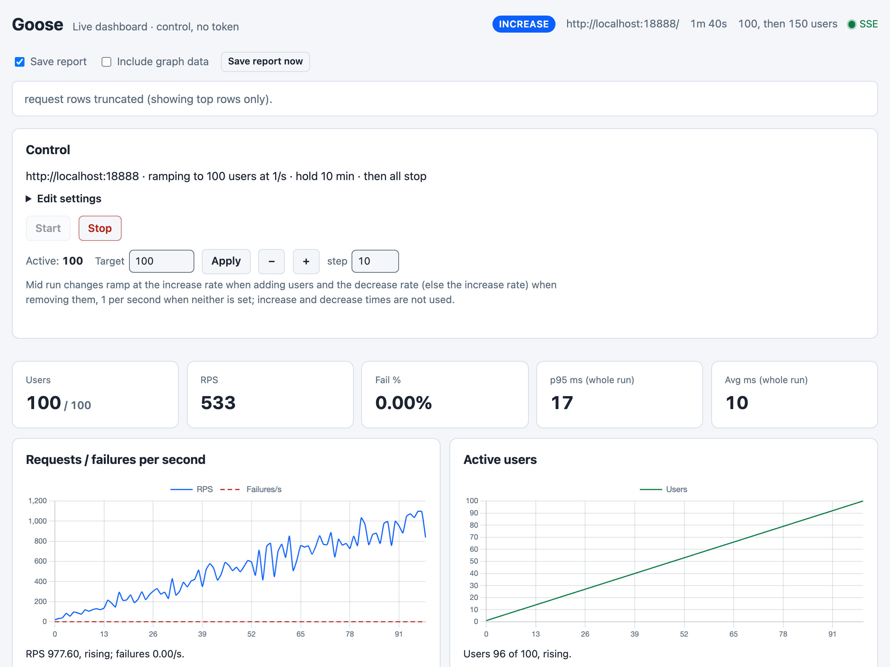
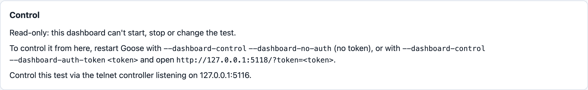
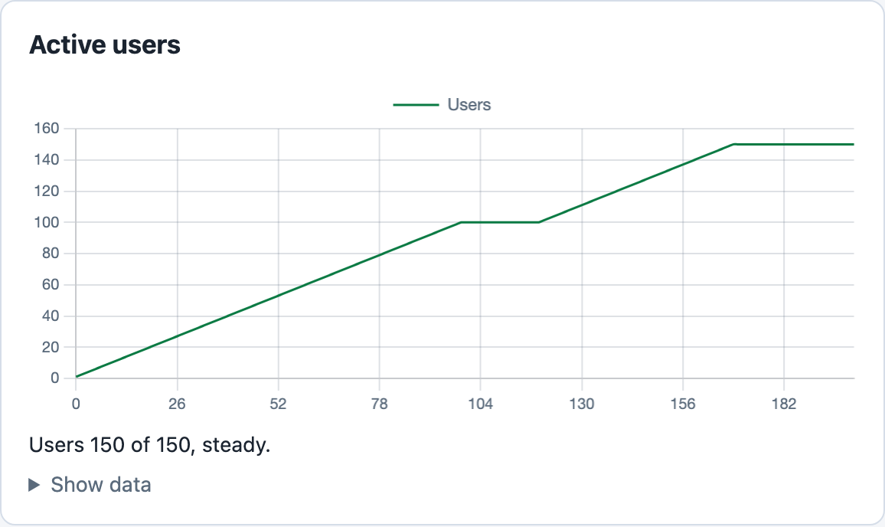
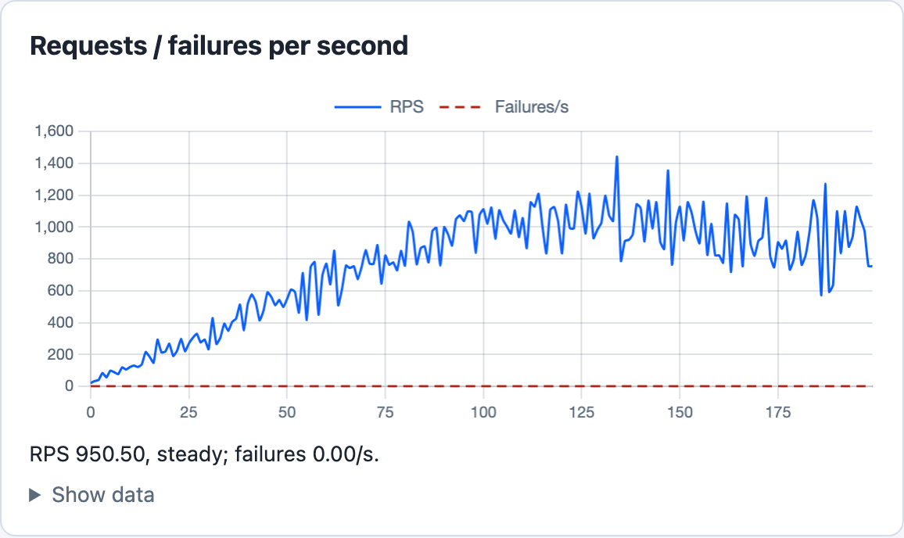
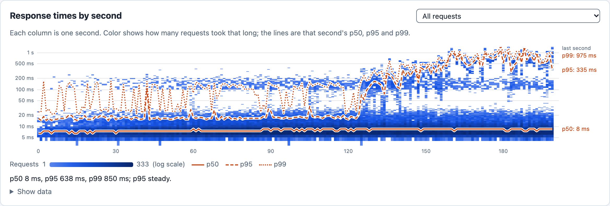
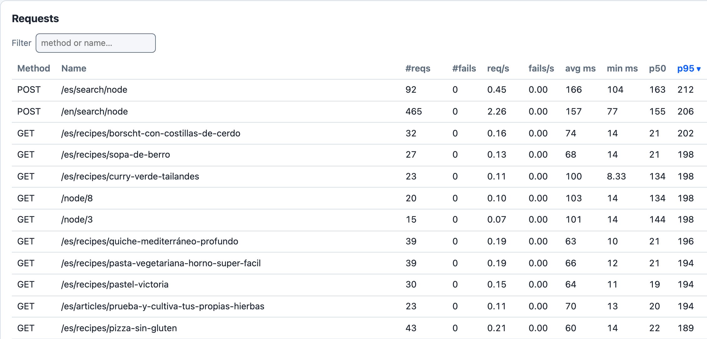
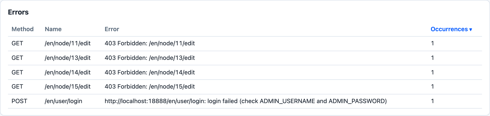
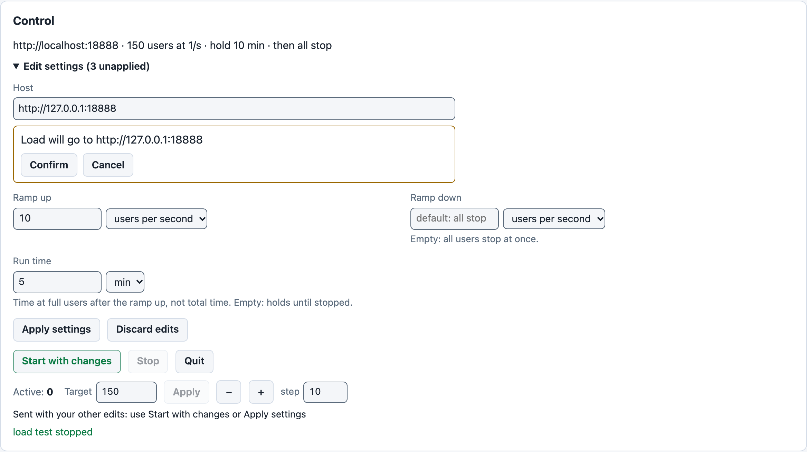
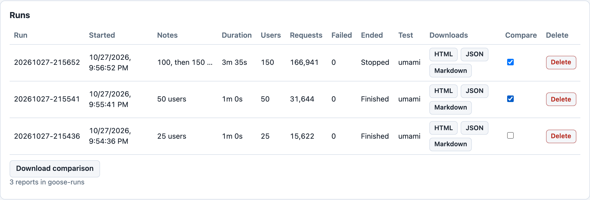

# Live Dashboard

The live dashboard is a web page Goose serves while a load test runs. It shows the test's users, requests, response times and errors second by second. It saves each run's report, and lists saved runs to download and compare. With control turned on it can also start and stop the test, and change its users, host, ramps and run time.



*The first screen of a run with control on, explained section by section below, with the truncation notice under [The tables](#the-tables).*

Build Goose with the `dashboard` feature, add `--dashboard`, and open `http://127.0.0.1:5118/`. In a checkout of Goose, against your own [Umami](../example/umami.md) site:

```bash
cargo run --release --features dashboard --example umami -- \
  --dashboard -H http://umami.example.com -u 100 -r 1
```

Most images on this page come from one run of the command above, against a local Umami site at `http://localhost:18888`: the first image, the charts, the heatmap, the Requests table, the Control card with Edit settings open, and the Runs panel. That run added `--dashboard-control --dashboard-no-auth` for control, `-t 10m` for a 10 minute hold, `--no-reset-metrics` so the tables include the ramp up, `--notes "100, then 150 users"`, which the header shows, and `-q` to keep the console quiet. The read-only and Errors images come from runs of their own, and their captions say what changed.

## Turning it on

The dashboard is an opt in crate feature. In your own load test crate, turn it on in `Cargo.toml`, as [Requirements](../requirements.md) shows:

```toml
goose = { version = "^0.19", features = ["dashboard"] }
```

Then run your load test with `--dashboard`, like any other option:

```bash
cargo run --release -- --dashboard -H https://staging.example.com
```

A build without the feature refuses `--dashboard` at startup. The dashboard listens on `127.0.0.1:5118`; [Dashboard Reference](dashboard-reference.md#related-flags) lists the flags that change that.

`--dashboard` alone gives a read-only dashboard. Its Control card says so, names the two ways to get control, and points to the telnet Controller, which Goose starts by default and which takes no authentication:



*With `--dashboard` alone the card can only point elsewhere: to a restart with control, or to the telnet Controller listening on `127.0.0.1:5116`.*

To control the test from the page as well, add `--dashboard-control` and one of:

- `--dashboard-auth-token <token>`, then open `http://127.0.0.1:5118/?token=<token>`. See [Browser bootstrap with `?token=`](dashboard-reference.md#browser-bootstrap-with-token).
- `--dashboard-no-auth`, for control with no token, described next.

### Control without a token

With `--dashboard-control --dashboard-no-auth` the page reads `Live dashboard · control, no token`. Anyone who can reach the dashboard's port can then start and stop the test, point the load at any host, and delete saved reports. On a shared machine use a token instead, set in the load test's code so `ps` does not show it; [On a shared machine](dashboard-reference.md#on-a-shared-machine) shows how, and what else is open there. [Control without a token](dashboard-reference.md#control-without-a-token) in the reference gives its rules, among them the warning Goose prints off loopback.

### What changes, and what doesn't

- The dashboard saves each run's `report.html` and `report.json` in a run folder, `goose-runs/<start time>` under the working directory by default; see [Saving the report](dashboard-reference.md#saving-the-report). Goose still writes the reports it is asked for (PDF, HTML, Markdown and JSON), and prints the same metrics to the console, with a few lines more about the dashboard.
- Watching adds no requests to the target. `--dashboard` costs Goose memory for the per second graph data, whether or not a page is open, and a little CPU for each snapshot, built about once a second while a page is open; [Memory cost](dashboard-reference.md#graphdata-memory-cost) gives the numbers.

### Watching from another machine

Keep the dashboard on loopback and use an [SSH tunnel](dashboard-reference.md#ssh-tunnels), or bind another address with `--dashboard-host` and a token. On a shared machine, set a token either way, in the load test's code: a loopback dashboard with no token is open to every user of that machine. With a token set, the token goes in the URL whether or not control is on: `http://127.0.0.1:5118/?token=<token>` through the tunnel, or `http://<address>:5118/?token=<token>` on a bind off loopback. [Bind and token rules](dashboard-reference.md#bind-and-token-rules) says what each choice exposes, and to whom.

## What it shows

The header shows the phase (`idle`, `increase`, `maintain`, `decrease` or `shutdown`), the hosts under load, how long the test has run, its `--notes`, and the connection, `SSE` with a green dot while the page is streaming. With control off it also shows the run settings, such as the test plan. Under the header, the report bar holds the report switches, described under [Save, compare and delete runs](#save-compare-and-delete-runs). Below it and the Control card, the KPI row shows the active users against the target, then requests per second, the failure rate, the p95 and the average response time; all but the users cover the whole run, or the time since metrics were last reset, as [The tables](#the-tables) explains.

### Active users



*Users ramp to 100 at one a second, hold, then ramp to 150 after Target was set to 150 at 120 seconds, and hold again; the axis counts seconds since the test started.*

Each point is one second. The charts keep the last 300 seconds of the run, so these, taken 200 seconds in, show all of it; on a longer run the start scrolls off, and the reports keep the whole run. The summary under each line chart is the mean of its last 10 seconds (the requests per second chart leaves out the newest second, still filling), with `rising` or `falling` when that is more than 10 percent above or below the 10 seconds before, and `steady` otherwise, once there are 20 seconds of data. So in the first image, taken as the ramp ended, the summary under the users chart reads `Users 96 of 100` while the Users tile already reads `100 / 100`. The step to 150 came from the Control card while the test ran, with no restart.

### Requests per second



*Requests per second climb with the users to about 1,000 by 100 seconds, then stop climbing; the dashed Failures/s line stays at zero.*

Against the users chart, this shows the site at capacity: from 120 to 170 seconds users went from 100 to 150 and requests per second did not rise. The summary under the chart reads `RPS 950.50`.

### The response time heatmap



*From about 124 seconds, as users pass about 104, the p95 line climbs from about 20 ms to several hundred and the p99 rises to mostly between 500 ms and 1 second, while the p50 stays near 8 ms.*

The card, titled Response times by second, draws each second as a column, oldest on the left, and each row as a range of response times on a logarithmic axis; a darker cell holds more requests. Three lines cross it: each second's p50, p95 and p99. The newest two seconds are not drawn yet, as their slowest requests are still arriving. The labels at the right edge show the newest drawn second, here `p95: 335 ms`, and the summary under the chart the mean of the last 10 drawn seconds, `p95 638 ms`. Hover a cell for its second, its range, its count and that second's percentiles, and pick a request at the top of the card to see it alone. [The response time heatmap](dashboard-reference.md#the-response-time-heatmap) in the reference gives the rows, the color scale and how each percentile is worked out.

### The tables

Below the charts, **Summary** gives the phase, how long the test has run, the users and total users, the Goose version, the hosts and the series window (the 300 seconds the charts keep), and **Whole run** the totals and response time percentiles. **Scenarios** lists every scenario with its users, how many times it ran and how long it took. **Transactions** lists every transaction with its runs, failures and times, and **Requests** each request with its counts, times and status codes:



*Sorted by p95 with one click on its heading, the table puts the Spanish search, `POST /es/search/node`, first at 212 ms over the whole run, and scrolls right for p99, max and the status codes.*

The table's p95 covers the whole run, so the fast first two minutes weigh in; the heatmap's lines are each one second.

Click a heading to sort by it. Every figure covers the whole run, or the time since metrics were last reset: as in a console run, Goose resets them when the ramp up ends, unless `--no-reset-metrics` or `--iterations` is given, or a test plan runs (see [Metrics](../getting-started/metrics.md)). Goose sends the dashboard only the 100 busiest request names. A site with more, such as Umami, shows the notice `request rows truncated (showing top rows only).` above the Control card, and the table lists those 100, so a slow request that is rarely made may not be among them. In the run above, the admin user's login and article edits, a few requests each, are left out, though the login and the saved edits are slower than the Spanish search. The reports list every request.

### Errors



*From a run with `ADMIN_PASSWORD` set to a wrong password: the admin user's login fails, its row names the cause, and each article the admin then tries to edit answers 403.*

Each row is one error, with its request and its count, and rows appear while the run is going; the table holds the 50 most frequent, and a notice at the top of the page says when there are more. **Transaction errors**, below it, counts errors that a transaction's own code returned, other than failed requests.

## What you can do with it

Stop, Start, Quit, changing users or settings, the report switches, Save report now and Delete need control on. Saved runs can be downloaded and compared without it.

### Stop a run that is erroring

Errors show first in the Fail % tile and as the dashed red Failures/s line in the requests per second chart, at zero in the run behind the charts above. The Errors table, below Requests, says what they are. When a run is failing, press **Stop** rather than waiting for it to end: the users stop at once, and Goose writes the run's reports, as at the end of any run. See [Start and Stop semantics](dashboard-reference.md#start-and-stop-semantics).

### Change users and settings

Type a count in **Target** and press **Apply**, or press **−** or **+** to send a change of one **step** at once. Goose ramps up to a higher count at the increase rate, as the change to 150 above shows, and down to a lower one at the decrease rate, or the increase rate when no decrease rate is set. An increase with no increase rate set, and a decrease with neither rate set, go at 1 user a second. A change of users never uses `--increase-time` or `--decrease-time`. A change made during the ramp up starts the hold once the new count is reached, for the full run time; a change made during the hold leaves its end where it was. The planned ramp down follows, unless the new ramp outlasts the hold, or the new count is the one the run already has: then the run holds that count until stopped. Once the ramp down has started, a new count abandons it, and Goose holds the new count until stopped. See [Users on a running test](dashboard-reference.md#users-on-a-running-test).



*In Idle after the charts' run was stopped, and with a new host, ramp up and run time pending: **Start** reads **Start with changes**, the new host waits for Confirm, and the note under Target says a change of users would go with them.*

**Edit settings** opens a form for the host, the ramp up and ramp down, and the run time. An edit stays pending until you press **Apply settings**, or until **Start with changes** starts the next run with it. The first change of host in a page load asks for confirmation before anything is sent. While a test runs, the form takes only what the run can still change, such as the run time, and says why for the rest. In Idle with settings edits pending, Target's **Apply** sends nothing on its own, and **−** and **+** only change the Target count: the count goes with those edits when you press **Apply settings** or **Start with changes**. See [Run settings](dashboard-reference.md#run-settings).

### Start a run

Start Goose with `--no-autostart` and it waits in Idle for **Start**; after a Stop it waits the same way. With settings edits pending, the button reads **Start with changes** and sends them with the start, as in the Control card above. The card shows **Quit**, which shuts Goose down, only in Idle, so stop a running test first.

### Save, compare and delete runs

The report bar at the top of the page holds two switches. **Save report** sets whether this run's report is written to its folder, and **Include graph data** adds the per second data to the JSON report. With control on, the switches can be changed, and the bar also holds **Save report now**, which writes the report mid run; without control the switches are shown read only. `--report-graph-data` turns Include graph data on from the command line. Without control, Save report stays on, except under `--no-metrics` or when the run's folder can't be written to.

The **Runs** panel at the foot of the page lists the saved reports in `goose-runs`, the newest 50 first, with **Show all** for the rest. With `--output-dir <dir>`, which names the run's own folder, it lists the folder that holds `<dir>` instead. The list also includes console runs made without the dashboard, when they wrote to a run folder: a run given a bare `--report-file`, with no file name, writes `report.html` and `report.json` there (see [Output Files](../getting-started/output-files.md)).



*Three saved runs: two from console runs given a bare `--report-file`, and the newest from the dashboard; the two newest are checked, so Download comparison appears.*

Each row downloads its HTML, Markdown or JSON report; a format the run did not save is rendered from its JSON report. Check **Compare** on two rows and **Download comparison** gives a Markdown report of the newer run against the older. With control on, **Delete** removes a run's reports and logs. See [Saving the report](dashboard-reference.md#saving-the-report) and [The runs panel](dashboard-reference.md#the-runs-panel).

## When the run ends

When a run Goose started on its own (without `--no-autostart`) reaches its end, Goose exits. That is when its run time and any ramp down are over, its test plan finishes, or every user exits. If a page is connected at that moment and the report was saved, Goose stays up instead, so the report can still be downloaded, and prints:

```text
Run finished. Download it from the dashboard at http://127.0.0.1:5118. Press Ctrl-C to exit.
```

With control on, it ends `Press Quit in the dashboard or Ctrl-C to exit.` Closing the tab does not end this wait; Ctrl-C, a Controller `shutdown` and Quit do.

A Stop leaves Goose in Idle with the page up, ready for the next run, and a run started from the dashboard or a Controller goes back to Idle when it ends. During a run, Ctrl-C, the [killswitch](../getting-started/killswitch.md), a Controller `shutdown` or a [threshold](../getting-started/thresholds.md) that aborts the run ends both the run and Goose, with no wait. Once Goose exits, the page says `Goose has exited.` See [Waiting after an autostarted run](dashboard-reference.md#waiting-after-an-autostarted-run).

## Reference

[Dashboard Reference](dashboard-reference.md) lists every flag and default, the bind and token rules, the control endpoints, the snapshot and health endpoints, and how to build the page from its TypeScript sources.
