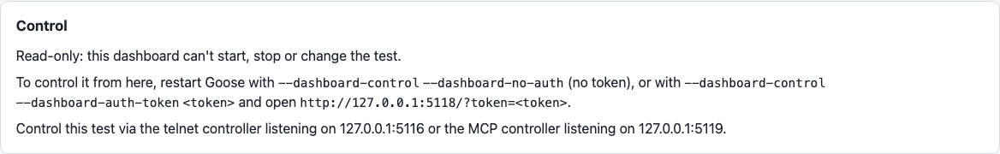
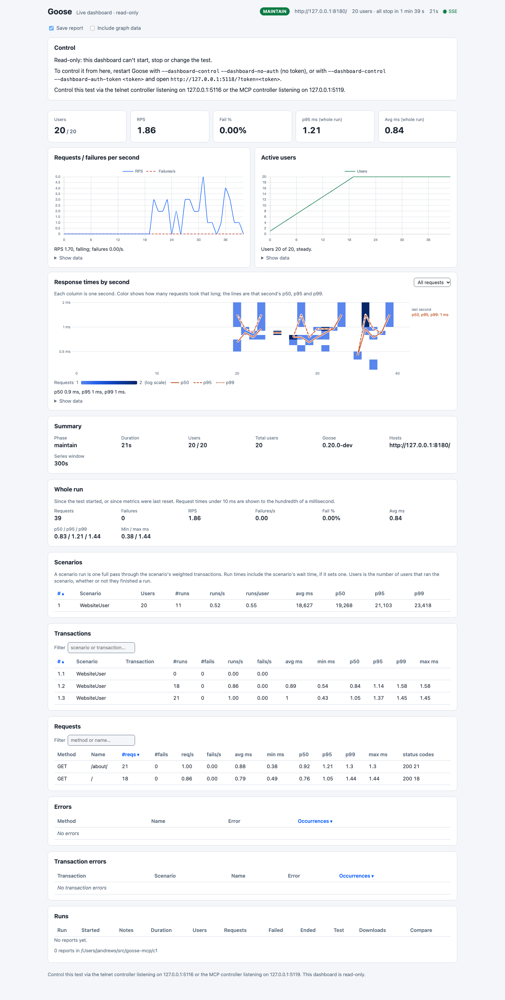

# MCP Controller

The MCP Controller lets an AI agent drive a running load test. It serves every Controller command as a [Model Context Protocol](https://modelcontextprotocol.io/) tool, so an agent such as Claude Code can read the test's configuration and metrics and start, stop and change it, exactly as a person at the [telnet Controller](telnet.md) can. Each tool hands its argument to the same parser telnet uses, sends the command on the same channel, and returns the answer Goose gives every front end, so a tool accepts and refuses what telnet accepts and refuses, with the same message.

Three things an agent can do with it:

- **A capacity search.** "Raise users by 50 every two minutes until p95 goes over 500 ms, then report the last user count that held." The agent calls `set_users`, waits, reads `get_metrics`, and repeats.
- **A status question during a soak.** "Is the overnight soak still healthy? Any errors in the last hour?" The agent reads `get_metrics` and answers, changing nothing.
- **A CI agent reading structured metrics.** A pipeline step starts Goose with `--no-autostart`, has an agent `start` it, polls `get_metrics` for its structured JSON, and calls `shutdown` when the numbers it needs are in.
- **A question about past runs.** "Did last night's run get slower than the one before?" The agent calls `list_runs`, then `compare_runs` with the older run as the baseline, and reads the changes.

## Turning it on

The MCP Controller is off twice over: Goose has to be built with the `mcp` feature, and started with `--mcp`.

```bash
cargo run --release --features mcp -- --host https://staging.example.org/ --mcp --no-autostart
```

`--mcp` in a Goose built without the feature fails at startup, as `--dashboard` does without its feature:

```text
Error: required compile-time feature not enabled (mcp: rebuild with `--features mcp`)
```

Once on, the tools are served over Streamable HTTP at `http://127.0.0.1:5119/mcp`.

| Option | Default | What it does |
|---|---|---|
| `--mcp` | off | Serve the MCP Controller. Set in code with `GooseDefault::Mcp`. |
| `--mcp-host HOST` | `127.0.0.1` | The address it listens on. One that is not loopback needs `--mcp-token`. `GooseDefault::McpHost`. |
| `--mcp-port PORT` | `5119` | The TCP port it listens on; as for telnet and WebSocket, 0 is refused. `GooseDefault::McpPort`. |
| `--mcp-token TOKEN` | none | A token every request must send as `Authorization: Bearer TOKEN`. `GooseDefault::McpToken`. |
| `GOOSE_MCP_TOKEN` | none | An environment variable, read for the token when `--mcp-token` is not given and before `GooseDefault::McpToken`; the better way to give it. An empty value is as if it were unset. |
| `--mcp-read-only` | off | List and answer only the five tools that read: `get_config`, `get_metrics`, `list_runs`, `get_run_report` and `compare_runs`. `GooseDefault::McpReadOnly`. |
| `--mcp-set-host` | off | Also list and answer `set_host`. Ignored with `--mcp-read-only`. `GooseDefault::McpSetHost`. |

With `--no-autostart`, the MCP Controller counts as a Controller that can start the test, unless it is read only. The dashboard's `/api/v1/health` names it under `controllers.mcp`, and the read-only dashboard says where it listens, beside telnet and WebSocket; a read only MCP Controller, which can not control the test, is not named there.



The whole dashboard of that run, the `simple` example with `--mcp --dashboard --no-autostart`, started and raised to 20 users through the MCP tools:



## Connecting a client

Claude Code:

```bash
claude mcp add --transport http goose http://127.0.0.1:5119/mcp
```

With a token, add the header: `claude mcp add --transport http goose http://127.0.0.1:5119/mcp --header "Authorization: Bearer TOKEN"`.

The [MCP Inspector](https://github.com/modelcontextprotocol/inspector) calls tools from a shell, which is a quick way to see what an agent sees:

```bash
npx @modelcontextprotocol/inspector --cli http://127.0.0.1:5119/mcp --method tools/list
npx @modelcontextprotocol/inspector --cli http://127.0.0.1:5119/mcp --method tools/call --tool-name set_users --tool-arg users=20
```

Any client that speaks Streamable HTTP works the same way: give it the URL, and the Bearer header if there is a token.

## Tools

Each tool's description is its command's line from telnet's `help`, with when it applies and the grammar and bounds of its argument. A tool takes its argument as the value a telnet user types: `"30s"` or `"1h30m5s"` for a time, `"10,30s;0,10s"` for a test plan, a number for users, rates and the throttle.

| Tool | Telnet command | Argument | Annotations |
|---|---|---|---|
| `get_config` | `config-json` | none | read only |
| `get_metrics` | `metrics-json` | none | read only |
| `start` | `start` | none | open world |
| `stop` | `stop` | none | destructive, idempotent, open world |
| `shutdown` | `shutdown` | none | destructive, idempotent, open world |
| `set_users` | `users` | `users`, integer, 1 to 100000 | idempotent, open world |
| `set_host` | `host` | `host`, string, an http or https url; listed only with `--mcp-set-host` | idempotent, open world |
| `increase_rate` | `increaserate` | `rate`, number, 0.01 to 100000 | idempotent, open world |
| `decrease_rate` | `decreaserate` | `rate`, number, 0.01 to 100000 | idempotent, open world |
| `increase_time` | `increase-time` | `time`, string, up to 30 days, 0 clears | idempotent, open world |
| `decrease_time` | `decrease-time` | `time`, string, up to 30 days, 0 clears | idempotent, open world |
| `set_run_time` | `runtime` | `time`, string, up to 30 days, 0 clears | open world |
| `set_test_plan` | `test-plan` | `plan`, string, at most 100 steps and 4096 bytes | open world |
| `set_throttle` | `throttle` | `requests`, integer, 1 to 1000000, 0 clears | idempotent, open world |
| `list_runs` | `runs-json` | `before`, string, optional: a saved run's folder name | read only |
| `get_run_report` | `report`, `report-json` | `run`, string, optional, the newest saved run when left out; `format`, `markdown` (the default) or `json` | read only |
| `compare_runs` | `compare` | `baseline`, string, required; `run`, string, optional, the newest saved run when left out | read only |

With the default options `tools/list` lists 16 tools: `set_host` is listed, and answered, only with `--mcp-set-host`, which makes 17; without it a call to `set_host` is refused as an unknown tool is. With `--mcp-read-only` it lists 5, with or without `--mcp-set-host`.

Every tool but the five that read is marked not read only and not destructive unless the table says destructive. The dashboard's Quit has no tool, as it has no telnet command; `shutdown` ends Goose.

What a tool returns:

- A command returns its message as text, `users configured` for example, and the whole outcome as structured content: `ok`, `message`, and when they apply `error`, `phase`, `active_users`, `target_users` and `field`.
- A refused command, such as `set_users` with 0 or `stop` while idle, is a tool result with `isError: true` and the message telnet would print, never a protocol error, so the model reads why.
- `get_config` and `get_metrics` return the JSON `config-json` and `metrics-json` return, to the byte, as text and as structured content. Tokens read `(set)`.
- The saved run tools read the runs in the run folder, as telnet's `runs`, `report` and `compare` do; see [Saved runs](overview.md#saved-runs). `list_runs` returns the JSON `runs-json` returns, to the byte, as text and as structured content, `{"dir", "runs", "more"}`: 20 runs at most, newest first, then with `before` set to the last run's name, the 20 after it. `get_run_report` returns the Markdown report as text, and `{"run", "markdown"}` as structured content; with `format` `json`, the JSON report without its per second graph data, as `report-json` returns it, refused over 4 MiB. `compare_runs` returns the comparison as text, and `{"run", "baseline", "markdown"}`. A name that is not a saved run is refused, `no saved run named "..."`, naming no path.
- Every tool answers at once, as telnet does: `start` answers once the test is starting, not once its users are running. An agent reads `get_metrics` to see what a change did. A tool waits at most 15 seconds for Goose to answer; on a timeout the change may still apply, so check before retrying.
- An unknown tool is a JSON-RPC error, `-32602`.

The MCP Controller offers no resources and no prompts.

### Reading saved runs

Started with `--no-autostart` from the folder that holds `goose-runs`, Goose runs nothing until told to, so an agent can read the saved runs without any load test running. Through the Inspector, from the `simple` example:

```bash
npx @modelcontextprotocol/inspector --cli http://127.0.0.1:5119/mcp --method tools/call --tool-name list_runs
npx @modelcontextprotocol/inspector --cli http://127.0.0.1:5119/mcp --method tools/call --tool-name get_run_report --tool-arg run=20261106-191049
npx @modelcontextprotocol/inspector --cli http://127.0.0.1:5119/mcp --method tools/call --tool-name compare_runs --tool-arg baseline=20261106-191005
```

`compare_runs` answers with the same text telnet's `compare 20261106-191005` prints, starting `Run 20261106-191049 (started 2026-11-06 18:10:49 UTC) compared to baseline 20261106-191005 (started 2026-11-06 18:10:05 UTC).`, as text and as `markdown` in its structured content. A `run` is one folder name: `"a b"` is refused as telnet's `report a b` is.

## Read only mode

With `--mcp-read-only`, `tools/list` lists only the five tools that read, `get_config`, `get_metrics`, `list_runs`, `get_run_report` and `compare_runs`, and a call to any other tool is refused as an unknown tool is. Use it to let an agent watch a test it must not change.

## Limits

- No sessions: each request stands alone, as in the 2026-07-28 revision of the protocol. Clients of earlier revisions that start with `initialize` are answered too.
- At most 16 connections open at once; one more is closed as soon as it is accepted. The telnet and WebSocket Controllers have no such cap.
- A request body is at most 131072 bytes, the limit of a WebSocket Controller message; a longer one gets `413`.

## Security

- **Loopback by default.** The MCP Controller listens on `127.0.0.1` unless told otherwise. A `--mcp-host` that is not loopback is refused at startup without a token, from `--mcp-token`, `GOOSE_MCP_TOKEN` or `GooseDefault::McpToken`:

  ```text
  Error: invalid option or value specified (`configuration.mcp_host` "0.0.0.0": `configuration.mcp` is enabled with non-loopback host `0.0.0.0`; set `configuration.mcp_token` (--mcp-token, or the GOOSE_MCP_TOKEN environment variable) when `configuration.mcp_host` (--mcp-host) is not a loopback address)
  ```

  With a token it starts, and warns that the token is all that guards it. There is no TLS, so the token crosses the network in clear text: an ssh forward (`ssh -L 5119:127.0.0.1:5119 loadtest`) to a loopback bind is safer.
- **The token.** With a token, every request needs `Authorization: Bearer TOKEN`, compared in constant time; a missing or wrong one gets `401`. A token in the query string is not read. Give it in the `GOOSE_MCP_TOKEN` environment variable rather than with `--mcp-token`: Goose never shows it, but a token on the command line shows in `ps` and `/proc/<pid>/cmdline` to other users of the machine, and in your shell's history. A load test can also set it in code with `GooseDefault::McpToken`. `--mcp-token` comes first, then the variable, then the default:

  ```bash
  GOOSE_MCP_TOKEN=s3cret target/release/examples/simple --host https://staging.example.org/ --mcp --mcp-host 10.0.0.5 --no-autostart
  ```
- **Without a token, loopback is trusted.** On a loopback bind with no `--mcp-token`, any program on the machine can call the tools. Set `--mcp-token` on a shared machine.
- **Origin and Host checks.** A request from a browser page on another site, whose `Origin` is not loopback or the configured host, gets `403`, and so does one whose `Host` does not name the Controller: on a loopback bind only `localhost`, `127.0.0.1` and `::1`, otherwise only the configured host as typed and the address the Controller is bound to. No name is looked up, so a client that reaches it by another name for the same address is refused: give `--mcp-host` the name clients use. This stops a web page from reaching the Controller through DNS rebinding. With a wildcard host such as `0.0.0.0`, clients must send that host, so bind the address clients use.
- **`set_host` is off unless `--mcp-set-host` is given.** Text from the target reaches the model through `get_metrics`, and text crafted to look like instructions could lead an agent holding `set_host` and `start` to point Goose at someone else's server and send it load. Without `set_host` the agent can only load the host the test was started with. Give `--mcp-set-host` only to an agent you trust with any host, and an agent you do not fully trust `--mcp-read-only`.
- **Text from the target reaches the model.** Request names, hosts and error messages in `get_metrics` come from the load test and the server under load, which may be someone else's. The tools that read say so in their descriptions, but a model can still be misled by text crafted to look like instructions.
- **Saved reports hold text the target controls.** `get_run_report` and `compare_runs` return a run's reports, and `list_runs` its notes: request names, error bodies, hosts and notes in them came from the load test and the server it targeted, in that run or an older one. An agent must treat them as data, never as instructions.
- **Every saved run is readable.** Anyone who can call the tools can read every run saved in the run folder, as through the telnet and WebSocket Controllers: keep the MCP Controller on loopback, or set a token.

## A Gaggle

On a [Gaggle](../gaggle/overview.md) manager the MCP Controller works as telnet does there: each change reaches every worker as its share. A worker runs no Controller, so `--mcp` and the other MCP options are refused with `--worker`.
