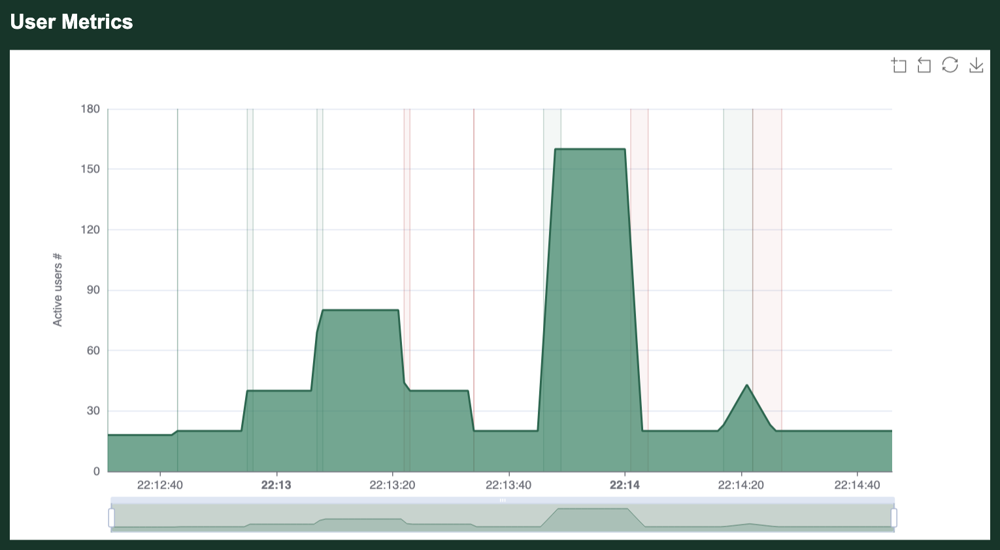

# Telnet Controller

The host and port that the telnet Controller listens on can be configured at start time with `--telnet-host` and `--telnet-port`. The telnet Controller can be completely disabled with the `--no-telnet` command line option. The defaults can be changed with [`GooseDefault::TelnetHost`](https://docs.rs/goose/*/goose/config/enum.GooseDefault.html#variant.TelnetHost),[`GooseDefault::TelnetPort`](https://docs.rs/goose/*/goose/config/enum.GooseDefault.html#variant.TelnetPort), and [`GooseDefault::NoTelnet`](https://docs.rs/goose/*/goose/config/enum.GooseDefault.html#variant.NoTelnet).

## Controller Commands

To learn about all available commands, telnet into the Controller thread and enter `help` (or `?`). For example:
```bash
% telnet localhost 5116
Trying 127.0.0.1...
Connected to localhost.
Escape character is '^]'.
goose> ?
goose 0.19.0 controller commands:
help               this help
exit               exit controller

start              start an idle load test
stop               stop a running load test and return to idle state
shutdown           shutdown load test and exit controller

host HOST          set host to load test, (ie https://web.site/)
increaserate FLOAT set per-second rate users increase (0.01 to 100000)
increase-time TIME set total time to take increasing users (0 clears)
decreaserate FLOAT set per-second rate users decrease (0.01 to 100000)
decrease-time TIME set total time to take decreasing users (0 clears)
users INT          set number of simulated users (1 to 100000)
runtime TIME       set how long to hold users after the ramp up, (ie 1h30m5s, 0 clears)
test-plan PLAN     define or replace test-plan, (ie 10,5m;10,1h;0,30s)

config             display load test configuration
config-json        display load test configuration in json format
metrics            display metrics for current load test
metrics-json       display metrics for current load test in json format
goose> q
goodbye!
goose> Connection closed by foreign host.
```

`exit`, `quit` and `q` end the session, and `help` and `?` print this list. Commands and values are not case sensitive, and most commands take aliases: `increase_rate` and `increase-rate` for `increaserate`, `increasetime` for `increase-time`, `run_time` for `runtime`, `testplan` and `plan` for `test-plan`, `stats` for `metrics`, and the like. A command takes its value after one space.

`config` prints the configuration, and `config-json` prints it as JSON, with an option that is not set shown as `null` and an output flag given without a path shown as `(the run's folder)`. `metrics` prints the metrics tables, and `metrics-json` prints the metrics as JSON. In that JSON each request's `raw_data` holds its response times in microsecond buckets, `times_us`, beside `minimum_time_us`, `maximum_time_us` and `total_time_us`, and the whole millisecond `minimum_time`, `maximum_time`, `total_time` and `counter`; each transaction and scenario holds the same as `times_us`, `min_time_us`, `max_time_us` and `total_time_us`, beside `min_time`, `max_time`, `total_time` and `counter`.

A command whose value can't be used is refused with what the value must be, and changes nothing:
```bash
goose> users 0
users must be an integer between 1 and 100000
goose> increaserate 0
increase_rate must be a number from 0.01 to 100000
goose> runtime 31d
run_time must be a time span such as 1h30m5s, from 1 second to 30 days, or 0 to clear
```

Telnet, WebSocket and the dashboard share these bounds:

| Setting | Accepted |
|---------|----------|
| `host` | An `http://` or `https://` url with no user name or password, which would show to observers and in reports |
| `users` | 1 to 100000 |
| `increaserate`, `decreaserate` | 0.01 to 100000 users per second |
| `increase-time`, `decrease-time`, `runtime` | 1 second to 30 days; `0` clears the setting, so Goose's default applies |
| `test-plan` | At most 100 steps of 0 seconds to 30 days each, in at most 4096 bytes, starting 1 to 100000 users in total |

`host`, `increase-time` and `decrease-time` are accepted only while the load test is idle, as they are read when it starts. `runtime`, `users` and `test-plan` also change a running load test. A `runtime` on a running users ramp moves the end of the hold in progress to its start plus the new run time, and starts the ramp down at once if that has passed; before the hold starts it replaces the hold ahead, and on a run holding until stopped it holds from now for the new run time, then ramps down. `runtime 0` on a running test holds until stopped, and is refused while a ramp down is configured. `runtime` is refused during the ramp down, while stopping and while a test plan runs, as the plan sets how long it runs. See [Run time on a running test](dashboard.md#run-time-on-a-running-test). A `users` change on a running users ramp keeps its run time and ramp down: it ramps to the new count, then holds until the hold's end and ramps down for the new count, and during the ramp down it abandons the ramp down and holds the new count until stopped. `users` is refused while a test plan runs, as the plan sets users. See [Users on a running test](dashboard.md#users-on-a-running-test).

The rates are accepted in Idle and on a running users ramp, and are refused during its ramp down, while stopping and while a test plan runs. On a running test, a rate is refused while its own time is set, since a time changes only in Idle; in Idle a rate clears its own time and a time clears its own rate. A decrease rate on a running users ramp regenerates the ramp down still ahead, or adds one where all users would stop at once when the hold ends; an increase rate is for the next `users` increase.

A test plan sets users, so while one is configured a rate or a time is refused with `set users first to switch to a users ramp`: `users` switches to a users ramp and clears the plan, and `test-plan` switches back and clears users, the rates and the times. The command line's rules also apply: `runtime` and `test-plan` are refused under `--iterations`, `test-plan` under `--no-reset-metrics`, and in Idle `increase-time` or `decrease-time` with fewer than 2 users, or `users 1` while either is set. `users` and `test-plan` are refused while a `stop`, `shutdown` or Ctrl-C is ramping the load test down. A command that gets no answer within 15 seconds is answered `control timed out, it may still apply: check before retrying`: check the configuration or metrics before sending it again.

## Example

One possible use-case for the controller is to dynamically reconfigure the number of users being simulated by the load test. In the following example, the load test was launched with the following parameters:

```bash
% cargo run --release --example umami -- --no-autostart --host https://umami.ddev.site/ --increase-rate 50 --report-file report.html --report-file report.md
```

Then the telnet controller is invoked as follows:
```bash
% telnet loadtest 5116
Trying loadtest...
Connected to loadtest.
Escape character is '^]'.
goose> start 
load test started
goose> users 20
users configured
goose> users 40
users configured
goose> users 80
users configured
goose> users 40 
users configured
goose> users 20
users configured
goose> users 160
users configured
goose> users 20
users configured
goose> increase_rate 5
increase_rate configured
goose> users 80
users configured
goose> users 20
users configured
goose> shutdown
load test shut down
goose> Connection closed by foreign host.
```

Initially the load test is configured with an increase rate of 50, so goose increases and decreases the user count by 50 user threads per second. Later we reconfigure the increase rate to 5, slowing down the rate that goose alters the number of user threads. The result is more clearly illustrated in the following graph generated at the end of the above example load test:



The above commands are also summarized in the plan overview of the Markdown report, `report.md`, here from a run of the same commands against a local server (the HTML report has the same table):

```markdown
## Plan Overview

| Action | Started | Stopped | Elapsed | Users |
| ------ | ------- | ------- | ------- | ----: |
| Increasing | 26-10-25 22:04:47 | 26-10-25 22:04:47 | 00:00:00 | 0 &rarr; 18 |
| Maintaining | 26-10-25 22:04:47 | 26-10-25 22:04:52 | 00:00:05 | 18 |
| Increasing | 26-10-25 22:04:52 | 26-10-25 22:04:52 | 00:00:00 | 18 &rarr; 20 |
| Maintaining | 26-10-25 22:04:52 | 26-10-25 22:04:57 | 00:00:05 | 20 |
| Increasing | 26-10-25 22:04:57 | 26-10-25 22:04:57 | 00:00:00 | 20 &rarr; 40 |
| Maintaining | 26-10-25 22:04:57 | 26-10-25 22:05:02 | 00:00:05 | 40 |
| Increasing | 26-10-25 22:05:02 | 26-10-25 22:05:03 | 00:00:01 | 40 &rarr; 80 |
| Maintaining | 26-10-25 22:05:03 | 26-10-25 22:05:07 | 00:00:04 | 80 |
| Decreasing | 26-10-25 22:05:07 | 26-10-25 22:05:08 | 00:00:01 | 40 &larr; 80 |
| Maintaining | 26-10-25 22:05:08 | 26-10-25 22:05:12 | 00:00:04 | 40 |
| Decreasing | 26-10-25 22:05:12 | 26-10-25 22:05:12 | 00:00:00 | 20 &larr; 40 |
| Maintaining | 26-10-25 22:05:12 | 26-10-25 22:05:17 | 00:00:05 | 20 |
| Increasing | 26-10-25 22:05:17 | 26-10-25 22:05:20 | 00:00:03 | 20 &rarr; 160 |
| Maintaining | 26-10-25 22:05:20 | 26-10-25 22:05:22 | 00:00:02 | 160 |
| Decreasing | 26-10-25 22:05:22 | 26-10-25 22:05:25 | 00:00:03 | 20 &larr; 160 |
| Maintaining | 26-10-25 22:05:25 | 26-10-25 22:05:32 | 00:00:07 | 20 |
| Increasing | 26-10-25 22:05:32 | 26-10-25 22:05:37 | 00:00:05 | 20 &rarr; 45 |
| Decreasing | 26-10-25 22:05:37 | 26-10-25 22:05:42 | 00:00:05 | 20 &larr; 45 |
| Maintaining | 26-10-25 22:05:42 | 26-10-25 22:05:42 | 00:00:00 | 20 |
| Canceling | 26-10-25 22:05:42 | 26-10-25 22:05:42 | 00:00:00 | 0 &larr; 20 |
```

The run starts with the default users, one per CPU core (18 here). At 5 users a second, the `users 80` that follows `increase_rate 5` had reached 45 users when `users 20` arrived 5 seconds later, so Goose turned back from 45.
