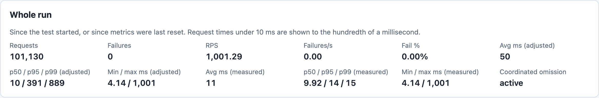
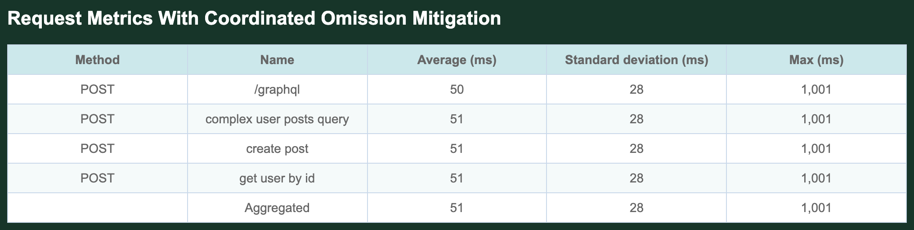
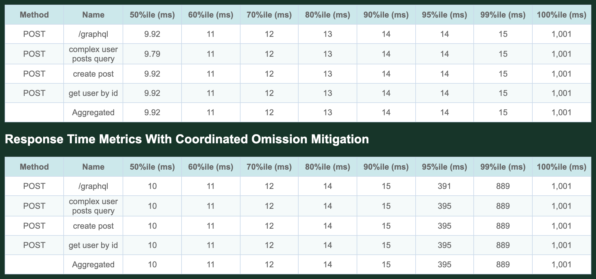
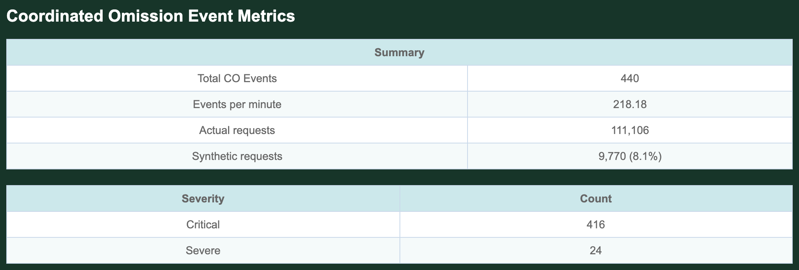

# Metrics

With [coordinated omission mitigation](mitigation.md) on, Goose keeps two sets of response times for each request name. The **measured** times, which other pages call raw, are the ones Goose timed. The **adjusted** times are the measured times together with the synthetic times that mitigation adds for the requests that a delayed user did not make. Goose also counts [CO events](#co-event-tracking). This page shows where each view reports them; [Was my run affected?](#was-my-run-affected) says how to read them for your own run.

## The run on this page

Every image and excerpt on this page comes from runs against a small local server that answers each request after a random delay of about 5 to 15 ms, and stalls every 1,000th request, counted across all connections, for one second. The [GraphQL example](../example/graphql.md) ran 10 users for two minutes against it, with no wait between requests:

```bash
cargo run --release --features dashboard --example graphql_loadtest -- \
  -H http://127.0.0.1:18900 --dashboard -u 10 -r 10 -t 2m --co-mitigation average \
  --report-file report.html --report-file report.md --report-file report.json
```

Each user runs the example's four requests in a loop, and one time through the loop is an [iteration](../glossary.md#iteration). The time a user's iteration is expected to take is its [cadence](../glossary.md#cadence): with `--co-mitigation average`, the average time of the user's iterations. A stalled request delays the rest of its user's iteration. Of about 111,000 requests in two minutes, the server stalled 111 for a second each, and the console logged each of them as [taking abnormally long](#console-output).

## The live dashboard

Once mitigation records its first event, the dashboard shows adjusted times where it shows response times:

- the p95 and average KPI cards say `(whole run, adjusted)`;
- the **Whole run** card shows adjusted and measured times side by side and, once there is an event, lists Coordinated omission as **active**;
- the requests table shows adjusted times, with the measured time on hover;
- the response time heatmap opens on **Adjusted**, with a **Measured** button beside it.

The RPS card, and the Requests and RPS figures on the Whole run card, then count the synthetic requests too, so the RPS figures read higher than the requests per second chart: 1,001 against 922.70 in the image below. Before the first event, and with mitigation off, every time on the dashboard is measured. The dashboard shows no count of CO events; the reports and the console do.


*The adjusted p95 on the KPI card is 391 ms, while the heatmap's densest band sits near 10 ms: almost everything above that band is synthetic, spread from about 20 ms up to the one second stall, for requests that the delayed users did not make.*



*Two seconds later, the card shows that stalling one request in 1,000 for a second lifts the adjusted p99 to 889 ms, while the measured p99 stays at 15 ms.*

## PDF and HTML reports

The PDF and HTML reports add two adjusted tables once mitigation has added synthetic times, and an events section whenever mitigation is on. **Request Metrics With Coordinated Omission Mitigation** follows Request Metrics: the adjusted average, a standard deviation and the maximum for each request name that has synthetic times, then the aggregate. Mitigation never changes the minimum, so this table shows in its place the standard deviation of two numbers, the measured and the adjusted average, which is their difference divided by the square root of 2.



*The adjusted averages are 50 to 51 ms; a standard deviation of 28 puts the measured average about 40 ms lower, at the 11 ms the Whole run card shows as Avg ms (measured).*

**Response Time Metrics With Coordinated Omission Mitigation** follows Response Time Metrics, with the same percentile columns.



*The measured table, untitled here, on top and the adjusted one below stay within a millisecond of each other up to the 90th percentile; above it the adjusted times climb toward the one second stall.*

**Coordinated Omission Event Metrics** ends the report whenever mitigation is on, even with no events: the events, the events per minute, the actual and synthetic requests, and a count of each severity that had an event.



*The 440 events are four for each stalled request that had an iteration after it, as [Reading the event summary](#co-event-tracking) explains.*

## Markdown report

The Markdown report has no adjusted tables. It has the event summary, with all four severities, and, when there are events, tables of events by user and by scenario. From this run, without the per user and per scenario tables:

```markdown
## Coordinated Omission Metrics

**Overall Metrics:**
- Total CO Events: 440
- Synthetic Requests Generated: 9,770
- Actual Requests: 111,106
- Synthetic Percentage: 8.1%

**Severity Breakdown:**
- Minor (2-5x): 0
- Moderate (5-10x): 0
- Severe (10-20x): 24
- Critical (>20x): 416
```

## JSON report

`co_request_metrics` and `co_response_metrics` hold the two adjusted tables, beside the measured `raw_request_metrics` and `raw_response_metrics`. Each request name in `raw_metrics.requests` holds its adjusted timing data in `coordinated_omission_data`, `null` when it has none. `coordinated_omission_metrics` holds the event summary, shown here without its `per_user_events` and `per_scenario_events`:

```json
{
  "total_co_events": 440,
  "actual_requests": 111106,
  "synthetic_requests": 9770,
  "synthetic_percentage": 8.082664,
  "severity_breakdown": {
    "Critical": 416,
    "Severe": 24
  },
  "duration_secs": 121,
  "events_per_minute": 218.1818181818182,
  "minor_count": 0,
  "moderate_count": 0,
  "severe_count": 24,
  "critical_count": 416
}
```

## Console metrics {#console-output}

With mitigation on, Goose logs each request that took longer than the user's cadence, starting with the user's fourth iteration; with mitigation off, it logs none:

```text
16:24:37 [INFO] 1.447s into goose attack: "POST http://127.0.0.1:18900/graphql" [200] took abnormally long (1000 ms), transaction name: "Simple Query"
16:24:38 [INFO] 2.546s into goose attack: "POST http://127.0.0.1:18900/graphql" [200] took abnormally long (999 ms), transaction name: "Complex Query"
16:24:39 [INFO] 3.654s into goose attack: "POST http://127.0.0.1:18900/graphql" [200] took abnormally long (1001 ms), transaction name: "Mutation"
```

In the final metrics, an `Adjusted for Coordinated Omission` table follows the table of averages (Avg, Min, Max, Median) and another follows the percentile table, as the two adjusted tables do in the HTML report:

```text
 ------------------------------------------------------------------------------
 Name                     |    Avg (ms) |        Min |         Max |     Median
 ------------------------------------------------------------------------------
 POST /graphql            |          11 |       4.12 |       1,001 |       9.92
 POST complex user post.. |          11 |       4.14 |       1,001 |       9.79
 POST create post         |          11 |       4.14 |       1,001 |       9.92
 POST get user by id      |          11 |        4.2 |       1,001 |       9.92
 -------------------------+-------------+------------+-------------+-----------
 Aggregated               |          11 |       4.12 |       1,001 |       9.92
 ------------------------------------------------------------------------------
 Adjusted for Coordinated Omission:
 ------------------------------------------------------------------------------
 Name                     |    Avg (ms) |    Std Dev |         Max |     Median
 ------------------------------------------------------------------------------
 POST /graphql            |          50 |         28 |       1,001 |         10
 POST complex user post.. |          51 |         28 |       1,001 |         10
 POST create post         |          51 |         28 |       1,001 |         10
 POST get user by id      |          51 |         28 |       1,001 |         10
 -------------------------+-------------+------------+-------------+-----------
 Aggregated               |          51 |         28 |       1,001 |         10
 ------------------------------------------------------------------------------
 Slowest page load within specified percentile of requests (in ms):
 ------------------------------------------------------------------------------
 Name                     |    50% |    75% |    98% |    99% |  99.9% | 99.99%
 ------------------------------------------------------------------------------
 POST /graphql            |   9.92 |     12 |     15 |     15 |     17 |   1001
 POST complex user post.. |   9.79 |     12 |     15 |     15 |     25 |   1001
 POST create post         |   9.92 |     12 |     15 |     15 |   1001 |   1001
 POST get user by id      |   9.92 |     12 |     15 |     15 |   1001 |   1001
 -------------------------+--------+--------+--------+--------+--------+-------
 Aggregated               |   9.92 |     12 |     15 |     15 |     25 |   1001
 ------------------------------------------------------------------------------
 Adjusted for Coordinated Omission:
 ------------------------------------------------------------------------------
 Name                     |    50% |    75% |    98% |    99% |  99.9% | 99.99%
 ------------------------------------------------------------------------------
 POST /graphql            |     10 |     13 |    766 |    889 |    987 |   1001
 POST complex user post.. |     10 |     13 |    766 |    889 |    987 |   1001
 POST create post         |     10 |     13 |    766 |    889 |   1001 |   1001
 POST get user by id      |     10 |     13 |    766 |    889 |    995 |   1001
 -------------------------+--------+--------+--------+--------+--------+-------
 Aggregated               |     10 |     13 |    766 |    889 |    987 |   1001
```

The event summary comes just before `=== OVERVIEW ===` in the final metrics. A copy is also printed at the metrics reset, when every user has started; it covers only the ramp up, so read the final one:

```text
 === COORDINATED OMISSION METRICS ===
 Duration: 121 seconds
 Total CO Events: 440
 Events per minute: 218.18

 Request Breakdown:
   Actual requests: 111106
   Synthetic requests: 9770 (8.1%)

 Severity Distribution:
   Critical: 416
   Severe: 24
```

## Reading the event summary {#co-event-tracking}

- **Total CO Events** counts requests, not stalled requests. When an iteration takes more than twice the user's cadence (here, one with a stalled request), each request of the user's next iteration that mitigation adds synthetic times for is one event. Here 110 of the 111 stalled requests led to four events each, one for each request of the user's next iteration; the last came as the run ended, with no iteration after it.
- **Duration** is the time in whole seconds since the counts started, and **Events per minute** is Total CO Events divided by that time in minutes: 440 in 121 seconds is 218.18.
- <a id="co-event-metrics-display"></a>**Actual requests** are the requests Goose timed; **synthetic requests** are the times mitigation added. Together they are the Aggregated `# reqs` of the request table in the reports and the console, 120,876 here. The percentage is the synthetic requests' share of that total: 9,770 of 120,876 is 8.1%.
- The counts start again at the metrics reset after the users start, as the other metrics do; in a run with no reset (`--no-reset-metrics`, `--iterations` or a test plan) they cover the whole run.
- **Severity** is the delayed iteration's length as a multiple of the user's cadence: Minor below 5 times, Moderate from 5 to 10, Severe from 10 to 20, and Critical from 20 times. Mitigation starts only above 2 times. The PDF and HTML reports and the console list only the severities with events, in no fixed order.
- In the Markdown report's table of events by user, users are numbered from 0 and listed in no fixed order; the console's `[user 1]: launching user` lines number them from 1.

## Was my run affected? {#was-my-run-affected}

If your run had mitigation off, as it is by default (`--co-mitigation disabled`), look at its measured times: a maximum or a 99.99th percentile many times the median is the sign that requests were stalled. The `disabled` run in the table below had a maximum of 1,002 ms against a median of 9.92 ms in its console. Mitigation adds nothing to the load Goose sends, so run again with `--co-mitigation average` to see what the measured times leave out.

With mitigation on, check for events first. On the live dashboard, Coordinated omission **active** on the Whole run card means at least one event. In the reports, and in the console's final event summary (not the copy printed at the metrics reset), read Total CO Events. When it is 0, mitigation added no synthetic times and Goose shows no adjusted tables. With `average` or `minimum`, that means no iteration judged since the metrics reset ran far enough over twice its user's cadence for mitigation to add a synthetic time. A user's first two iterations are never judged, so a stall in them, as on a cold start, counts no events. A user's last iteration is not judged either, so a stall as the run ends counts none. With `maximum`, which counts no events in Goose 0.19, a 0 says nothing; run it again with `average`.

When there are events, compare the measured and adjusted times from the 95th percentile up:

- the dashboard's Whole run card: p95 and p99, adjusted beside measured;
- the PDF or HTML report: its two percentile tables;
- the JSON report: `raw_response_metrics` against `co_response_metrics`;
- the console: its two percentile tables, from the 98% column.

The Markdown report has no adjusted tables. If the adjusted times climb, as from 15 to 889 ms at the 99th percentile here, stalled requests kept users from sending requests that the measured times leave out. With only a few events, only the highest percentiles change, but the run was still affected; the [synthetic percentage](#co-event-metrics-display) (8.1% here) says by how much. If your run used `minimum`, read its note below the table first.

The setting decides what counts. The `average` row is the run above; the others ran the same command against a second copy of the server on port 18901, with `--no-telnet` in place of `--dashboard`:

| `--co-mitigation` | CO events | Synthetic requests | Measured p99 | Adjusted p99 |
|---|---:|---:|---:|---:|
| `disabled` (the default) | not counted | none | 15 ms | none |
| `average` | 440 | 9,770 (8.1%) | 15 ms | 889 ms |
| `minimum` | 18,258 | 38,288 (25.7%) | 15 ms | 938 ms |
| `maximum` | 0 | 0 (0.0%) | 15 ms | none |

- **`average`** compares each iteration with the user's average iteration; here it counted events after every stalled request but the last.
- **`minimum`** compares with the fastest iteration. Iterations of ordinary length led to events too. The fastest iteration in the run took 20 ms and the median 40 ms, so an iteration of ordinary length could run over twice the cadence of a user whose fastest iteration was near 20 ms; 17,818 of the 18,258 events were Minor and 440 Critical. With `minimum`, judge a run by its events above Minor (Moderate, Severe and Critical), or run it again with `average`.
- **`maximum`** compares with the slowest iteration Goose has recorded. Goose records a slowest iteration only once an iteration is no faster than the fastest before it; until then the user's cadence is 0, and Goose logs every request but adds no synthetic times. Once there is a slowest iteration, a longer iteration becomes the slowest before Goose judges it, so no iteration is ever more than twice the slowest, and in Goose 0.19 `maximum` counts no events. Once one of a user's iterations included a stalled request, that user's cadence was over a second, and Goose stopped logging the user's stalled requests. It logged 10 of that run's 111 stalled requests, all in the first 18 seconds. It also logged 12 ordinary requests in the run's first 0.6 seconds, from users whose every iteration so far had been faster than the one before it.

Goose does not test whether a change in the distribution is statistically significant; see the [statistical analysis note](mitigation.md#statistical-analysis-note).
