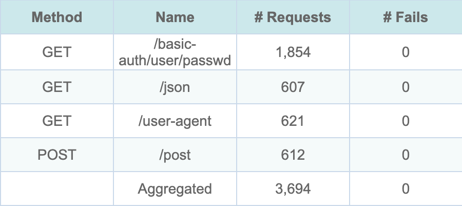
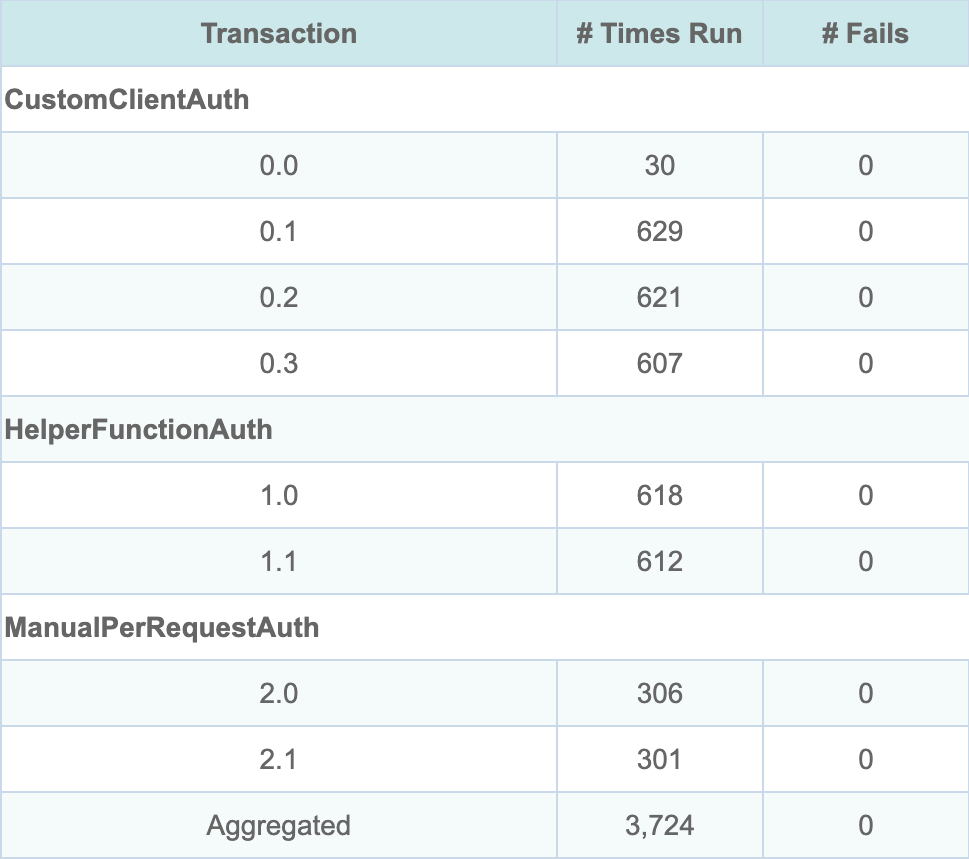

# Basic Authentication Example

The [`basic_auth.rs`](https://github.com/tag1consulting/goose/blob/main/examples/basic_auth.rs) example demonstrates different approaches to handling HTTP Basic Authentication in Goose load tests. It answers [issue #608](https://github.com/tag1consulting/goose/issues/608), how to test a site behind Basic Auth, including when static assets (CSS, JS, images) need the credentials too.



*The HTML report's Request Metrics, from `cargo run --release --features dashboard --example basic_auth -- --host http://127.0.0.1:8080 -u 60 -r 20 -t 2m --no-reset-metrics --report-file --dashboard -q` against a local nginx server that answers the example's four httpbin.org paths; the run writes `report.html` and `report.json` to `goose-runs/<YYYYMMDD-HHMMSS>/`.*

The server answers `/basic-auth/user/passwd` with 401 unless the request has Basic auth for the user `user` with the password `passwd`, and Goose counts a 401 as a failed request. No request failed, including all 1,854 to the protected path, so all three approaches below sent the credentials. With `-q` Goose does not print the dashboard's address when it starts: open `http://127.0.0.1:5118` while the test runs. If that tab is still open when the run ends, Goose prints the address and waits for Ctrl-C.



*The same run's Transaction Metrics: one group for each approach.*

The example names no transaction, so the report lists each by number alone, scenario then transaction, from 0; the dashboard and the console count from 1. Row 0.0 is the on start `setup_basic_auth_client`, which sends no request of its own. It ran 30 times, once for each `CustomClientAuth` user: the weights 3, 2 and 1 give 30, 20 and 10 of the 60. The other rows follow the order of the table under [Solutions Demonstrated](#solutions-demonstrated).

## Problem Statement

When load testing a site protected by HTTP Basic Authentication:

1. **Static assets**: credentials added to one request do not reach the CSS, JavaScript and image requests its page leads to, so those fail when they need Basic Auth too
2. **Code duplication**: adding the credentials to every request by hand repeats the same code

## Solutions Demonstrated

The example shows three different approaches to handle Basic Auth, one per scenario:

| Scenario | Weight | Transactions | Requests |
|---|---|---|---|
| `CustomClientAuth` | 3 | `setup_basic_auth_client` (on start), `test_basic_auth_endpoint`, `test_user_agent_endpoint`, `test_json_endpoint` | `GET /basic-auth/user/passwd`, `GET /user-agent`, `GET /json` |
| `HelperFunctionAuth` | 2 | `test_with_helper_function`, `test_post_with_helper` | `GET /basic-auth/user/passwd`, `POST /post` |
| `ManualPerRequestAuth` | 1 | `test_manual_basic_auth`, `test_manual_with_validation` | `GET /basic-auth/user/passwd`, twice |

Every scenario waits 1 to 3 seconds after each transaction except the on start one. The paths are those of [httpbin.org](https://httpbin.org/), where `/basic-auth/user/passwd` answers 200 only to the user `user` with the password `passwd`.

The excerpts below are taken from the example, where they sit inside a module compiled only with the `cookies` feature. That feature is on by default; built without it, the example prints an error and exits.

### 1. Custom Client with Default Headers (Recommended)

This approach sets up the HTTP client once per user with default Basic Auth headers. All subsequent requests automatically include the authentication headers, including requests for static assets.

```rust,ignore
async fn setup_basic_auth_client(user: &mut GooseUser) -> TransactionResult {
    // Get credentials from environment variables
    let (username, password) = get_basic_auth_credentials()?;

    // Use reqwest's built-in basic_auth() to generate a properly encoded
    // Authorization header, then extract it for use as a default header.
    let temp_request = reqwest::Client::new()
        .get("http://localhost")
        .basic_auth(&username, Some(&password))
        .build()
        .map_err(TransactionError::Reqwest)?;

    let mut headers = header::HeaderMap::new();
    if let Some(auth_header) = temp_request.headers().get(header::AUTHORIZATION) {
        headers.insert(header::AUTHORIZATION, auth_header.clone());
    }

    // Set up the client builder with default headers and other common settings
    // Enable cookie store for maintaining session state with Basic Auth
    let builder = Client::builder()
        .user_agent("Goose/1.0 BasicAuth Example")
        .default_headers(headers)
        .timeout(Duration::from_secs(30))
        .cookie_store(true);

    // Apply the custom client to this user
    user.set_client_builder(builder).await?;

    Ok(())
}
```

**Advantages:**
- Set up once per user
- Applies to every request the user makes, static assets included
- Works with helpers that load a page's static assets, such as `validate_and_load_static_assets` in the [Umami example](umami.md)

### 2. Helper Function Approach

This approach uses a helper function that adds Basic Auth to each request.
```rust,ignore
async fn send_authenticated_request(
    user: &mut GooseUser,
    method: &GooseMethod,
    path: &str,
) -> Result<GooseResponse, Box<TransactionError>> {
    let mut reqwest_request_builder = user.get_request_builder(method, path)?;

    // Check for Basic Auth credentials in environment
    if let Ok((username, password)) = get_basic_auth_credentials() {
        reqwest_request_builder = reqwest_request_builder.basic_auth(username, Some(password));
    }

    // Build the GooseRequest and make the request. The path names the request in
    // the metrics, as the RequestBuilder already has its URL.
    let goose_request = GooseRequest::builder()
        .path(path)
        .set_request_builder(reqwest_request_builder)
        .build();

    let goose_response = user.request(goose_request).await?;
    Ok(goose_response)
}
```

**Advantages:**
- Control over each request
- Can apply authentication to some requests and not others

**Disadvantages:**
- Must be called for every request
- Does not reach static asset requests

The request is built from a Reqwest `RequestBuilder`, which already holds the URL, so the helper also calls `.path(path)` on the `GooseRequest` builder: the path names the request in the metrics, as `GET /basic-auth/user/passwd` and `POST /post`. Without `.path()` or `.name("...")`, Goose would name it by its method alone, as `GET` or `POST`.

### 3. Manual Per-Request Authentication

This approach manually adds Basic Auth to each individual request using the request builder.

```rust,ignore
async fn test_manual_basic_auth(user: &mut GooseUser) -> TransactionResult {
    let (username, password) = get_basic_auth_credentials()?;

    let reqwest_request_builder = user
        .get_request_builder(&GooseMethod::Get, "/basic-auth/user/passwd")?
        .basic_auth(username, Some(password));

    let goose_request = GooseRequest::builder()
        .path("/basic-auth/user/passwd")
        .set_request_builder(reqwest_request_builder)
        .build();

    let _goose_metrics = user.request(goose_request).await?;

    Ok(())
}
```

**Disadvantages:**
- Repeats the most code of the three approaches
- Does not reach static asset requests, the problem [issue #608](https://github.com/tag1consulting/goose/issues/608) describes
- Must name each request with `.path()` or `.name()`, as in the helper function approach, or it is named by its method alone in the metrics

## Configuration

### Environment Variables

**Separate variables:**
```bash
export BASIC_AUTH_USERNAME="your_username"
export BASIC_AUTH_PASSWORD="your_password"
```

**Combined format:**
```bash
export BASIC_AUTH="username:password"
```

`BASIC_AUTH_USERNAME` and `BASIC_AUTH_PASSWORD` are used when both are set; otherwise `BASIC_AUTH` is used, split at its first colon, so the password may contain colons. A `BASIC_AUTH` without a colon is an error. The manual approach's transactions then fail immediately, because each returns the error, while the helper function sends its requests without credentials. The custom client's on start transaction fails too, but Goose goes on with its standard client for that user. Those requests also go out without credentials, and the protected path answers them with 401.

### Default Credentials

If neither the pair nor `BASIC_AUTH` is set, the example uses the credentials `user:passwd`, which httpbin.org accepts. Each time it reads them it logs three warning lines, even with `-q`, and it reads them once per helper function request, once per manual transaction and once per custom client user. Setting the variables quiets those; `test_manual_with_validation` still warns after every 200 that static assets would fail.

## Running the Example

```bash
# Using httpbin.org for testing (uses default credentials)
cargo run --example basic_auth -- --host http://httpbin.org --users 5 --run-time 30s

# With custom credentials
BASIC_AUTH_USERNAME="myuser" BASIC_AUTH_PASSWORD="mypass" \
cargo run --example basic_auth -- --host https://your-protected-site.com --users 10 --run-time 60s

# Using combined format
BASIC_AUTH="myuser:mypass" \
cargo run --example basic_auth -- --host https://your-protected-site.com --users 10 --run-time 60s
```

Against another site the example still requests the httpbin.org paths in the table above, so change them to paths on your site first.

## Key Takeaways

1. **Use the custom client approach** for most sites: it sends credentials with every request the user makes, CSS, JS and image requests included
2. **Set up authentication once per user**, in an on start transaction, rather than in every request
3. **Use environment variables** for credentials to keep them out of your code
4. **Try your approach against httpbin.org** before pointing it at your own site

## Related Issues

This example addresses [GitHub issue #608](https://github.com/tag1consulting/goose/issues/608): "How can I test a site behind Basic Auth".
