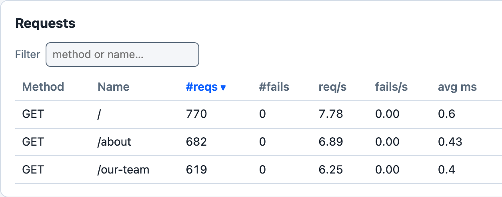

# Closure Example

The [`examples/closure.rs`](https://github.com/tag1consulting/goose/blob/main/examples/closure.rs) example loads three different pages on a web site. Instead of defining a hard coded [`Transaction`](https://docs.rs/goose/*/goose/goose/struct.Transaction.html) function for each, the paths are passed in via a [vector](https://doc.rust-lang.org/std/vec/index.html) and the [TransactionFunction](https://docs.rs/goose/*/goose/goose/type.TransactionFunction.html) is dynamically created in a [closure](https://doc.rust-lang.org/rust-by-example/fn/closures.html).



*`cargo run --release --features dashboard --example closure -- --host http://127.0.0.1:8080 -u 200 -r 50 -t 3m --no-reset-metrics --dashboard -q`, against a local nginx server that answers `/`, `/about` and `/our-team` with 200, 100 seconds in: one request row for each path in the vector.*

Each user pauses 5 to 15 seconds after each transaction, so 200 users make about 20 requests a second; each user loads the three paths in turn, so the counts fall in the vector's order. The closures carry no names, so the dashboard's Transactions table lists them by number alone, 1.1 to 1.3; the request names are the paths. With `-q` Goose does not print the dashboard's address when it starts: open `http://127.0.0.1:5118` while the test runs. If that tab is still open when the run ends, Goose prints the address and waits for Ctrl-C.

## Details

The paths to be loaded are first defined in a vector:
```rust
{{#include ../../../../../examples/closure.rs:30}}
```

A transaction function for each path is then dynamically created as a closure:
```rust,ignore
{{#include ../../../../../examples/closure.rs:31:40}}
```

## Complete Source Code

```rust,ignore
{{#include ../../../../../examples/closure.rs}}
```
