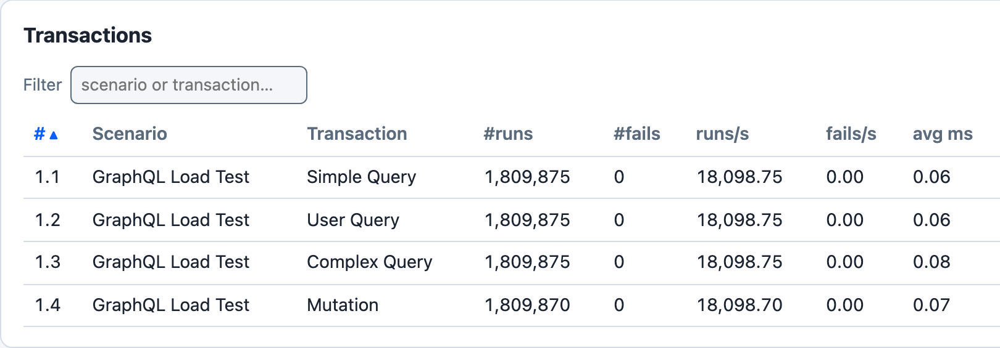
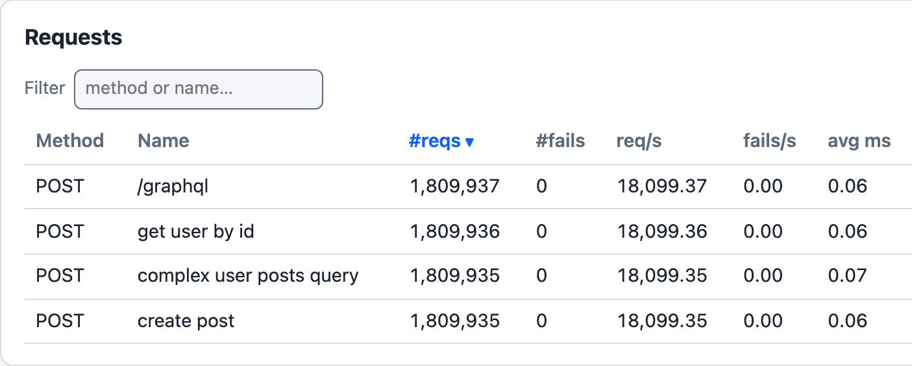

# GraphQL

Goose 0.19 adds two helper methods that send GraphQL queries and mutations.





*`cargo run --release --features dashboard --example graphql_loadtest -- --host http://127.0.0.1:4400 -u 5 -r 5 -t 3m --no-reset-metrics --dashboard -q`, against a local Node server that answers each of the example's four operations at `POST /graphql` with a 200 and a JSON `data` body without delay, 100 seconds in.*

The transactions are named with `set_name()`, and three of their requests with `post_graphql_named()`. Simple Query's request is sent with `post_graphql()`, which names it by its path, `POST /graphql`. No transaction waits, and this server answers without delay, so 5 users send about 72,000 requests a second; the [Sample Output](#sample-output) below comes from a slower server. With `-q` Goose does not print the dashboard's address when it starts: open `http://127.0.0.1:5118` while the test runs. If that tab is still open when the run ends, Goose prints the address and waits for Ctrl-C.

## GraphQL Helper Methods

- `post_graphql()`: POST a GraphQL query as JSON to a path; the metrics name the request by its path, for example `POST /graphql`
- `post_graphql_named()`: the same, with a name for the request in the metrics, for example `POST get user by id`

Both take the request body as anything that implements `serde::Serialize`, usually a `serde_json::Value` built with `json!()`, and return a [`GooseResponse`](https://docs.rs/goose/*/goose/goose/struct.GooseResponse.html), like the other request helpers.

## GraphQL Endpoint Configuration

There is no configured GraphQL endpoint: the path is the first argument of each call, and Goose prepends the host as it does for every request. By convention, most GraphQL APIs use `/graphql`, but you can specify any path. In this fragment `query` is a `serde_json::Value`:

```rust,ignore
// Using the conventional /graphql endpoint
let _goose = user.post_graphql("/graphql", &query).await?;

// Using a custom endpoint
let _goose = user.post_graphql("/api/graphql", &query).await?;
```

## Example: GraphQL Load Test

The [`examples/graphql_loadtest.rs`](https://github.com/tag1consulting/goose/blob/main/examples/graphql_loadtest.rs) example defines one scenario, `GraphQL Load Test`, with four transactions. No transaction sets a weight, and the scenario sets no wait time, so each user runs the four in turn, without pausing, for as long as the load test runs. Each one POSTs to `/graphql`:

| Transaction | Sends | Request name in the metrics |
|---|---|---|
| `Simple Query` | the query `{ __typename }`, with `post_graphql()` | `POST /graphql` |
| `User Query` | a `GetUser` query with the variable `id` | `POST get user by id` |
| `Complex Query` | a `GetUserWithPosts` query for a user's posts and their comments, with the variables `userId` and `first` | `POST complex user posts query` |
| `Mutation` | a `CreatePost` mutation with an `input` variable | `POST create post` |

## Key Features

### JSON Query Construction
Each query is a `serde_json::Value` built with `json!()`.

### Variables
Variables go in the JSON value's `variables` field, beside its `query` field, as `User Query`, `Complex Query` and `Mutation` show.

### Named Requests
`post_graphql_named()` gives each operation its own row in the metrics. Every request made with `post_graphql()` to the same path shares one row.

### Weighted Transactions
`set_weight()` makes one operation run more often than another, such as more reads than writes. The example leaves every transaction at the default weight of 1.

## Advanced Usage

### Error Handling
Goose judges a GraphQL request by its HTTP status code, like any other request, so a GraphQL error returned with a `200` counts as a success. To catch those, read the response body and call `set_failure`:

```rust,ignore
async fn validated_graphql_transaction(user: &mut GooseUser) -> TransactionResult {
    let query = json!({
        "query": "query GetUser($id: ID!) { user(id: $id) { id name } }",
        "variables": { "id": "invalid-id" }
    });

    let mut goose = user
        .post_graphql_named("/graphql", &query, "get user with validation")
        .await?;

    if let Ok(response) = goose.response {
        match response.json::<serde_json::Value>().await {
            Ok(json) => {
                if json.get("errors").is_some() {
                    return user.set_failure("GraphQL errors returned", &mut goose.request, None, None);
                }
            }
            Err(_) => {
                return user.set_failure("Invalid JSON response", &mut goose.request, None, None);
            }
        }
    }

    Ok(())
}
```

### Custom Headers
If your GraphQL API requires authentication or custom headers, you can use the lower-level request building approach:

```rust,ignore
async fn authenticated_graphql_transaction(user: &mut GooseUser) -> TransactionResult {
    let query = json!({
        "query": "query GetPrivateData { privateData { id value } }"
    });

    // Build custom request with authentication header
    let request_builder = user
        .get_request_builder(&GooseMethod::Post, "/graphql")?
        .header("Authorization", "Bearer your-token-here")
        .json(&query);

    let goose_request = GooseRequest::builder()
        .set_request_builder(request_builder)
        .name("authenticated query")
        .build();

    let _goose = user.request(goose_request).await?;
    Ok(())
}
```

Both are fragments: they need `use goose::prelude::*;` and `use serde_json::json;`, and a scenario that registers them.

## Sample Output

Running the example for 30 seconds with 5 users, against a small local server that answers every POST to `/graphql`, after 5 to 25 ms, with a `200` and a JSON body:

```bash
$ cargo run --release --example graphql_loadtest -- --host http://localhost:8080 --users 5 --run-time 30s

19:53:20 [INFO] Output verbosity level: INFO
19:53:20 [INFO] Logfile verbosity level: WARN
19:53:20 [INFO] users = 5
19:53:20 [INFO] run_time = 30
19:53:20 [INFO] global host configured: http://localhost:8080
19:53:20 [INFO] [scheduler]: allocating transactions and scenarios with RoundRobin scheduler
19:53:20 [INFO] [scheduler]: initializing 5 user states...
19:53:20 [INFO] [controller]: Telnet listening on: 127.0.0.1:5116
19:53:20 [INFO] entering GooseAttack phase: Increase
19:53:20 [INFO] [user 1]: launching user from GraphQL Load Test
19:53:21 [INFO] [user 2]: launching user from GraphQL Load Test
19:53:22 [INFO] [user 3]: launching user from GraphQL Load Test
19:53:23 [INFO] [user 4]: launching user from GraphQL Load Test
19:53:24 [INFO] [user 5]: launching user from GraphQL Load Test
19:53:25 [INFO] printing running metrics after 5 seconds...
```

Goose starts one user a second, and when all 5 have launched it prints the metrics so far and resets them. Those tables are left out here.

```bash
All 5 users launched, resetting metrics (disable with --no-reset-metrics).

19:53:25 [INFO] entering GooseAttack phase: Maintain
19:53:55 [INFO] entering GooseAttack phase: Decrease
19:53:55 [INFO] [user 2]: exiting from GraphQL Load Test
19:53:55 [INFO] [user 4]: exiting from GraphQL Load Test
19:53:55 [INFO] [user 1]: exiting from GraphQL Load Test
19:53:55 [INFO] [user 5]: exiting from GraphQL Load Test
19:53:55 [INFO] [user 3]: exiting from GraphQL Load Test
19:53:55 [INFO] entering GooseAttack phase: Shutdown
19:53:55 [INFO] printing final metrics after 30 seconds...

 === PER SCENARIO METRICS ===
 ------------------------------------------------------------------------------
 Name                     |  # users |  # times run | scenarios/s | iterations
 ------------------------------------------------------------------------------
 1: GraphQL Load Test     |        5 |         2254 |       75.13 |     450.80
 ------------------------------------------------------------------------------
 Name                     |    Avg (ms) |        Min |         Max |     Median
 ------------------------------------------------------------------------------
   1: GraphQL Load Test   |          67 |         27 |         103 |         67

 === PER TRANSACTION METRICS ===
 ------------------------------------------------------------------------------
 Name                     |   # times run |        # fails |  trans/s |  fail/s
 ------------------------------------------------------------------------------
 1: GraphQL Load Test    
   1: Simple Query        |         2,256 |         0 (0%) |    75.20 |    0.00
   2: User Query          |         2,256 |         0 (0%) |    75.20 |    0.00
   3: Complex Query       |         2,256 |         0 (0%) |    75.20 |    0.00
   4: Mutation            |         2,256 |         0 (0%) |    75.20 |    0.00
 -------------------------+---------------+----------------+----------+--------
 Aggregated               |         9,024 |         0 (0%) |   300.80 |    0.00
 ------------------------------------------------------------------------------
 Name                     |    Avg (ms) |        Min |         Max |     Median
 ------------------------------------------------------------------------------
 1: GraphQL Load Test    
   1: Simple Query        |          17 |       5.28 |          29 |         17
   2: User Query          |          17 |       5.25 |          29 |         17
   3: Complex Query       |          17 |       5.29 |          28 |         17
   4: Mutation            |          17 |       5.41 |          31 |         17
 -------------------------+-------------+------------+-------------+-----------
 Aggregated               |          17 |       5.25 |          31 |         17

 === PER REQUEST METRICS ===
 ------------------------------------------------------------------------------
 Name                     |        # reqs |        # fails |    req/s |  fail/s
 ------------------------------------------------------------------------------
 POST /graphql            |         2,258 |         0 (0%) |    75.27 |    0.00
 POST complex user post.. |         2,256 |         0 (0%) |    75.20 |    0.00
 POST create post         |         2,256 |         0 (0%) |    75.20 |    0.00
 POST get user by id      |         2,257 |         0 (0%) |    75.23 |    0.00
 -------------------------+---------------+----------------+----------+--------
 Aggregated               |         9,027 |         0 (0%) |   300.90 |    0.00
 ------------------------------------------------------------------------------
 Name                     |    Avg (ms) |        Min |         Max |     Median
 ------------------------------------------------------------------------------
 POST /graphql            |          17 |       5.28 |          29 |         17
 POST complex user post.. |          17 |       5.27 |          28 |         17
 POST create post         |          17 |       5.39 |          31 |         17
 POST get user by id      |          17 |       5.24 |          29 |         17
 -------------------------+-------------+------------+-------------+-----------
 Aggregated               |          17 |       5.24 |          31 |         17
 ------------------------------------------------------------------------------
 Slowest page load within specified percentile of requests (in ms):
 ------------------------------------------------------------------------------
 Name                     |    50% |    75% |    98% |    99% |  99.9% | 99.99%
 ------------------------------------------------------------------------------
 POST /graphql            |     17 |     22 |     27 |     27 |     28 |     29
 POST complex user post.. |     17 |     22 |     27 |     27 |     28 |     28
 POST create post         |     17 |     22 |     27 |     27 |     28 |     31
 POST get user by id      |     17 |     22 |     27 |     27 |     28 |     29
 -------------------------+--------+--------+--------+--------+--------+-------
 Aggregated               |     17 |     22 |     27 |     27 |     28 |     29
 ------------------------------------------------------------------------------
 Name                     |                                        Status codes 
 ------------------------------------------------------------------------------
 POST /graphql            |                                         2,258 [200]
 POST complex user post.. |                                         2,256 [200]
 POST create post         |                                         2,256 [200]
 POST get user by id      |                                         2,257 [200]
 -------------------------+----------------------------------------------------
 Aggregated               |                                         9,027 [200] 

 === OVERVIEW ===
 ------------------------------------------------------------------------------
 Action       Started               Stopped             Elapsed    Users
 ------------------------------------------------------------------------------
 Increasing:  2026-10-26 20:53:20 - 2026-10-26 20:53:25 (00:00:05, 0 -> 5)
 Maintaining: 2026-10-26 20:53:25 - 2026-10-26 20:53:55 (00:00:30, 5)
 Decreasing:  2026-10-26 20:53:55 - 2026-10-26 20:53:55 (00:00:00, 0 <- 5)

 Target host: http://localhost:8080/
 goose v0.19.0
 ------------------------------------------------------------------------------
```

### Key Observations

Each request made with `post_graphql_named()` appears under its own name, such as `POST get user by id`, and the one made with `post_graphql()` under its path, `POST /graphql`. With no weights set, each transaction runs about as often as the others, so the four requests have about the same counts. Every request returned 200.

## Complete Source Code

```rust,ignore
{{#include ../../../../../examples/graphql_loadtest.rs}}
```
