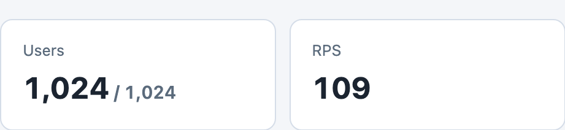
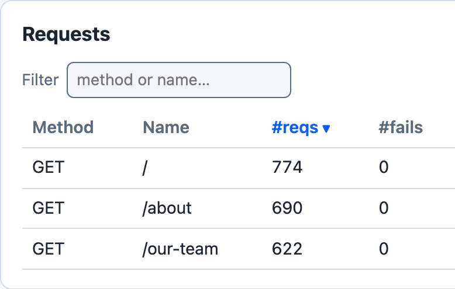
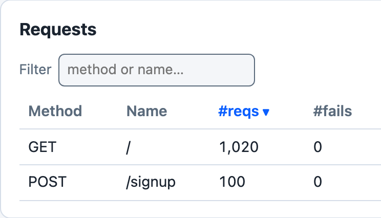
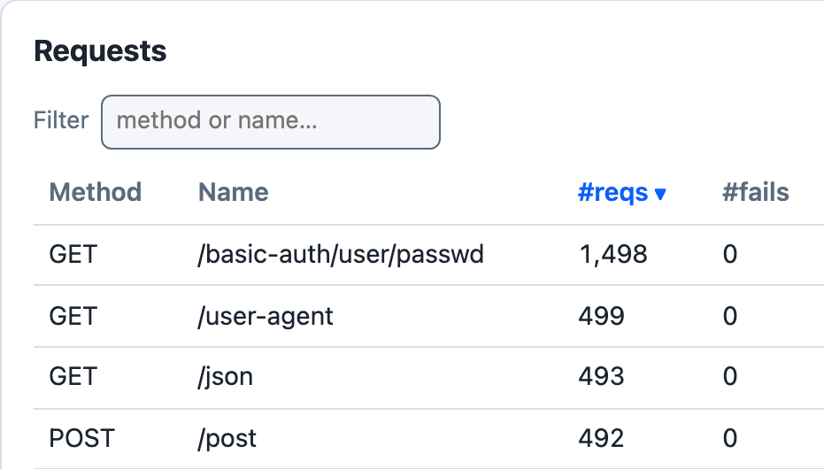
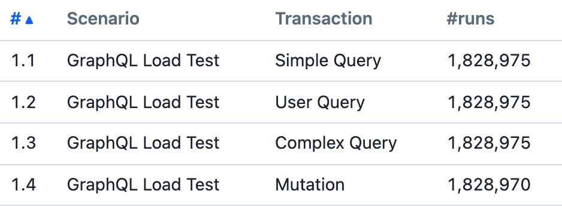
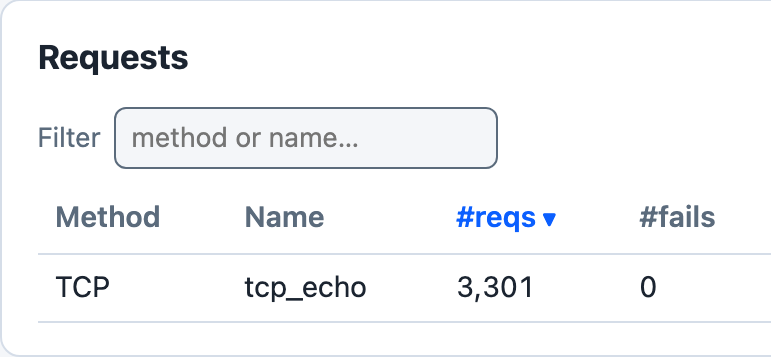
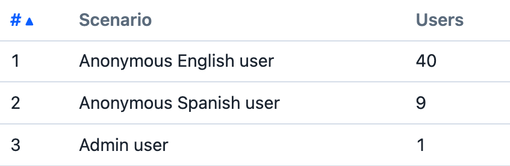

# Examples

Goose ships eight example load tests. Each entry below says what the example demonstrates and what it needs, and, except for Drupal Memcache, shows a piece of a real run; select the picture to open the example's page. Simple is the smallest place to start, and Umami is the closest to a real site.

## Simple

GET and POST requests, a login that runs once per user, and a wait after each transaction except the login. Needs: any web server that answers `POST /login`, `/` and `/about/` with 200. Source: [examples/simple.rs](https://github.com/tag1consulting/goose/blob/main/examples/simple.rs)

## Closure

Transactions built in a loop, one closure per path. Needs: any web server that answers `/`, `/about` and `/our-team` with 200. Source: [examples/closure.rs](https://github.com/tag1consulting/goose/blob/main/examples/closure.rs)

## Session

A token from a signup request, kept per user with `set_session_data` and sent as a bearer token. Needs: a server whose `POST /signup` answers JSON with a `jwtToken`, and whose `/` answers 200 to a request that carries it. Source: [examples/session.rs](https://github.com/tag1consulting/goose/blob/main/examples/session.rs)

## Basic Authentication

Three ways to send HTTP Basic auth, one scenario each, and which of them covers static assets. Needs: the httpbin.org paths, or a server that answers them. Source: [examples/basic_auth.rs](https://github.com/tag1consulting/goose/blob/main/examples/basic_auth.rs)

## GraphQL

GraphQL queries and a mutation sent with `post_graphql` and `post_graphql_named`, and how each names its request. Needs: a server at `POST /graphql` that answers the example's four operations with 200; a real GraphQL server needs the `user`, `posts` and `createPost` fields the queries ask for. Source: [examples/graphql_loadtest.rs](https://github.com/tag1consulting/goose/blob/main/examples/graphql_loadtest.rs)

## TCP Load Test

A raw TCP round trip timed by the transaction and recorded in Goose's metrics with `record_custom_request_duration`. Needs: a TCP echo server. Source: [examples/tcp_loadtest.rs](https://github.com/tag1consulting/goose/blob/main/examples/tcp_loadtest.rs)

## Drupal Memcache

A Locust load test ported to Goose: anonymous and logged in users, form tokens read from pages, and comments posted. Needs: a Drupal 7 site prepared as the drupal-loadtest repository describes, since the example posts Drupal 7 forms. Its page has no picture of a run: against the Drupal 11 Umami site that the Umami example uses, nearly all of the example's node and profile requests answered 404. Source: [examples/drupal_memcache.rs](https://github.com/tag1consulting/goose/blob/main/examples/drupal_memcache.rs)

[Open the Drupal Memcache page](drupal-memcache.md)

## Umami

Three kinds of visitor (English, Spanish and admin), most of the site's page types, the log in and article edit forms, and each page's stylesheets, scripts and images. Needs: a stock Drupal 11.4 site installed with the Umami demo profile, aggregation left on, and an admin account the example can log in with. Source: [examples/umami/](https://github.com/tag1consulting/goose/tree/main/examples/umami)

