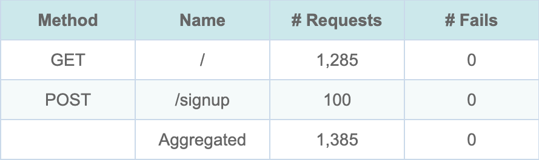

# Session Example

The [`examples/session.rs`](https://github.com/tag1consulting/goose/blob/main/examples/session.rs) example demonstrates how you can add JWT authentication support to your load test, making use of the [`GooseUserData`](https://docs.rs/goose/*/goose/goose/trait.GooseUserData.html) trait. In this example, the session is recorded in the [`GooseUser`](https://docs.rs/goose/*/goose/goose/struct.GooseUser.html) object with [`set_session_data`](https://docs.rs/goose/*/goose/goose/struct.GooseUser.html#method.set_session_data), and retrieved with [`get_session_data_unchecked`](https://docs.rs/goose/*/goose/goose/struct.GooseUser.html#method.get_session_data_unchecked).



*The HTML report's Request Metrics, from `cargo run --release --features dashboard --example session -- --host http://127.0.0.1:8081 -u 100 -r 20 -t 2m --no-reset-metrics --report-file --dashboard -q` against a local nginx server whose `POST /signup` answers `{"jwtToken":"goose-example-token"}`; the run writes `report.html` and `report.json` to `goose-runs/<YYYYMMDD-HHMMSS>/`.*

`POST /signup` ran 100 times, once for each of the 100 users, because it is the on start transaction. The server answers `/` with 401 to any request without the token, and Goose counts a 401 as a failed request, so 0 fails on `GET /` means every one of its 1,285 requests carried the token the user stored. With `-q` Goose does not print the dashboard's address when it starts: open `http://127.0.0.1:5118` while the test runs. If that tab is still open when the run ends, Goose prints the address and waits for Ctrl-C.

## Details

In this example, the [`GooseUserData`](https://docs.rs/goose/*/goose/goose/trait.GooseUserData.html) is a simple struct containing a string. Goose implements `GooseUserData` for every type that is `Clone`, `Send`, `Sync` and `'static`, so the struct only needs to derive `Clone`:
```rust
{{#include ../../../../../examples/session.rs:24:27}}
```

Passing `set_session_data` a type that is not `Clone` does not compile.

Each user builds the struct from the JSON its signup request returns, and stores it in its own [`GooseUser`](https://docs.rs/goose/*/goose/goose/struct.GooseUser.html):
```rust,ignore
{{#include ../../../../../examples/session.rs:67:69}}
```

The session data is retrieved from the [`GooseUser`](https://docs.rs/goose/*/goose/goose/struct.GooseUser.html) object with each subsequent request. The example does no validation:
```rust,ignore
{{#include ../../../../../examples/session.rs:75:97}}
```

_If `POST /signup` does not answer with JSON holding a `jwtToken`, the user stores no session data, and `get_session_data_unchecked` panics with `Missing session data!`._

## Complete Source Code

```rust,ignore
{{#include ../../../../../examples/session.rs}}
```
