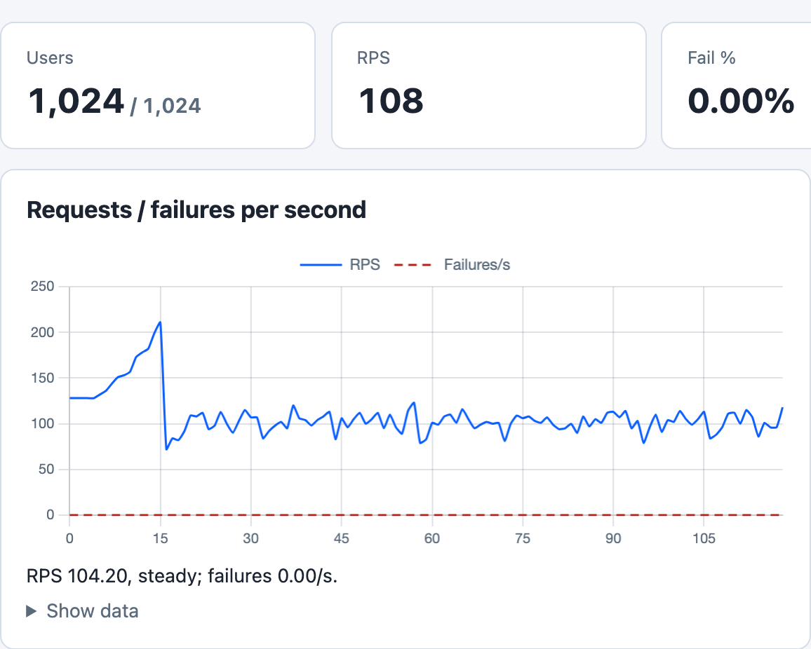

# Simple Example

The [`examples/simple.rs`](https://github.com/tag1consulting/goose/blob/main/examples/simple.rs) example copies the simple load test documented on the [locust.io web page](https://locust.io/), rewritten in Rust for Goose. It shows how to GET and POST pages, with one scenario.



*`cargo run --release --features dashboard --example simple -- --host http://127.0.0.1:8080 -u 1024 -r 64 -t 3m --no-reset-metrics --dashboard -q`, against a local nginx server that answers `POST /login`, `/` and `/about/` with 200, 120 seconds in.*

Each user logs in once with `POST /login`, then loads `/` and `/about/` in turn, pausing 5 to 15 seconds after each of those two but not after the login. During the ramp each new user sends its login and its first page before its first pause, which is why the chart starts near 128 a second (64 new users a second, each sending two requests). From about 5 seconds in, the first users come back from their pauses and add to that, so it climbs to about 200 until all 1,024 users have started, then drops when the new users stop. After that the pause holds 1,024 users to about 100 requests a second.

A separate run measured Goose itself: `-u 1024 -r 64 -t 120s --no-telnet -q`, without the dashboard or the telnet Controller, against the same server on an Apple M5 Max. While all 1,024 users ran, Goose held at 77 MB of memory and used under 3% of one core. It made 12,245 requests in the 120 seconds after the last user started, and none of them failed.

With `-q` Goose does not print the dashboard's address when it starts: open `http://127.0.0.1:5118` while the test runs. If that tab is still open when the run ends, Goose prints the address and waits for Ctrl-C.

## Complete Source Code

```rust,ignore
{{#include ../../../../../examples/simple.rs}}
```
