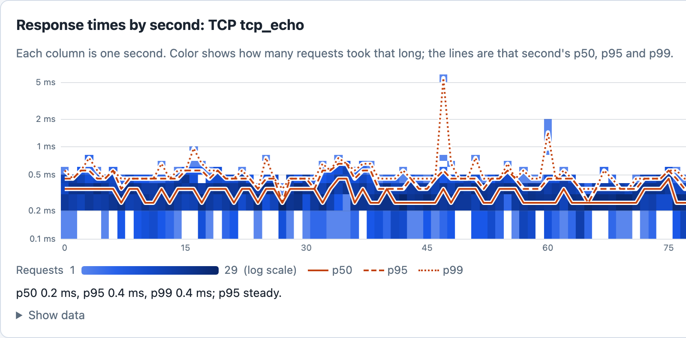
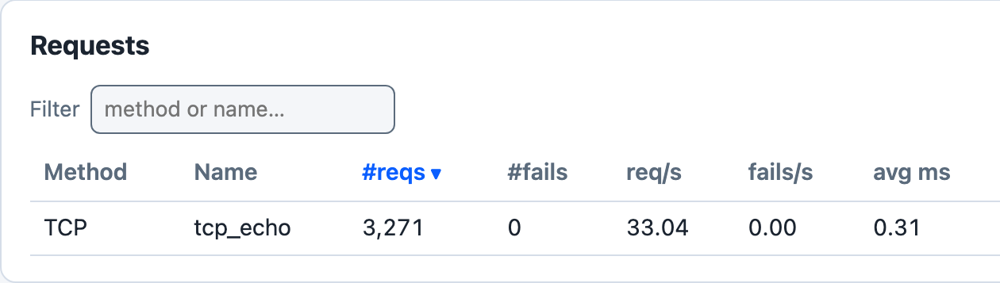

# TCP Load Test

The [`examples/tcp_loadtest.rs`](https://github.com/tag1consulting/goose/blob/main/examples/tcp_loadtest.rs) example demonstrates how to use Goose to load test a raw TCP server. While Goose is primarily an HTTP load testing framework, its metrics pipeline supports any protocol through `GooseUser::record_custom_request` and `GooseUser::record_custom_request_duration`, both new in 0.19. The example uses `record_custom_request_duration`.





*`cargo run --release --features dashboard --example tcp_loadtest -- --host tcp://127.0.0.1:9000 -u 10 -r 10 -t 3m --no-reset-metrics --dashboard -q`, against a small local Node echo server that writes each connection's bytes back to it, about 100 seconds in.*

The latency image shows the left part of the dashboard's Response times by second card, the run's first 77 seconds; the summary under its chart is the mean of the last 10 drawn seconds, which fall to the right of that part. Each user pauses 100 to 500 ms after every round trip, so 10 users make about 33 round trips a second. The example records each round trip as a `Duration`, so Goose keeps the fraction of a millisecond: most fall between 0.2 and 0.5 ms, and they average 0.31 ms. `as_millis()` truncates, so with `record_custom_request` every round trip under 1 ms would have been recorded as 0 ms. With `-q` Goose does not print the dashboard's address when it starts: open `http://127.0.0.1:5118` while the test runs. If that tab is still open when the run ends, Goose prints the address and waits for Ctrl-C.

## Load testing other protocols

Some services communicate over raw TCP, UDP, WebSocket, gRPC, or other protocols rather than HTTP. Before 0.19, the only way to record metrics for these operations was to construct fake HTTP `GooseRequest` objects, which produced misleading results (spurious 404 errors). With `record_custom_request`, you time the operation yourself and hand the result to Goose.

## The API

```rust,ignore
user.record_custom_request(
    method,        // &str: protocol label shown in metrics (e.g. "TCP", "GRPC", "WS")
    name,          // &str: identifies this operation in metrics output
    response_time, // u64: how long the operation took, in milliseconds
    success,       // bool: whether the operation succeeded
    status_code,   // Option<u16>: protocol-specific status code, or None if not applicable
    error,         // Option<&str>: failure reason; ignored when success is true
).await?;
```

This is a fragment: it runs inside a transaction function, with the six values already set.

Recorded metrics appear in all Goose reports under the method label you provide. These are the final request tables of the command under [Running the example](#running-the-example), a different run from the dashboard run above, against a different echo server, so their times differ:

```
 === PER REQUEST METRICS ===
 ------------------------------------------------------------------------------
 Name                     |        # reqs |        # fails |    req/s |  fail/s
 ------------------------------------------------------------------------------
 TCP tcp_echo             |         1,194 |         0 (0%) |    29.85 |    0.00
 ------------------------------------------------------------------------------
 Name                     |    Avg (ms) |        Min |         Max |     Median
 ------------------------------------------------------------------------------
 TCP tcp_echo             |        0.95 |       0.29 |          15 |       0.91
 ------------------------------------------------------------------------------
 Slowest page load within specified percentile of requests (in ms):
 ------------------------------------------------------------------------------
 Name                     |    50% |    75% |    98% |    99% |  99.9% | 99.99%
 ------------------------------------------------------------------------------
 TCP tcp_echo             |   0.91 |   1.05 |   1.64 |    1.8 |    4.9 |     15
 ------------------------------------------------------------------------------
 Name                     |                                        Status codes 
 ------------------------------------------------------------------------------
 TCP tcp_echo             |                                           1,194 [0]
 -------------------------+----------------------------------------------------
 Aggregated               |                                           1,194 [0] 
```

A custom request is counted like an HTTP request: in the `# reqs`, `# fails`, `req/s` and `fail/s` columns, in the Aggregated rows (the request tables print one only when there is more than one request name; the status code table always does), and in its response times and status codes.

### Parameters

- **`method`**: A short label for the protocol (e.g. `"TCP"`, `"GRPC"`, `"WS"`, `"MQTT"`). Must not be empty or contain whitespace. Displayed in place of the HTTP method in all metrics output.
- **`name`**: Identifies the specific operation within that protocol. Must not be empty or only whitespace. Combined with `method` to form the metrics key (`"TCP tcp_echo"`).
- **`response_time`**: The measured duration in milliseconds. `as_millis()` truncates to whole milliseconds, so a sub-millisecond operation is recorded as `0 ms`; to keep its microseconds, as Goose does for HTTP requests, call `record_custom_request_duration` (below).
- **`success`**: Whether the operation succeeded. Unlike HTTP requests where Goose infers success from the status code, for custom protocols you control this directly.
- **`status_code`**: `None` when the protocol has no concept of status codes (e.g. raw TCP); `Some(code)` to record a protocol-specific code (e.g. a gRPC status code). Internally, `None` is stored as `0`, so status code tables show `[0]` for these requests unless `--no-status-codes` turns those tables off.
- **`error`**: An optional error description for failed operations. When `success` is `false` and `error` is `None`, Goose records `<method> <name>: request failed`.

`record_custom_request_duration` takes the same arguments, with the time as a `Duration` such as `started.elapsed()`, and keeps its microseconds.

Both return an error, and record nothing, when `method` or `name` breaks the rules above. They return `Ok(())` even when `success` is `false`: recording a failure does not fail the transaction. To fail it as well, return an error from the transaction function after recording, for example `Err(Box::new(TransactionError::Custom(message)))`. With `--no-metrics` nothing is recorded.

Coordinated Omission Mitigation applies to custom requests the same way it does to HTTP requests.

Goose records a custom request with the method `GooseMethod::Custom` and keeps the label you passed in `raw.custom_method`. `GooseMethod::Custom` is new in 0.19, so a `match` on `GooseMethod` with no wildcard arm needs an arm for it. It is not an HTTP method: `get_request_builder(&GooseMethod::Custom, path)` returns `TransactionError::Custom` with the text `GooseMethod::Custom cannot be used with HTTP request builders; use record_custom_request() instead`.

## Running the example

Start a local TCP echo server:

```bash
ncat -l 9000 -k -e /bin/cat
```

Then run the load test, pointing `--host` at the server. Goose requires a URL with a scheme for validation, and any scheme works (e.g. `tcp://`, `grpc://`, `ws://`). The example reads the host and port from it for the TCP connection, and fails each transaction when the URL has no port:

```bash
cargo run --example tcp_loadtest -- \
  --host tcp://localhost:9000 \
  --users 10 \
  --run-time 30s \
  --no-reset-metrics
```

## Adapting to other protocols

The same pattern works for any protocol: replace the `TcpStream` logic with UDP sockets, a WebSocket client, a gRPC stub, or any other I/O:

```rust,ignore
async fn my_custom_operation(user: &mut GooseUser) -> TransactionResult {
    let started = std::time::Instant::now();

    // Perform the actual operation here (TCP, UDP, gRPC, etc.)
    let result: Result<_, _> = do_my_protocol_operation().await;

    let response_time = started.elapsed();

    match result {
        Ok(_) => {
            user.record_custom_request_duration(
                "GRPC",
                "operation_name",
                response_time,
                true,
                None,
                None,
            )
            .await?;
        }
        Err(e) => {
            user.record_custom_request_duration(
                "GRPC",
                "operation_name",
                response_time,
                false,
                None,
                Some(&e.to_string()),
            )
            .await?;
        }
    }

    Ok(())
}
```

This is a fragment: `do_my_protocol_operation()` stands for your own code.

## Complete Source Code

```rust,ignore
{{#include ../../../../../examples/tcp_loadtest.rs}}
```
