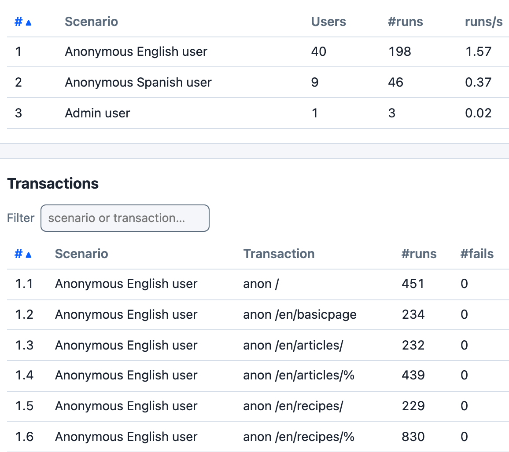

# Umami Example

The [`examples/umami`](https://github.com/tag1consulting/goose/tree/main/examples/umami) example load tests the [Umami demonstration profile](https://www.drupal.org/docs/umami-drupal-demonstration-installation-profile) as Drupal 11.4 installs it.

*`cargo run --release --features dashboard --example umami -- --host http://go193-target -u 50 -r 5 -t 3m --no-reset-metrics --dashboard -q`, against a stock Drupal 11.4.11 site installed with the Umami demo profile, CSS and JS aggregation on, and the admin account `admin` with its password in `ADMIN_PASSWORD`, 126 seconds in.*

The Scenarios table shows that with 50 users the weights 40, 9 and 1 give exactly 40, 9 and 1 users. The Transactions table goes on past the six English rows shown here to 19 rows in all: the rest of the English user's, the Spanish user's and the admin user's. In the first 126 seconds of the run, the 50 users made 39,405 requests with none failed; 35,642 of them were the stylesheets, scripts and images the pages name, which the example requests under the names `static css`, `static js` and `static image`. With `-q` Goose does not print the dashboard's address when it starts: open `http://127.0.0.1:5118` while the test runs. If that tab is still open when the run ends, Goose prints the address and waits for Ctrl-C.

## Overview

The Umami profile installs a sample food magazine site in English and Spanish, with articles, recipes, basic pages and several taxonomies. The example targets a stock Drupal 11.4 Umami site, left as the installer sets it up: CSS and JS aggregation on, and nothing enabled or changed. The example's [README](https://github.com/tag1consulting/goose/blob/main/examples/umami/README.md) shows one way to install it.

The included example simulates three different types of users: an anonymous user browsing the site in English (scenario `Anonymous English user`, weight 40), an anonymous user browsing the site in Spanish (`Anonymous Spanish user`, weight 9), and an administrative user that logs into the site (`Admin user`, weight 1). The anonymous users load most of the site's page types. The anonymous user browsing the site in English loads the front page, the About Umami basic page, the article listing and a random article, the recipe listing and a random recipe, a random node by node id, and a random term listing. The Spanish user does the same in Spanish, except loading a node by node id. The admin user logs in once, then loads the front page, the article listing, and edits and saves a random article. Goose counts any response that is not a 2xx as a failure. On each page the example also checks the HTML for the expected title and loads the stylesheets, scripts and images the page names, each once, under the request names `static css`, `static js` and `static image`. It finds them with aggregation on or off.

Earlier versions of the example also searched the site and sent its contact form. Drupal 11.4's Umami installs neither node search nor the contact module, so those transactions were removed.

On a freshly installed site the first seconds of a run fail, and the failures come from Drupal, not from the example. Drupal generates each image derivative on its first request, and while one request generates it, Drupal answers every other request for that image with `503 Service Unavailable`, `Retry-After: 3` ("Image generation in progress. Try again shortly."); it also creates some cache tables on first use, and a request that races that creation can get a rare `500`. They stop once each page has been served: in three runs of 50 users against new sites, all of them came in the first 17 seconds. The run pictured above was against a site that had already served each page.

To get a clean measurement, warm the site with one run you do not measure, such as `cargo run --release --example umami -- -H http://umami.example.com -u 50 -r 5 -t 3m`, then run the test you measure. Twice, a 3 minute run like that against a new site was followed by a run with 0 failures; a shorter one may be enough, but has not been checked. Do not count on the metrics reset once all users have started to hide the warm up: with `-u 50` and the default rate of one user a second it happened to leave all 30 failures of a new site out of the report, but with `-r 5` the report kept 54 of 188. The example's [README](https://github.com/tag1consulting/goose/blob/main/examples/umami/README.md) has the numbers.

The example load tests `https://drupal-9.ddev.site/` unless `--host` names another site. The admin user logs in as `admin` with the password `P@ssw0rd1234`; set the `ADMIN_USERNAME` or `ADMIN_PASSWORD` environment variable to change either.

Read the blog [A Goose In The Clouds: Load Testing At Scale](https://www.tag1consulting.com/blog/goose-clouds-load-testing-scale) for a demonstration of using this example, and learn more about the testplan from the [README](https://github.com/tag1consulting/goose/blob/main/examples/umami/README.md).

## Alternative

The [Goose Eggs library](https://docs.rs/goose-eggs/) contains [a variation of the Umami example](https://github.com/tag1consulting/goose-eggs/tree/main/examples/umami).

## Complete Source Code

This example is more complex than the other examples, and is split into multiple files, all of which can be found within [`examples/umami`](https://github.com/tag1consulting/goose/tree/main/examples/umami).
