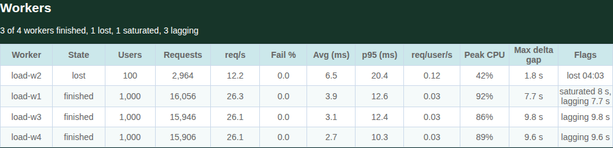
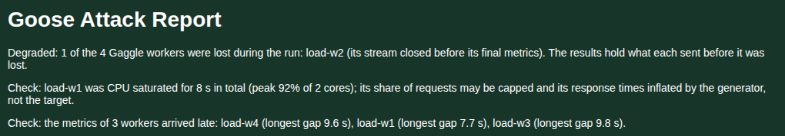

# Gaggle Manager

The manager is your load test started with `--manager`, compiled with the `gaggle` [feature](technical.md#compile-time-feature). It runs no users itself: it waits for its workers, splits the load test between them, and merges what they measure. Every option that shapes the load, the metrics, the reports or the logs is given to the manager, never to a worker.

`--expect-workers` is required: the manager waits for exactly that many workers before the run starts, at most `--gaggle-connect-timeout` (60 seconds by default). If fewer join in time, the manager tells those that did to exit, and exits with an error. With `--no-autostart`, the manager waits for its workers and then for a `start` from a Controller or the dashboard.

## Example

_A manager listening on every interface on the default port, 5115, waiting for 3 workers, with a token so no other process can join, and the live dashboard on port 5118:_

```bash
GOOSE_GAGGLE_TOKEN=s3cret target/release/examples/simple --manager --expect-workers 3 \
    --manager-bind-host 0.0.0.0 --host http://localhost:8080 \
    --users 900 --increase-rate 30 --run-time 5m --dashboard --report-file
```

A manager that listens on any address but loopback needs `--gaggle-token`, or the `GOOSE_GAGGLE_TOKEN` environment variable. The token is never shown: a Controller's `config` and `config-json` show it as `(set)`.

## How it splits the load test

- Users are split as evenly as they go, the remainder one each to the first workers. Each worker's users are numbered as one process running every user would number them, and run the scenarios that process would give them, so the merged per scenario counts are the same.
- Each step of the test plan is split the same way: every step's users add up to the step's. A worker may hold 0 users in a step.
- A users ramp, `--users` with `--increase-rate` or `--increase-time`, `--run-time` and a ramp down, runs as a users ramp on every worker when each has at least one user: its share of the users, each rate times its share of the users, and the same times, so every worker ramps up, holds and ramps down with the manager, and a Controller can change its users, rates and run time as one process's. With more workers than users, each worker runs its share of the ramp as a test plan instead, and a running users ramp's users, rates and run time can not change.
- `--throttle-requests` is split in proportion to each worker's users, the remainder spread, never 0: a worker with no users keeps 1, as it may get users later. The shares add up to the throttle, and a throttle smaller than the number of workers is refused.
- Custom data: see [Custom data for each worker](worker.md#custom-data-for-each-worker).

## While it runs

The manager's phase, run time and test plan are the run's: its console, Controllers and dashboard show the merged metrics, and the users count is the one its plan calls for. Ctrl-C on the manager stops every worker, waits for their final metrics, and writes the reports, as at the end of a run.

## Runtime control

The manager's telnet Controller, WebSocket Controller and dashboard control change the whole Gaggle while it runs: users, the rates and times, the test plan, the host and the throttle, and `start`, `stop`, `shutdown` and the dashboard's Quit. Each change is applied as one process running the whole load test would apply it:

1. The manager checks the change against the rules one process applies, the phase, the bounds and the settings it conflicts with, and against what a Gaggle needs, before it sends anything. A refused change reaches no worker.
2. It applies the change to its own run, which keeps the run's clock.
3. It sends each worker its share. Each worker says it received the change as soon as it reads it, and again once it applied it. The manager answers once every worker received it, within 10 seconds, inside the 15 a Controller or the dashboard waits, saying how many workers accepted it, such as `users configured; accepted by 3 of 3 workers`. A worker that has not said it received a change within 10 seconds is lost. Applying it has no deadline, as building thousands of users takes a while: a worker that received a change stays in the run while its stream and heartbeats are alive, the manager logs a warning every 30 seconds naming each worker still applying it, and logs when every worker applied it. A worker applies its throttle share before anything else in a change, so a new throttle never waits behind its users. Its main loop keeps running meanwhile, and a command sent after this one waits until every worker received this one, never until they applied it; every worker applies changes in the order they came, so a throttle sent after a large users change takes effect on each worker once that users change is applied. A worker with 8 changes it has yet to apply holds the next command back, `stop` and `shutdown` included, until it applies one, so its connection never stops reading. A worker that refuses a change the manager accepted is logged as a bug and lost; the reply names it when the refusal comes before every worker received the change, and the manager's log names the change either way.

What each worker gets is in [Controlling a Gaggle](../controller/overview.md#controlling-a-gaggle). In short: `users` keeps the users one process would run, each user's ordinal and scenario included, an increase taking the next ordinals and a decrease stopping the highest; the rates follow each worker's share of the users; the times, host and run time are the same everywhere; a test plan is split step by step; and the throttle is split by each worker's share of the users. A change made in Idle is kept for the next Start, which hands every worker its share with it.

A worker that does not answer within 10 seconds is marked lost, sent `Shutdown` and disconnected; the reply names it, and the change stands on the others. A worker refusing a change the manager accepted is a bug: the manager logs it, marks the worker lost the same way, and the reply names it.

`--no-autostart` works on a manager: once every worker has joined it waits, and an accepted `start` answers first, then runs `test_start`, the worker data hook, each worker's share and the common start, as an autostarted run does. `stop` ends the run and keeps every worker connected and idle, waiting with the manager; the next `start` hands them new shares, a new host or throttle among them. `shutdown` and the dashboard's Quit tell every worker to exit with the manager; a worker told so before it was handed a share exits cleanly.

The manager's Controllers listen on loopback, as on one process: from another machine, use an ssh forward, `--telnet-host`, or `--websocket` with `--websocket-host`. Neither Controller takes authentication, so anyone who reaches one controls the whole Gaggle's load; the dashboard's control takes its token.

## The throttle across workers

`--throttle-requests` is one limit for the whole Gaggle. Each worker throttles its share, in proportion to its share of the users and never 0, and the shares add up to the throttle. A `throttle` command splits the new rate the same way, refused below one request a second for each worker; each worker's share can go anywhere from 1 to 1000000. On a running Gaggle the throttle changes on its own: sent in one dashboard settings body with users or a test plan, it is refused with `conflicting_settings`. A change of users moves the shares with them. When a worker is lost, the manager splits the throttle again over the workers left and sends their new shares, so the run's limit holds; if the throttle is below the number of workers left, each keeps 1 request a second, and the manager logs it.

## Rebalancing a lost worker's users

By default a lost worker's users are gone for the rest of the run: the run goes on with the users the other workers run. With `--gaggle-rebalance` on the manager, its users move to the workers left, dealt to those running fewest, each keeping its ordinal and scenario, so the run keeps its users and its scenario mix; they start over a second, with the throttle split again over the workers left. Rebalancing moves the users of a users ramp until its ramp down starts; a test plan's are not moved, nor any once the ramp down has started, and the manager logs it.

## Lost workers

The manager marks a worker lost when nothing has come from it for `--gaggle-heartbeat-timeout` (10 seconds by default), when its connection closes before its final metrics, or when it is stopped on its own machine. What the worker sent stays in the results, the run goes on with the others, and the manager tells the lost worker to exit if it can still reach it. The run's record, in `report.json`, lists every worker with its state, and for a lost worker when it was lost and the last metrics it sent; the HTML, Markdown and PDF reports open with a line saying the run is degraded. A worker whose metrics are not all in the results degrades the run too, named with why: one that missed the metrics reset, whose metrics the merge leaves out, one whose metrics the manager refused, or one some of whose metrics never arrived. A worker that cannot hand over its final metrics within 30 seconds, or reset its metrics within 10, tells the manager it failed, which marks it lost, and exits with an error. If every worker is lost, the run ends, recorded as ended by losing its workers.

## Worker health {#worker-health}

The manager keeps one model of every worker's health: its state, its CPU use, how long since its last metrics arrived, and its own figures, over the whole run and over its last 10 seconds. The reports show it, so a run's numbers can be judged: whether every worker was free to make the load it was asked for, or whether one was held back by its own machine rather than by the target. Each worker says how many CPU cores its process may use when it joins, and sends its process's CPU time with each second's metrics; a platform that has no cheap source of CPU time sends none, and the reports show a dash. Each worker times its own CPU samples, so metrics that arrive late do not change the CPU shown.

A worker's state is `joining`, `ready` (prepared, waiting for the start), `running`, `stopping` (told to stop, or its users have stopped), `finished`, `users_exited` (`--iterations`) or `lost`.

Each worker is flagged, for the run, when:

| Flag | When | Why that threshold |
|---|---|---|
| lost | it was lost during the run, with when | |
| excluded | the results leave its metrics out | |
| saturated | its CPU use was at or above 90% of its cores for at least 5 seconds in all | past 90% a load generator queues its own work, which shows as longer response times and fewer requests than asked for; 5 seconds keeps one garbage collection or burst of logging from flagging it |
| lagging | it once went more than 3 seconds without its metrics arriving while running | a worker sends them every second, so 3 is three missed in a row, past what a busy network or manager delays one by |
| outlier | its requests per user per second, or its p95, was more than 25% from the median of the workers that ran, judged with at least 3 workers and once the run has run 30 seconds | workers running the same plan against the same target land well within 25%; with two, each is as far from their median as the other, and until the users have started and warmed up workers differ for no reason of their own |
| refused, missing | some of its metrics deltas were refused, or never arrived, or its final metrics never arrived | |

The same flags are judged live, over the last 10 seconds, where saturated means 5 seconds in a row: the event log records when a worker becomes saturated or lagging and when it recovers, once each way.

The HTML, Markdown and PDF reports have a Workers section after the plan overview and thresholds. It opens with a line such as `47 of 48 workers finished, 1 lost, 1 saturated, 1 lagging`, then a table of every worker, the most severe first (lost, excluded, saturated, lagging, outlier, refused or missing, then healthy) and then by name: its state, users, requests, requests per second over its running time since the metrics reset, failure percent, average and p95 response time over every request name, requests per user per second, peak CPU, the longest gap between its metrics, and its flags in words, such as `lost 03:05`, `saturated 42 s` or `p95 +35%`. The console print shows at most 20 workers.



*A 10 minute run of four workers on a Kubernetes cluster. One worker's pod was deleted at four minutes; adding 2,400 users at once at eight minutes saturated one worker's CPU and held back every worker's metrics for a few seconds.*

An Events section follows, oldest first, each with its time from the start of the run: the run starting, a worker lost and why, a worker's metrics left out or refused, a worker becoming saturated or lagging and recovering, a change of users, throttle or host with how many workers acknowledged it and how long that took (`users 600 to 900, acknowledged by 48 of 48 in 0.4 s`), a stop or start, the throttle's shares made again over the workers left after a loss, and a lost worker's users moved with `--gaggle-rebalance`. The manager keeps the newest 1,000 events and counts older ones, which the section says it left out.

When a worker carries the saturated, lagging or outlier flag, the reports open with a "Check:" sentence for it, after any "Degraded:" sentences, for example: `Check: load-17 was CPU saturated for 42 s in total (peak 97% of 4 cores); its share of requests may be capped and its response times inflated by the generator, not the target.`



A worker's CPU is its own process's: another process on the same machine taking the CPU lowers it rather than raising it, so a worker starved by a neighbour shows as lagging or an outlier, not as saturated.

`report.json`'s `gaggle` section carries the same: each worker gains `cores`, `peak_cpu_percent`, `saturated_secs`, `longest_delta_gap_secs`, `running_secs`, `requests`, `failures`, `average_ms`, `p50_ms`, `p95_ms`, `p99_ms`, `requests_per_second`, `requests_per_user_per_second`, `rate_vs_median_percent` and `p95_vs_median_percent` (only when past 25%), `lost_second` and `flags`, and the section gains `events` (each with its `second`, `time`, `kind`, `worker` when about one, and `text`) and `events_dropped`. Every new field is optional, so a report of an earlier Goose still loads. No report holds a worker's address, host name, port or token: a worker appears only under the name the manager gave it.

## Logs

With `--request-log`, `--transaction-log`, `--scenario-log`, `--error-log` or `--debug-log` on the manager, each worker writes that log in its own run folder, in the format and compression the manager's options give. When the run ends, after every worker has stopped, the manager asks each for its logs, and keeps them in its run's folder as `workers/<worker name>/<file>`, under the file names its options give. A worker's transfer fails when neither a full 1 MiB chunk of its logs nor a log's last arrives for 60 seconds; a transfer that keeps moving has no deadline, however large the log. A log that fails part way, or whose worker is lost, stays on its worker, and nothing of it is kept under its name on the manager; the manager's log, and its reports, name the worker and the path. Two logs may not share a file name, ignoring case: the manager refuses, for example, `--request-log a/x.log` with `--error-log b/x.log`. Each process keeps its own `--goose-log`.
