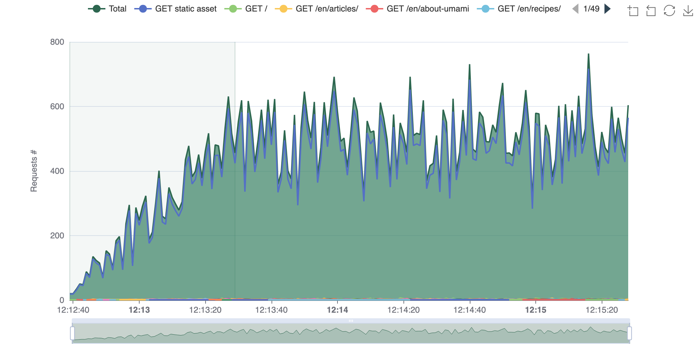

# Common Run Time Options

Goose has many run time options. This page shows the most common ones, one at a time; combine them as you need. Each example other than the host example also needs `--host`, unless the load test sets a host itself with `GooseDefault::Host` or `Scenario::set_host`.

## Host to load test

Load test plans typically contain relative paths, and so Goose must be told which host to run the load test against in order for it to start. This allows a single load test plan to be used for testing different environments, for example "http://local.example.com", "https://qa.example.com", and "https://www.example.com".

### Host example
_Load test the https://www.example.com domain._

```bash
cargo run --release -- -H https://www.example.com
```

## How many users to simulate

By default, Goose will launch one user per available CPU core. Often you will want to simulate considerably more users than this, and this can be done by setting the `--users` run time option.

(_Alternatively, you can use [`--test-plan`](./test-plan.html) to build both simple and more complex traffic patterns that can include a varying number of users._)

### Users example
_Launch 1,000 GooseUsers._

```bash
cargo run --release -- -u 1000
```

## Controlling how long it takes Goose to launch all users

There are several ways to configure how long Goose will take to launch all configured GooseUsers. For starters, you can use either `--increase-rate` or `--increase-time`, but not both together. (_These replace `--hatch-rate` and `--startup-time` from Goose 0.18 and earlier, which no longer exist; see [Upgrading From 0.18](upgrading.md)._) Alternatively, you can use [`--test-plan`](./test-plan.html) to build both simple and more complex traffic patterns that can include varying launch rates.

### Specifying the increase rate

By default, Goose starts one GooseUser per second. So if you configure `--users` to 10 it will take ten seconds to fully start the load test. If you set `--increase-rate 5` then Goose will start 5 users every second, taking two seconds to start up. If you set `--increase-rate 0.5` then Goose will start 1 user every 2 seconds, taking twenty seconds to start all 10 users. The slowest rate Goose accepts is one user a day, about `0.0000116`; a slower rate is an error.

(_The configured increase rate is a best effort limit, Goose will not start users faster than this but there is no guarantee that your load test server is capable of starting users as fast as you configure._)

Goose starts each user one interval after the last was due, so a rate that is not a whole number is kept too: `--increase-rate 1.5` starts a user every 667 milliseconds, starting 9 users in about 5.3 seconds. The same applies to `--decrease-rate`, `--increase-time`, `--decrease-time` and the steps of a [test plan](./test-plan.html).

### Increase rate example
_Launch one user every two seconds._

```bash
cargo run --release -- -r .5
```

### Specifying the total increase time

Alternatively, you can tell Goose how long you'd like it to take to start all GooseUsers. So, if you configure `--users` to 10 and set `--increase-time 10` it will launch 1 user every second. If you set `--increase-time 1m` it will start 1 user every 6 seconds, starting all users over one minute. And if you set `--increase-time 2s` it will launch five users per second, launching all users in two seconds.

(_The configured increase time is a best effort limit, Goose will not start users faster than this but there is no guarantee that your load test server is capable of starting users as fast as you configure._)

### Increase time example
_Launch all users in 5 seconds._

```bash
cargo run --release -- -s 5
```

## Controlling the ramp-down rate

Similarly, you can configure how quickly Goose stops users at the end of a load test using `--decrease-rate` or `--decrease-time`. These are mutually exclusive, just like their increase counterparts, and `--decrease-rate` has the same slowest rate of one user a day. If neither is set, Goose shuts down all users as quickly as possible.

### Decrease rate example
_Stop one user every two seconds._

```bash
cargo run --release -- --decrease-rate .5
```

### Decrease time example
_Stop all users over 30 seconds._ Goose stops the first user at once and the rest at even intervals, so with 4 users the last one stops after about 22.5 seconds.

```bash
cargo run --release -- --decrease-time 30s
```

## Specifying how long the load test will run

The `--run-time` option is not affected by how long Goose takes to start up. Thus, if you configure a load test with `--users 100 --increase-time 30m --run-time 5m` Goose will run for a total of 35 minutes, first ramping up for 30 minutes and then running at full load for 5 minutes. If you want Goose to exit immediately after all users start, you can set a very small run time, for example `--users 100 --increase-rate .25 --run-time 1s`.

Alternatively, you can use [`--test-plan`](./test-plan.html) to build both simple and more complex traffic patterns and can define how long the load test runs.

A final option is to instead use the `--iterations` option to configure how many times GooseUsers will run through their assigned Scenario before exiting.

If you do not configure a run time, Goose will run until it's canceled with `ctrl-c`.

### Run time example
_Run the load test for 30 minutes._

```bash
cargo run --release -- -t 30m
```

### Iterations example
_Each GooseUser will take as long as it takes to fully run its assigned Scenario 5 times and then stop._

```bash
cargo run --release -- --iterations 5
```

## Writing An HTML-formatted Report

By default, Goose displays [text-formatted metrics](metrics.md) when a load test finishes.

It can also optionally write one or more reports in HTML, Markdown, or JSON format, or PDF when built with the `pdf-reports` feature. For that, you need to provide one or more `--report-file <FILE>` run-time options. All requested reports will be written, even with `--no-print-metrics`.

The value of `<FILE>` is an absolute or relative path to the report file to generate. The file extension (`.html` or `.htm`, `.md`, `.json`, or `.pdf`) sets the type of report to write. Any file that already exists at the specified path will be overwritten. A `--report-file` given without a path writes `report.json` and `report.html` into the [run's folder](#run-folders).

For more information, see [Report Formats](metrics.md#report-formats).



### HTML report example
_Write an HTML-formatted report to `report.html` when the load test finishes._

```bash
cargo run --release -- --report-file report.html
```

### HTML & Markdown report example
_Write a Markdown and an HTML-formatted report when the load test finishes._

```bash
cargo run --release -- --report-file report.md --report-file report.html
```

### Printer-friendly HTML report example
_Write a printer-friendly HTML report optimized for PDF conversion._

```bash
cargo run --release -- --pdf-print-html print-report.html
```

The `--pdf-print-html` option writes the HTML report with CSS laid out for printing, to convert to PDF with your browser's "Print to PDF" function or to print on paper. It needs neither Chrome nor the `pdf-reports` feature. It has the same graphs and response time heatmap as the HTML report, with or without a `--report-file`, and is written once even when a `.pdf` report is written too. It counts as a report for `--notes` and `--no-granular-report`, and can't be used with `--no-metrics`. It can also be written beside an HTML report:

```bash
cargo run --release -- --report-file report.html --pdf-print-html print-report.html
```

### PDF report example
_Build with the `pdf-reports` feature and write a PDF report, waiting up to two minutes for Chrome._

```bash
cargo run --release --features goose/pdf-reports -- --report-file report.pdf --pdf-timeout 120
```

A PDF report needs Chrome or Chromium; see [Requirements](../requirements.md#chrome-for-pdf-reports). `--pdf-timeout` is how many seconds Goose waits for Chrome to start and to render the PDF, from 10 to 600, default 60. `--pdf-scale`, from 0.1 to 2.0, default 0.8, sets how much Chrome scales the pages. Both exist only with the `pdf-reports` feature.

## Comparing Against A Baseline

When you run load tests regularly (for example, before and after a deployment), it's useful to compare results against a previous run to see what changed. Goose supports this with the `--baseline-file` option.

First, run a load test and save a JSON report:

```bash
cargo run --release -- --report-file baseline.json --report-file report.html
```

Later, run the same load test and pass the previous JSON report as a baseline:

```bash
cargo run --release -- --report-file report.html --baseline-file baseline.json
```

When a baseline file is provided, the numeric metrics in the HTML and Markdown reports include a delta showing the difference from the baseline. For example, instead of just showing `1,234` requests, the HTML report shows `1,234 (+200)` if the current run had 200 more requests than the baseline, or `1,234 (-50)` if it had 50 fewer; the Markdown report shows its request counts without thousands separators, `1234 (+200)`. The JSON report holds only the current run's values, so it can serve as the next run's baseline.

A time's delta is the difference of the two values shown. A 0.19 baseline's request, transaction and scenario times come from its microsecond timing data. A report from an older Goose holds whole milliseconds: its minimums and maximums are truncated, and its percentiles above 100 ms are rounded to 10 ms, 100 ms or whole seconds. So an unchanged time can read differently against it, such as `38 (+1)`.

Deltas are calculated for:

- **Requests**: number of requests, failures, average/min/max response time, requests/failures per second
- **Response time percentiles**: p50, p60, p70, p80, p90, p95, p99, p100
- **Transactions**: request count, failures, response times, rates
- **Scenarios**: user count, iteration count, response times, rates
- **Errors**: occurrence count
- **Transaction errors**: occurrence count
- **Coordinated Omission**: adjusted response times and standard deviation

Metrics are matched between runs by their key (HTTP method + endpoint name for requests, transaction + name for transactions, etc.). If an endpoint exists in the current run but not in the baseline (or vice versa), it is displayed normally without a delta.

The baseline file must be a JSON report generated by Goose, plain or gzipped (`.json.gz`), or a [run's folder](#run-folders), whose `report.json` or `report.json.gz` is then used. If the file doesn't exist, contains invalid JSON, or has no request metrics, Goose will report an error. A JSON report from Goose 0.18.1 or later loads as a baseline, including one from a run that received more than one status code. A report with transaction errors gets a delta for each of them, and a report without them, such as one from Goose 0.18.1, still loads.

A run's folder given as the baseline must already hold a report, such as one written by a run with `--output-dir goose-runs/nightly --report-file` (see [Run folders](#run-folders)):

```bash
cargo run --release -- --report-file report.html --baseline-file goose-runs/nightly
```

### Baseline comparison example
_Run a load test comparing against a previous run, generating both HTML and JSON reports._

```bash
cargo run --release -- --report-file report.html --report-file latest.json --baseline-file baseline.json
```

The resulting `latest.json` can then be used as the baseline for the next comparison, enabling a chain of run-over-run comparisons.

### Setting a default baseline file

You can configure a default baseline file programmatically using `GooseDefault::BaselineFile`:

```rust,ignore
GooseAttack::initialize()?
    .set_default(GooseDefault::BaselineFile, "baseline.json")?
    // ...register scenarios, then .execute().await?
```

This default will be used unless overridden by `--baseline-file` on the command line.

## Run folders

An output flag given without a path writes into the run's folder: `goose-runs/<YYYYMMDD-HHMMSS>` from the run's local start time, unless `--output-dir` names one. [Output files](output-files.md) gives the rules for every file Goose writes.

```bash
cargo run --release -- --report-file --notes "after the cache change"
```

When running Goose in Docker, mount a folder for the runs:

```bash
docker run -v "$PWD/goose-runs:/goose-runs" my-load-test --host https://example.com --output-dir /goose-runs/nightly --report-file
```

In CI, upload `goose-runs/` as a build artifact to keep every run's reports.

### Graph data and memory

A report written at the end of the run, by any `--report-file` or by the dashboard's Save report, graphs every second of the run, so Goose keeps per second graph data for the whole run in memory. It costs about 12 bytes per request name per second at steady state, and up to 4 times that while the report is written:

| run length | 20 request names | 100 request names |
|-|-|-|
| 10 minutes | 0.15 MB | 0.7 MB |
| 1 hour | 0.9 MB | 4 MB |
| 24 hours | 21 MB | 100 MB |
| 7 days | 145 MB | 730 MB |

Without a report, Goose records per second graph data only for the dashboard, which keeps its last 10 minutes. On a long soak test with `--dashboard-control` and no `--report-file` path, turn Save report off to keep memory flat, and turn it on before the part of the run you want graphed.
