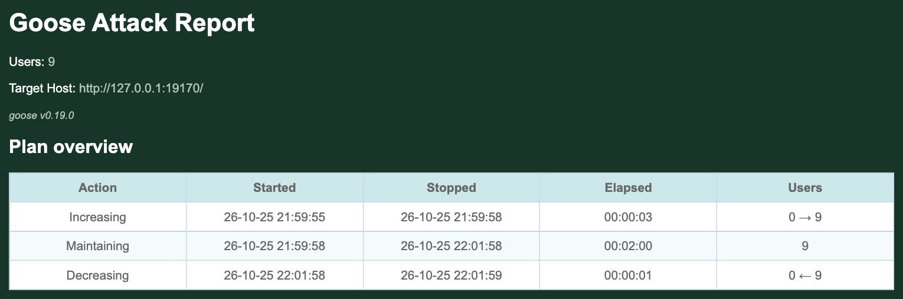
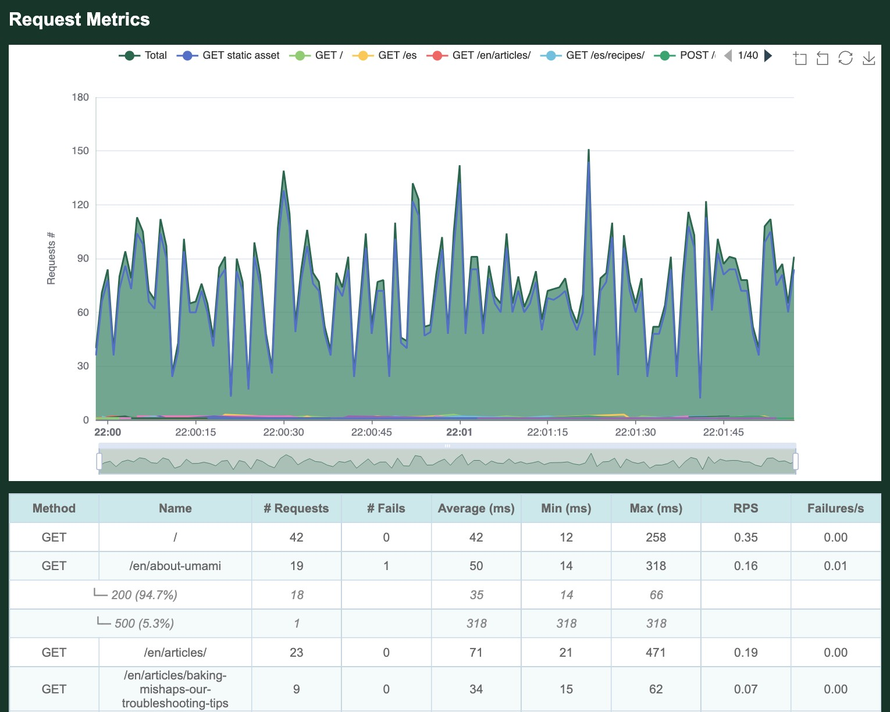
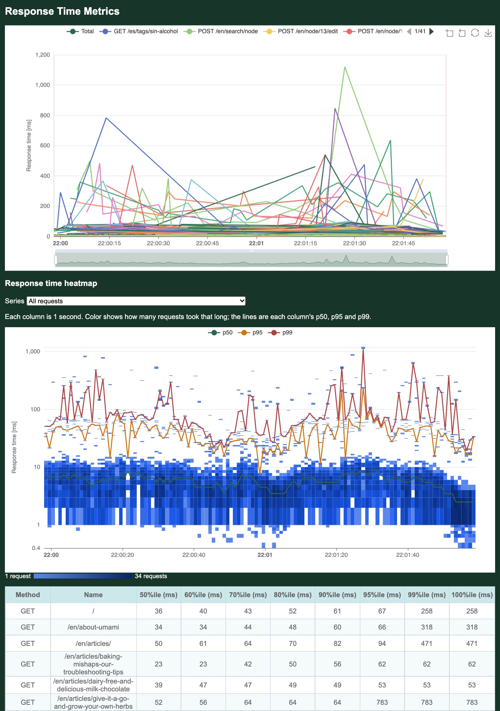
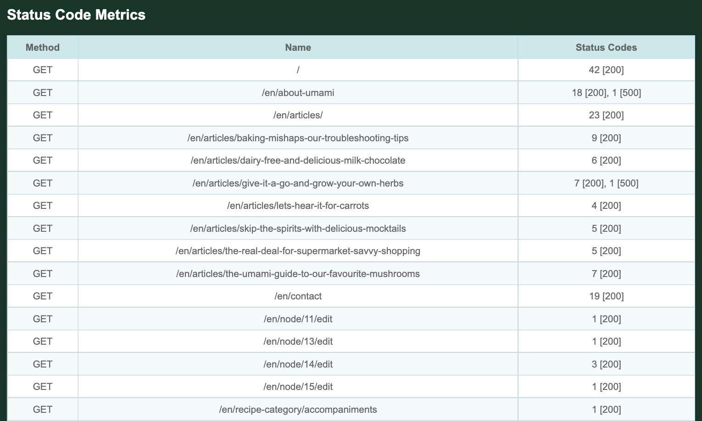
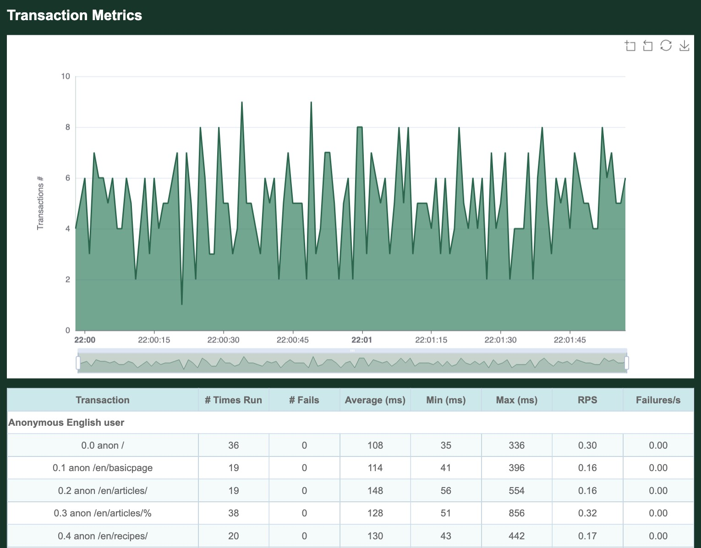
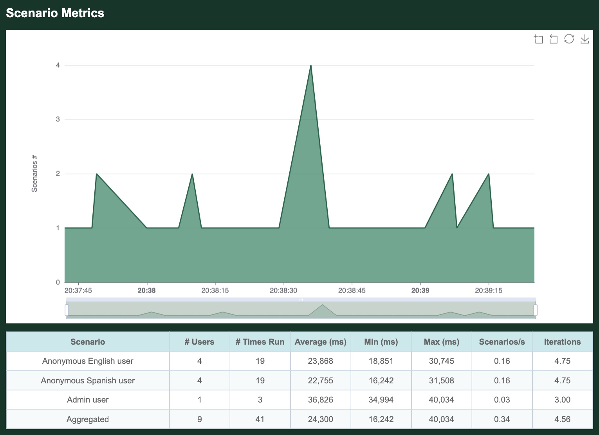
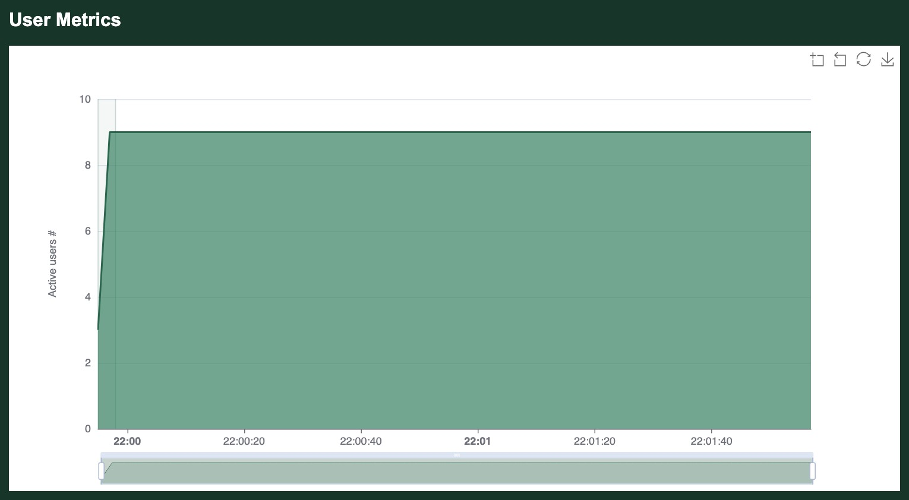

# Metrics

Here's sample output generated when running a loadtest, in this case the [Umami example](../example/umami.html) that comes with Goose.

The example is written for a site built with the [Drupal Umami demo](https://www.drupal.org/docs/umami-drupal-demonstration-installation-profile) profile: against any other server its validations fail. This sample came from a local test server that answers every page the example requests, with the titles, forms and static assets the example checks for. The following command was used to configure Goose and run the load test. The `-u9` tells Goose to spin up 9 users. The `-r3` option tells Goose to launch 3 users per second. The `-t1m` option tells Goose to run the load test for 1 minute, or 60 seconds. The `--no-reset-metrics` flag tells Goose to include all metrics, instead of the default which is to reset the metrics once every user has started. And finally, the two `--report-file` options tell Goose to write an HTML-formatted report named `report.html` and a Markdown-formatted report named `report.md` in the working directory once the load test finishes.

## ASCII metrics

The example names its transactions, such as `anon /`, but not its requests, so each request is named by its path: the run made requests under 93 names. In the request tables below, `...` marks the rows left out.

```bash
% cargo run --release --example umami -- --host http://127.0.0.1:19130/ -u9 -r3 -t1m --no-reset-metrics --report-file report.html --report-file report.md
    Finished `release` profile [optimized] target(s) in 0.23s
     Running `target/release/examples/umami --host 'http://127.0.0.1:19130/' -u9 -r3 -t1m --no-reset-metrics --report-file report.html --report-file report.md`
21:10:43 [INFO] Output verbosity level: INFO
21:10:43 [INFO] Logfile verbosity level: WARN
21:10:43 [INFO] users = 9
21:10:43 [INFO] run_time = 60
21:10:43 [INFO] increase_rate = 3.0
21:10:43 [INFO] no_reset_metrics = true
21:10:43 [INFO] report_file = ["report.html", "report.md"]
21:10:43 [INFO] global host configured: http://127.0.0.1:19130/
21:10:43 [INFO] [scheduler]: allocating transactions and scenarios with RoundRobin scheduler
21:10:43 [INFO] [scheduler]: initializing 9 user states...
21:10:43 [INFO] [controller]: Telnet listening on: 0.0.0.0:5116
21:10:43 [INFO] [controller]: WebSocket listening on: 0.0.0.0:5117
21:10:43 [INFO] entering GooseAttack phase: Increase
21:10:43 [INFO] [user 1]: launching user from Anonymous Spanish user
21:10:43 [INFO] [user 2]: launching user from Anonymous English user
21:10:43 [INFO] [user 3]: launching user from Anonymous Spanish user
21:10:44 [INFO] [user 4]: launching user from Anonymous English user
21:10:44 [INFO] [user 5]: launching user from Anonymous Spanish user
21:10:44 [INFO] [user 6]: launching user from Anonymous English user
21:10:45 [INFO] [user 7]: launching user from Admin user
21:10:45 [INFO] [user 8]: launching user from Anonymous Spanish user
21:10:45 [INFO] [user 9]: launching user from Anonymous English user
All 9 users launched.

21:10:46 [INFO] entering GooseAttack phase: Maintain
21:11:46 [INFO] entering GooseAttack phase: Decrease
21:11:46 [INFO] [user 5]: exiting from Anonymous Spanish user
21:11:46 [INFO] [user 8]: exiting from Anonymous Spanish user
21:11:46 [INFO] [user 6]: exiting from Anonymous English user
21:11:46 [INFO] [user 7]: exiting from Admin user
21:11:46 [INFO] [user 2]: exiting from Anonymous English user
21:11:46 [INFO] [user 4]: exiting from Anonymous English user
21:11:46 [INFO] [user 1]: exiting from Anonymous Spanish user
21:11:46 [INFO] [user 9]: exiting from Anonymous English user
21:11:46 [INFO] [user 3]: exiting from Anonymous Spanish user
21:11:46 [INFO] html report file written to: report.html
21:11:46 [INFO] markdown report file written to: report.md
21:11:46 [INFO] entering GooseAttack phase: Shutdown
21:11:46 [INFO] printing final metrics after 63 seconds...

 === PER SCENARIO METRICS ===
 ------------------------------------------------------------------------------
 Name                     |  # users |  # times run | scenarios/s | iterations
 ------------------------------------------------------------------------------
 1: Anonymous English u.. |        4 |            8 |        0.13 |       2.00
 2: Anonymous Spanish u.. |        4 |            8 |        0.13 |       2.00
 3: Admin user            |        1 |            2 |        0.03 |       2.00
 -------------------------+----------+--------------+-------------+------------
 Aggregated               |        9 |           18 |        0.29 |       2.00
 ------------------------------------------------------------------------------
 Name                     |    Avg (ms) |        Min |         Max |     Median
 ------------------------------------------------------------------------------
   1: Anonymous English.. |      26,437 |     21,959 |      31,240 |     26,608
   2: Anonymous Spanish.. |      24,977 |     19,969 |      30,105 |     23,724
   3: Admin user          |      29,412 |     28,898 |      29,927 |     28,898
 -------------------------+-------------+------------+-------------+-----------
 Aggregated               |      26,119 |     19,969 |      31,240 |     26,608

 === PER TRANSACTION METRICS ===
 ------------------------------------------------------------------------------
 Name                     |   # times run |        # fails |  trans/s |  fail/s
 ------------------------------------------------------------------------------
 1: Anonymous English user
   1: anon /              |            20 |         0 (0%) |     0.32 |    0.00
   2: anon /en/basicpage  |            11 |         0 (0%) |     0.17 |    0.00
   3: anon /en/articles/  |            11 |         0 (0%) |     0.17 |    0.00
   4: anon /en/articles/% |            19 |         0 (0%) |     0.30 |    0.00
   5: anon /en/recipes/   |            11 |         0 (0%) |     0.17 |    0.00
   6: anon /en/recipes/%  |            35 |         0 (0%) |     0.56 |    0.00
   7: anon /node/%nid     |            10 |         0 (0%) |     0.16 |    0.00
   8: anon /en term       |            17 |         0 (0%) |     0.27 |    0.00
   9: anon /en/search     |             8 |         0 (0%) |     0.13 |    0.00
   10: anon /en/contact   |             8 |         0 (0%) |     0.13 |    0.00
 2: Anonymous Spanish user
   1: anon /es/           |            20 |         0 (0%) |     0.32 |    0.00
   2: anon /es/basicpage  |            12 |         0 (0%) |     0.19 |    0.00
   3: anon /es/articles/  |            12 |         0 (0%) |     0.19 |    0.00
   4: anon /es/articles/% |            20 |         0 (0%) |     0.32 |    0.00
   5: anon /es/recipes/   |            12 |         0 (0%) |     0.19 |    0.00
   6: anon /es/recipes/%  |            36 |         0 (0%) |     0.57 |    0.00
   7: anon /es term       |            18 |         0 (0%) |     0.29 |    0.00
   8: anon /es/search     |            10 |         0 (0%) |     0.16 |    0.00
   9: anon /es/contact    |             8 |         0 (0%) |     0.13 |    0.00
 3: Admin user           
   1: auth /en/user/login |             1 |         0 (0%) |     0.02 |    0.00
   2: auth /              |             5 |         0 (0%) |     0.08 |    0.00
   3: auth /en/articles/  |             2 |         0 (0%) |     0.03 |    0.00
   4: auth /en/node/%/e.. |             4 |         0 (0%) |     0.06 |    0.00
 -------------------------+---------------+----------------+----------+--------
 Aggregated               |           310 |         0 (0%) |     4.92 |    0.00
 ------------------------------------------------------------------------------
 Name                     |    Avg (ms) |        Min |         Max |     Median
 ------------------------------------------------------------------------------
 1: Anonymous English user
   1: anon /              |         136 |         84 |         181 |        130
   2: anon /en/basicpage  |         115 |         80 |         170 |        114
   3: anon /en/articles/  |         124 |         79 |         168 |        123
   4: anon /en/articles/% |         122 |         67 |         171 |        122
   5: anon /en/recipes/   |         121 |         81 |         165 |        121
   6: anon /en/recipes/%  |         124 |         69 |         173 |        125
   7: anon /node/%nid     |         137 |         84 |         175 |        131
   8: anon /en term       |         131 |         81 |         162 |        131
   9: anon /en/search     |         426 |        383 |         485 |        408
   10: anon /en/contact   |         386 |        312 |         463 |        346
 2: Anonymous Spanish user
   1: anon /es/           |         128 |         75 |         181 |        125
   2: anon /es/basicpage  |         136 |         94 |         176 |        131
   3: anon /es/articles/  |         122 |         86 |         164 |        111
   4: anon /es/articles/% |         124 |         83 |         162 |        116
   5: anon /es/recipes/   |         135 |         77 |         177 |        140
   6: anon /es/recipes/%  |         125 |         71 |         181 |        117
   7: anon /es term       |         127 |         78 |         184 |        117
   8: anon /es/search     |         414 |        351 |         485 |        416
   9: anon /es/contact    |         406 |        312 |         488 |        395
 3: Admin user           
   1: auth /en/user/login |         452 |        452 |         452 |        452
   2: auth /              |         114 |         76 |         163 |        109
   3: auth /en/articles/  |         117 |        100 |         134 |        100
   4: auth /en/node/%/e.. |         582 |        514 |         639 |        578
 -------------------------+-------------+------------+-------------+-----------
 Aggregated               |         164 |         67 |         639 |        131

 === PER REQUEST METRICS ===
 ------------------------------------------------------------------------------
 Name                     |        # reqs |        # fails |    req/s |  fail/s
 ------------------------------------------------------------------------------
 GET /                    |            25 |         0 (0%) |     0.40 |    0.00
 GET /en/about-umami      |            11 |         0 (0%) |     0.17 |    0.00
 GET /en/articles/        |            13 |         0 (0%) |     0.21 |    0.00
 ...
 GET static asset         |         3,530 |         0 (0%) |    56.03 |    0.00
 POST /en/contact         |             8 |         0 (0%) |     0.13 |    0.00
 POST /en/node/12/edit    |             1 |         0 (0%) |     0.02 |    0.00
 POST /en/node/15/edit    |             1 |         0 (0%) |     0.02 |    0.00
 POST /en/node/16/edit    |             2 |         0 (0%) |     0.03 |    0.00
 POST /en/search/node     |             8 |         0 (0%) |     0.13 |    0.00
 POST /en/user/login      |             1 |         0 (0%) |     0.02 |    0.00
 POST /es/contact         |             8 |         0 (0%) |     0.13 |    0.00
 POST /es/search/node     |            10 |         0 (0%) |     0.16 |    0.00
 -------------------------+---------------+----------------+----------+--------
 Aggregated               |         3,883 |         0 (0%) |    61.63 |    0.00
 ------------------------------------------------------------------------------
 Name                     |    Avg (ms) |        Min |         Max |     Median
 ------------------------------------------------------------------------------
 GET /                    |          76 |         28 |         124 |         74
 GET /en/about-umami      |          61 |         22 |         116 |         52
 GET /en/articles/        |          67 |         24 |         116 |         68
 ...
 GET static asset         |        5.51 |       1.17 |          14 |       5.41
 POST /en/contact         |         211 |        126 |         282 |        214
 POST /en/node/12/edit    |         235 |        235 |         235 |        235
 POST /en/node/15/edit    |         252 |        252 |         252 |        252
 POST /en/node/16/edit    |         252 |        247 |         258 |        247
 POST /en/search/node     |         230 |        185 |         266 |        224
 POST /en/user/login      |         238 |        238 |         238 |        238
 POST /es/contact         |         218 |        154 |         274 |        237
 POST /es/search/node     |         223 |        152 |         287 |        216
 -------------------------+-------------+------------+-------------+-----------
 Aggregated               |          13 |       1.17 |         287 |       5.86
 ------------------------------------------------------------------------------
 Name                     |                                        Status codes 
 ------------------------------------------------------------------------------
 GET /                    |                                            25 [200]
 GET /en/about-umami      |                                            11 [200]
 GET /en/articles/        |                                            13 [200]
 ...
 GET static asset         |                                         3,530 [200]
 POST /en/contact         |                                             8 [200]
 POST /en/node/12/edit    |                                             1 [200]
 POST /en/node/15/edit    |                                             1 [200]
 POST /en/node/16/edit    |                                             2 [200]
 POST /en/search/node     |                                             8 [200]
 POST /en/user/login      |                                             1 [200]
 POST /es/contact         |                                             8 [200]
 POST /es/search/node     |                                            10 [200]
 -------------------------+----------------------------------------------------
 Aggregated               |                                         3,883 [200]
```

The final summary ends with the status codes. Its percentile tables, the errors table and the overview of the test plan are not printed in this release; the HTML and Markdown reports hold them. From the `report.md` of the same run:

```markdown
## Plan Overview

| Action | Started | Stopped | Elapsed | Users |
| ------ | ------- | ------- | ------- | ----: |
| Increasing | 26-10-25 22:10:43 | 26-10-25 22:10:46 | 00:00:03 | 0 &rarr; 9 |
| Maintaining | 26-10-25 22:10:46 | 26-10-25 22:11:46 | 00:01:00 | 9 |
| Decreasing | 26-10-25 22:11:46 | 26-10-25 22:11:46 | 00:00:00 | 0 &larr; 9 |

## Response Time Metrics

| Method | Name | 50%ile (ms) | 60%ile (ms) | 70%ile (ms) | 80%ile (ms) | 90%ile (ms) | 95%ile (ms) | 99%ile (ms) | 100%ile (ms) |
| ------ | ---- | ----------: | ----------: | ----------: | ----------: | ----------: | ----------: | ----------: | -----------: |
| GET | / | 74 | 80 | 98 | 109 | 116 | 119 | 124 | 124 |
| GET | /en/about-umami | 52 | 66 | 73 | 75 | 113 | 113 | 116 | 116 |
| GET | /en/articles/ | 68 | 72 | 75 | 82 | 102 | 102 | 116 | 116 |
| ... |
| GET | static asset | 5.41 | 6.18 | 6.94 | 7.78 | 8.64 | 9.66 | 11 | 14 |
| POST | /en/contact | 214 | 241 | 245 | 245 | 276 | 282 | 282 | 282 |
| POST | /en/node/12/edit | 235 | 235 | 235 | 235 | 235 | 235 | 235 | 235 |
| POST | /en/node/15/edit | 252 | 252 | 252 | 252 | 252 | 252 | 252 | 252 |
| POST | /en/node/16/edit | 247 | 247 | 247 | 258 | 258 | 258 | 258 | 258 |
| POST | /en/search/node | 224 | 234 | 253 | 253 | 257 | 266 | 266 | 266 |
| POST | /en/user/login | 238 | 238 | 238 | 238 | 238 | 238 | 238 | 238 |
| POST | /es/contact | 237 | 243 | 245 | 245 | 268 | 274 | 274 | 274 |
| POST | /es/search/node | 216 | 218 | 237 | 251 | 272 | 287 | 287 | 287 |
|  | Aggregated | 5.86 | 6.62 | 7.52 | 8.38 | 11 | 70 | 124 | 287 |
```

## Report Formats

In addition to the metrics displayed on the CLI, Goose can generate detailed reports in multiple formats. Each format serves different use cases:

- **HTML**: Interactive reports with charts and detailed visualizations
- **JSON**: Machine-readable data for automated analysis and integration
- **Markdown**: Text-based reports suitable for documentation and version control
- **PDF**: Portable reports optimized for printing and sharing (requires `pdf-reports` feature)

You can generate multiple report formats simultaneously by using multiple `--report-file` arguments. The report type is determined by the file extension:

```bash
# Generate multiple report formats at once
cargo run --example simple -- \
  --host http://localhost:8080 \
  --report-file report.html \
  --report-file metrics.json \
  --report-file summary.md
```

The following subsections describe each report format in detail.

### HTML report

The screenshots in this section come from another run of the Umami example, with `-u9 -r3 -t2m`, against a local test server that answered a few requests with errors.

#### Overview
The HTML report starts with a brief overview table of the test plan, the same table the Markdown report starts with, as [shown above](#ascii-metrics):


**NOTE:** The HTML report includes some graphs that rely on the [eCharts JavaScript library](https://echarts.apache.org). The HTML report loads the library via CDN, which means that the graphs won't be loaded correctly if the CDN is not accessible.

#### Requests
Next the report includes a graph of the requests made each second during the load test. It has a line for all requests together and, by default, one for each request; `--no-granular-report` leaves out the lines for each request. It's possible to click on the request names at the top of the graph to hide/show specific requests on the graphs. In this case, the graph shows that most requests made by the load test were for static assets.

The graphs that count something each second, the requests, errors, transactions and scenarios per second, leave out the run's final second when the run stopped partway through it, as a count there would hold only part of a second and the line would end in a drop. The response time and users graphs keep it.

Below the graph is a table that shows per-request details, only partially included in this screenshot:


#### Response times
The next graph shows the response times measured for each request made. Goose measures **Time to First Byte (TTFB)**: the time from when a request is sent until response headers are received, as measured by `reqwest::Client::execute()`. All "Response time" labels in Goose reports and console output refer to this measurement.

**What TTFB includes:**

- Network latency to establish connection
- Server processing time to generate response
- Time to receive response headers and status code
- Redirect handling time (when following redirects)

**What is NOT measured:**

- Time to download complete response body
- Time to process response content
- Client-side rendering or parsing time

**Why TTFB?** Goose focuses on TTFB because:
- **Server performance focus**: TTFB measures server processing time and network latency, which are the primary concerns for load testing
- **Consistent measurement**: Load test scenarios may not consume complete response bodies, making total download time inconsistent and potentially misleading
- **Resource efficiency**: Not downloading complete responses allows Goose to generate more load with fewer resources
- **Real-world relevance**: Many applications stream responses or use chunked encoding where TTFB is the critical performance metric

Goose measures request, transaction and scenario times to the microsecond. The console, HTML, Markdown and PDF reports and the dashboard show times under 10 ms to the hundredth of a millisecond and times from 10 ms in whole milliseconds, rounded half up, so a 0.418 ms response reads `0.42` where whole milliseconds showed `0`. Averages follow the same rule, and a baseline delta is the difference of the two values shown. Percentiles come from buckets that are never more than 1% off the times they hold, so 2.2 ms and 2.5 ms, or 1.4 s and 1.6 s, are told apart. The fastest and slowest times are kept exactly. The JSON report's minimums, maximums and percentiles keep whole milliseconds, truncated, so a 37.999 ms time shown as `38` is `37` there. Its averages are means of the microseconds. Its raw timing data holds each bucket once, in `times_us`, with `minimum_time_us`, `maximum_time_us` and `total_time_us`. A JSON report from Goose 0.18.1 or later loads as a baseline, except one from a run that received more than one status code; see [Comparing against a baseline](common.md#comparing-against-a-baseline).

If your load test needs to measure total download time including the response body, see [Measuring Complete Download Time](#measuring-complete-download-time) below.

In the following graph, several of the slowest responses are POST requests, such as `POST /en/search/node`. As before, it's possible to click on the request names at the top of the graph to hide/show details about specific requests.

Below the graph is a response time heatmap for the whole run, drawn as the [live dashboard](../controller/dashboard.md#the-response-time-heatmap) draws its own. Each column holds the requests that started in it. Each row is a range of response times, the same rows the dashboard draws, on a logarithmic axis. A cell's color shows how many requests took that long, on a logarithmic scale, and the legend shows the sparsest and busiest counts. Three lines show each column's p50, p95 and p99. A column starts as one second wide. The heatmap keeps at most 600 columns for all requests and 60 for each of the first 100 request names; when a series fills them, adjacent pairs merge and the columns double in width, so the chart states how wide each column is ("Each column is 8 seconds") and its memory stops growing however long the test runs. A column's percentiles are worked out from all of its requests, never averaged. A select chooses all requests or one request name, and when coordinated omission mitigation recorded synthetic times, **Adjusted** and **Measured** buttons choose whether they are counted. The heatmap is in the HTML report written at the end of a run, to a `--report-file` path or by Save report, and in one rendered from a JSON report written with `--report-graph-data`; `--no-percentiles-over-time` turns it off. The Markdown report has no heatmap, and the JSON report holds it only with `--report-graph-data`.

Below that is a table that shows per-request details:


#### Response time breakdowns by status code

When a request returns multiple different HTTP status codes during a load test, Goose automatically shows per-status-code response time breakdowns in the request metrics table. These breakdown rows appear beneath the aggregate row for the affected request, using a tree-style `└─` prefix:

```text
 Name                     |    Avg (ms) |        Min |         Max |     Median
 ------------------------------------------------------------------------------
 GET /                    |        5.13 |       2.62 |        9.46 |        4.9
   └─ 200 (98.2%)         |        5.05 |       2.62 |        7.93 |          -
   └─ 404 (1.8%)          |        9.46 |       9.46 |        9.46 |          -
 GET /about/              |        5.04 |       2.43 |        9.24 |        4.9
```

This sample comes from the `simple` example run with `-u50 -r50 -t30s` against a local test server that answers some requests for `/` with a `404`. The `GET /` request returned both `200` and `404` responses, and the breakdown shows that the 404 response took longer (9.46 ms against an average of 5.05 ms). `GET /about/` returned only `200`, so it has no breakdown.

Each breakdown row shows the status code, the percentage of total requests with that code, and the average, minimum, and maximum response times for that status code. The median column shows `-` because per-status-code breakdowns track aggregate statistics (count, total, min, max) rather than full response time distributions, so percentile calculations are not available at this level. Full percentile data remains available on the aggregate row. A request that got no response at all, such as one that could not connect, counts under status code `0`. The breakdowns hold only measured times, never coordinated omission synthetic ones.

Breakdowns only appear when a request returns two or more distinct status codes. If all requests for an endpoint return the same status code, no breakdown row is shown since it would be identical to the aggregate. This keeps the output clean for the common case while providing additional detail where it matters.

This feature is available in CLI output, HTML reports, and Markdown reports.

#### Status codes
All status codes returned by the server are displayed in a table, per-request and in aggregate. In this run most responses were `200 OK`, but the test server answered a few requests with `500 Internal Server Error`, such as one of the 19 requests for `/en/about-umami`.


#### Transactions
The next graph summarizes all Transactions run during the load test. One or more requests are grouped logically inside Transactions. For example, the Transaction named `0.0 anon /` includes an anonymous (not-logged-in) request for the front page, as well as requests for all static assets found on the front page.

Whereas a Request automatically fails based on the web server response code, the code that defines a Transaction must manually return an error for a Transaction to be considered failed. For example, the logic may be written to fail the Transaction if the html request fails, but not if one or more static asset requests fail.

This graph is also followed by a table showing details on all Transactions, partially shown here:


#### Scenarios
The next graph summarizes all Scenarios run during the load test. One or more Transactions are grouped logically inside Scenarios.

For example, the Scenario named `Anonymous English user` includes the above `anon /` Transaction, the `anon /en/basicpage`, and all the rest of the Transactions requesting pages in English.

It is followed by a table, shown in entirety here because this load test only has 3 Scenarios. The `# Users` column indicates how many `GooseUser` threads were assigned to run this Scenario during the load test. The `# Times Run` column indicates how many times in aggregate all `GooseUser` threads ran completely through the Scenario. From there you can see how long on average it took a `GooseUser` thread to run through all Transactions and make all contained Requests to completely run the Scenario, as well as the minimum and maximum amount of time. Finally, `Iterations` is how many times each assigned `GooseUser` thread ran through the entire Scenario (for each Scenario, Iterations times the # of Users equals the total # of times run).

As this run lasted two minutes, and the `Admin user` Scenario took 31 to 42 seconds to run once, its one user ran completely through it 3 times, while the 4 users of each anonymous Scenario ran through theirs 18 times in all:


#### Users
The final graph shows how many users were running at the various stages of the load test. The graph starts when the load test starts, so it shows the ramp up: as configured, Goose launched 3 users a second up to 9 users, then sustained that level of traffic for two minutes before shutting down:


### Markdown report

The Markdown report follows the structure of the [HTML report](#html-report). However, it does not include the chart elements or the heatmap, and with coordinated omission mitigation it has the event summary but not the adjusted tables.

### JSON report

The JSON report is a dump of the internal metrics collection. Its `raw_metrics` field carries the content of [`GooseMetrics`](https://docs.rs/goose/latest/goose/metrics/struct.GooseMetrics.html), including `history`, the test plan steps the run went through, and `thresholds`, the result of each `--threshold` rule (left out when there are none). Beside it are `goose_version`, `test`, `started`, `ended`, `ended_by` and `in_progress`, which describe the run, `notes` when the run had `--notes`, `canceled_reason`, why a canceled run was canceled, `graphs_start` when the graphs do not cover the whole run, the tables the other reports show (`raw_request_metrics`, `raw_response_metrics`, `co_request_metrics`, `co_response_metrics`, `scenario_metrics`, `transaction_metrics`, `status_code_metrics` and `errors`), and `coordinated_omission_metrics`, the [coordinated omission](../coordinated-omission/metrics.md) event summary. A JSON report can be loaded as a baseline with `--baseline-file`, or turned into the other reports with `--render-report`; see [Output files](output-files.md). With `--report-graph-data` it also has a `graphs` key holding the per second data the HTML report graphs and its heatmap.

Each request in `raw_metrics.requests` keeps its timing data in `raw_data`, and, with coordinated omission mitigation, in `coordinated_omission_data` (`null` without it). Each holds `counter`, the number of times recorded; `minimum_time`, `maximum_time` and `total_time` in whole milliseconds; and the same three in microseconds, `minimum_time_us`, `maximum_time_us` and `total_time_us`, with `times_us`, which maps each bucket's time in microseconds to how many times fell in it. Each transaction and scenario holds `counter`, `min_time`, `max_time` and `total_time` in whole milliseconds and `times_us`, `min_time_us`, `max_time_us` and `total_time_us` in microseconds. In the tables beside `raw_metrics`, minimums, maximums and percentiles are whole milliseconds, truncated, and averages are means of the microseconds.

### PDF Reports

Goose provides two approaches for creating PDF reports from your load test results:

1. **Two-step process**: Generate printer-friendly HTML first, then convert to PDF manually
2. **Integrated approach**: Generate PDF reports directly (requires additional dependencies)

#### Printer-Friendly HTML (Two-Step Process)

For users who want control over PDF generation or prefer to avoid additional dependencies, Goose can generate HTML reports optimized for printing and PDF conversion:

```bash
# Generate printer-friendly HTML
cargo run --example simple -- --host http://localhost:8080 --pdf-print-html print-ready.html

# Then convert to PDF using your preferred tool:
# - Browser: Open print-ready.html and use "Print to PDF"
# - wkhtmltopdf: wkhtmltopdf print-ready.html report.pdf
# - Puppeteer: Custom script to convert HTML to PDF
# - Chrome headless: chrome --headless --print-to-pdf=report.pdf print-ready.html
```

The `--pdf-print-html` option creates HTML with specialized CSS optimizations:
- Single-page layout optimized for printing
- Print-specific styling for clean presentation
- Proper page break handling for tables and sections
- Enhanced typography for improved readability
- All content consolidated on a single page

This approach is always available and doesn't require any additional feature flags or dependencies.

#### Direct PDF Generation (Integrated Approach)

For automated PDF generation, Goose can create PDF reports directly using headless Chrome. This requires compilation with the `pdf-reports` feature flag:

```bash
# In your load test crate, build Goose with PDF support
cargo build --release --features goose/pdf-reports
```

In a load test crate the feature is `goose/pdf-reports`, or `features = ["pdf-reports"]` on the `goose` dependency in `Cargo.toml`. The commands below run the `simple` example in the Goose repository, where the feature is `pdf-reports`.

#### System Requirements

PDF generation uses headless Chrome to convert HTML reports to PDF format. The system requirements are:

- Chrome or Chromium, installed or downloaded by Goose on first use
- Write permissions for the output directory

Goose looks for a browser in this order:

1. The `CHROME` environment variable. When it is set, Goose uses that binary and never downloads one. It must name an executable file: a directory is an error, and for a macOS app bundle such as `/Applications/Google Chrome.app` the error gives the binary inside it, `Contents/MacOS/Google Chrome`.
2. An installed Chrome, Chromium or Edge on `PATH`, or in the standard locations under `/Applications` on macOS.
3. A Chrome for Testing headless shell that Goose downloaded earlier.
4. A new download of the current stable Chrome for Testing headless shell. The archive is over 100MB and unpacks to more than twice that; Goose unpacks it with the system `unzip` (`tar` on Windows), and checks that it runs before downloading.

Goose does all of this before the load test starts. When any `--report-file` ends in `.pdf`, Goose finds Chrome, downloads it if needed, and renders a small test page to PDF with it, within `--pdf-timeout`. If that fails, the load test does not start, so a Chrome problem never costs you a finished run. The log names the Chrome it will use:

```
PDF reports will use Chrome 156.0.8078.35 at /Applications/Google Chrome.app/Contents/MacOS/Google Chrome (installed); checked in 2.6s
```

Downloads are kept in `goose/chrome` under the user cache directory: `~/.cache` (or `$XDG_CACHE_HOME`) on Linux, `~/Library/Caches` on macOS, and `%LOCALAPPDATA%` on Windows. Once a week Goose checks for a newer stable Chrome for Testing; when there is one, it downloads it and removes the older ones. If the check or the download fails, Goose logs a warning and uses the Chrome it has. Partial downloads left by a killed run are removed after an hour. Goose never updates or removes an installed browser or the binary `CHROME` names.

Goose built for musl, such as on Alpine, never downloads Chrome, because Chrome for Testing builds need glibc. Install Chromium (`apk add chromium`) or set `CHROME`.

To use a particular browser, or to stop Goose from downloading one, set `CHROME`:

```bash
CHROME=/opt/chromium/chrome cargo run --features pdf-reports --example simple -- --host http://localhost:8080 --report-file report.pdf
```

#### Generating PDF Reports

Once compiled with PDF support, generate PDF reports using the `--report-file` option with a `.pdf` extension:

```bash
# Generate only a PDF report
cargo run --features pdf-reports --example simple -- --host http://localhost:8080 --report-file report.pdf

# Generate both HTML and PDF reports
cargo run --features pdf-reports --example simple -- --host http://localhost:8080 --report-file report.html --report-file report.pdf

# Generate PDF with custom scaling and timeout
cargo run --features pdf-reports --example simple -- --host http://localhost:8080 --report-file report.pdf --pdf-scale 1.2 --pdf-timeout 120
```

#### Configuration Options

- `--pdf-scale <FACTOR>`: Scale factor for PDF content (0.1-2.0, default: 0.8). Higher values create larger text and elements.
- `--pdf-timeout <SECONDS>`: Chrome timeout for PDF generation (10 to 600 seconds, default: 60). Controls how long to wait for Chrome operations during PDF creation.

#### PDF Optimizations

PDF reports include several enhancements for better print output:
- Print-specific CSS styling for clean presentation
- Optimized page layout preventing awkward content breaks
- Automatically calculated page dimensions based on content
- Enhanced typography for improved readability

#### Troubleshooting PDF Generation

If you encounter issues generating PDF reports:

**Chrome-related problems:**
- With no browser installed, Goose needs network access to download Chrome for Testing and `unzip` on `PATH`; corporate firewalls may block the download, so install Chrome or Chromium or set `CHROME` instead
- On Linux the downloaded headless shell needs the shared libraries Chrome uses, such as `libnss3`; installing Chromium from your distribution brings them in
- An "Exec format error" means the binary was built for another architecture; install one that matches this machine
- When Chrome won't start, the error names the binary and how Goose found it. On Linux it also says when the binary's ELF interpreter is missing (usually a glibc binary on a musl system) and lists the shared libraries `ldd` can't find; otherwise it shows what the binary printed when run with `--version`
- Without `unzip`, install it (`apt install unzip`, `dnf install unzip`, `apk add unzip` or `brew install unzip`) or set `CHROME`
- If a PDF report fails at the end of a run, the other reports are still written, and the empty PDF file is removed
- Try verbose logging: `cargo run --features pdf-reports --example simple -- --host http://localhost:8080 --report-file report.pdf -v`

**PDF generation failures:**
- Confirm write permissions in the output directory
- Use absolute paths if relative paths cause issues
- Ensure sufficient system memory (Chrome requires additional RAM)
- Check that no other Chrome processes are interfering

### Measuring Complete Download Time

If your load test needs to measure total download time including the response body, read the body yourself and record the time it took with `record_custom_request_duration`, which records it as a request of its own:

```rust
use goose::prelude::*;
use std::time::Instant;

async fn measure_full_download(user: &mut GooseUser) -> TransactionResult {
    let started = Instant::now();
    let goose = user.get("/large-file").await?;

    // Read the entire response body.
    let success = match goose.response {
        Ok(response) => response.bytes().await.is_ok(),
        Err(_) => false,
    };

    // Record the time to the last byte as a request of its own.
    user.record_custom_request_duration(
        "DOWNLOAD",
        "/large-file",
        started.elapsed(),
        success,
        None,
        None,
    )
    .await?;

    Ok(())
}
```

The `GET /large-file` row then holds the time to the first byte, and the `DOWNLOAD /large-file` row the time to the last. In this release the `# reqs`, `# fails`, `req/s` and `fail/s` columns read 0 for a custom request, and the Aggregated row's counts leave it out, while its response times are recorded and the Aggregated response times and status codes include it; with no status code given, the status code table shows it under `[0]`, as in the [TCP example](../example/tcp.md).

**Note:** Reading complete response bodies will consume more memory and may reduce the load generation capacity of your test.

### Live dashboard

For **live** metrics while a load test is running (RPS, users, latency charts, request/error tables), enable the optional [Live Dashboard](../controller/dashboard.md): compile with `--features dashboard` and run with `--dashboard`. By default it is observe-only; with `--dashboard-control` and a required auth token the browser can also Start, Stop, and set users. Controllers remain the power-user path for host/test-plan changes, rate tuning, and process shutdown. Enabling the dashboard records the same per-second GraphData series used for HTML report graphs, and the per second response time histograms behind both heatmaps.

### Developer documentation
Additional details about how metrics are collected, stored, and displayed can be found [in the developer documentation](https://docs.rs/goose/*/goose/metrics/index.html).
