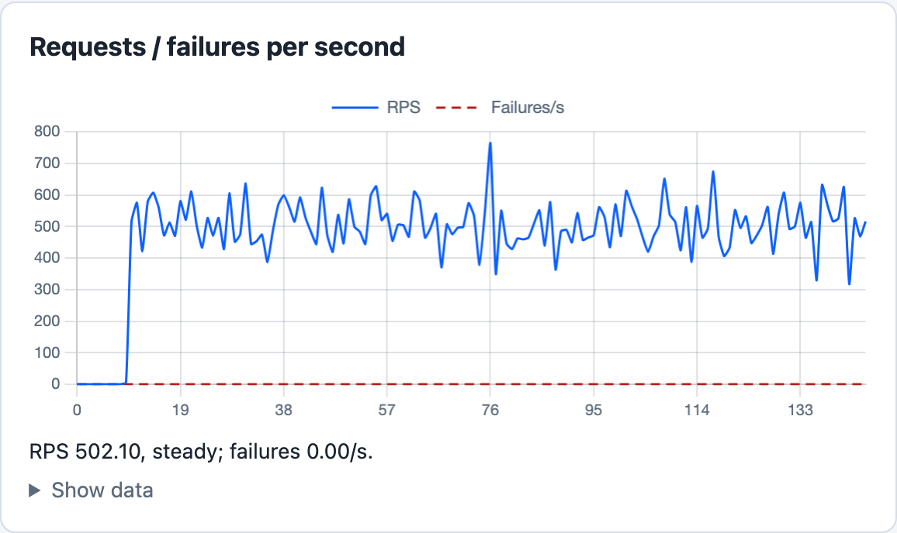
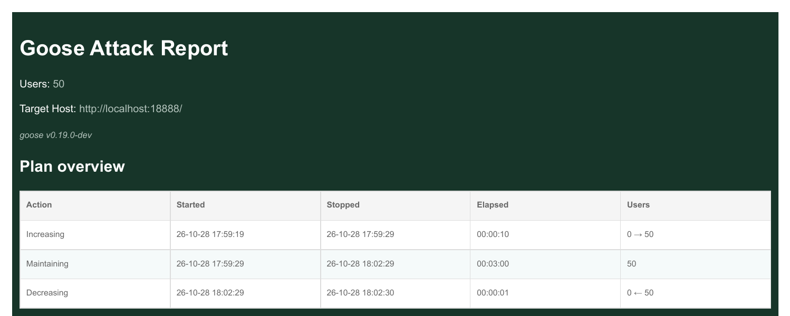
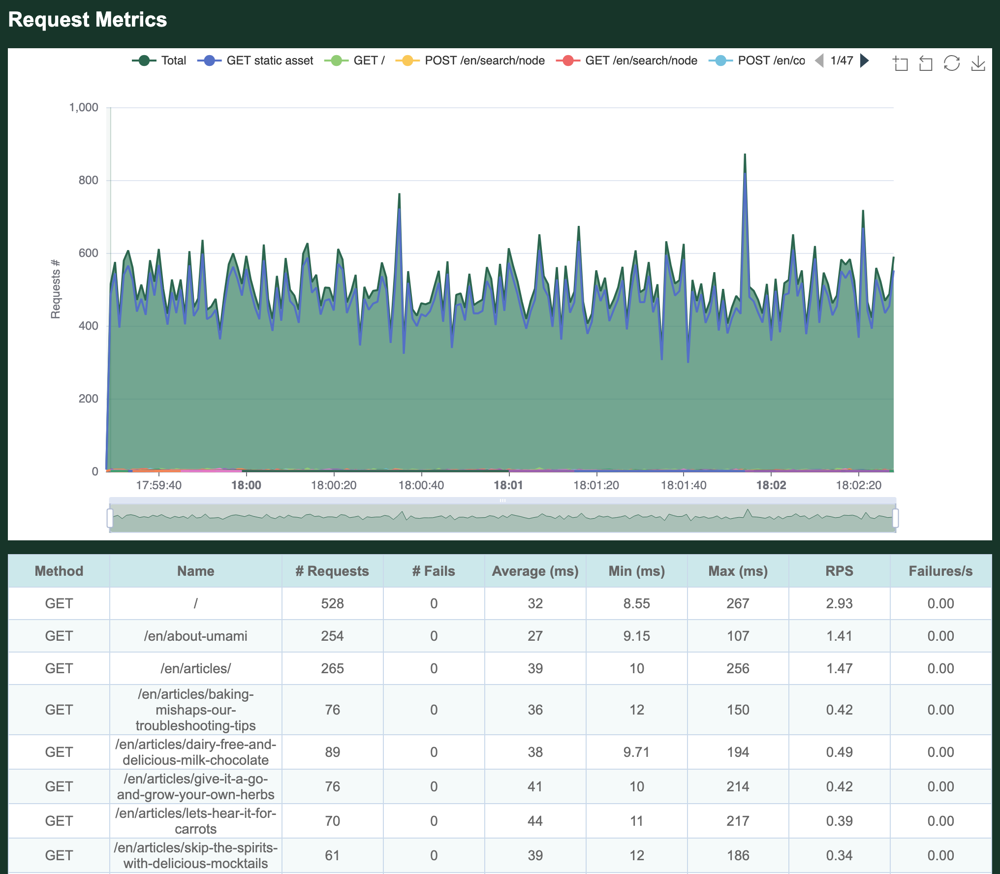
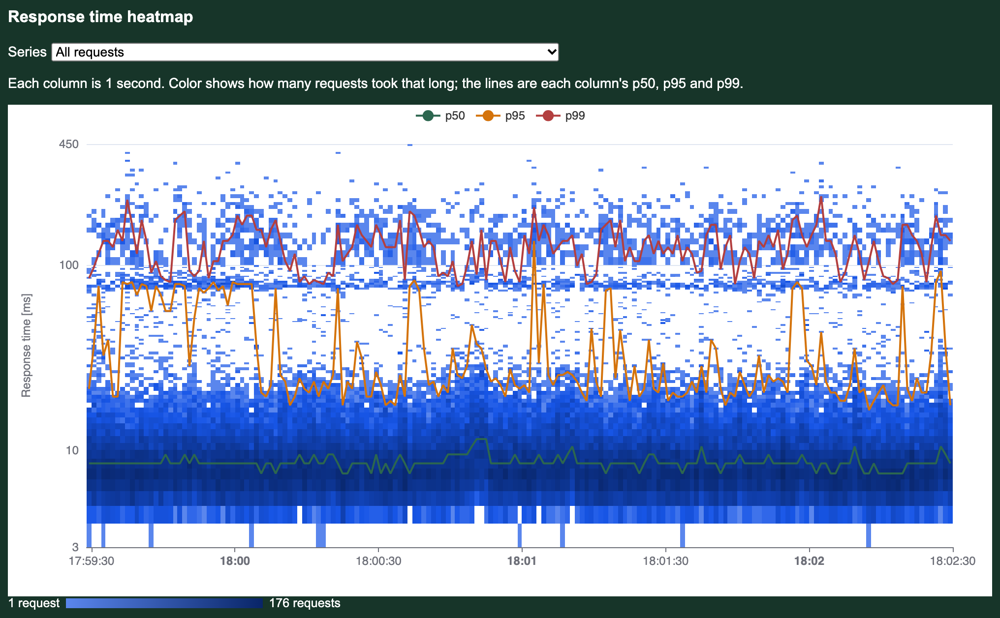
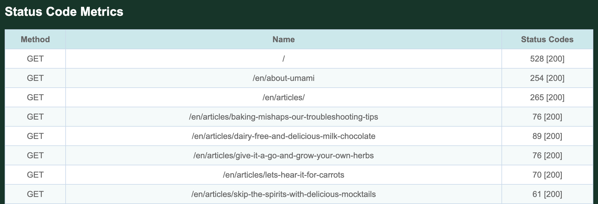
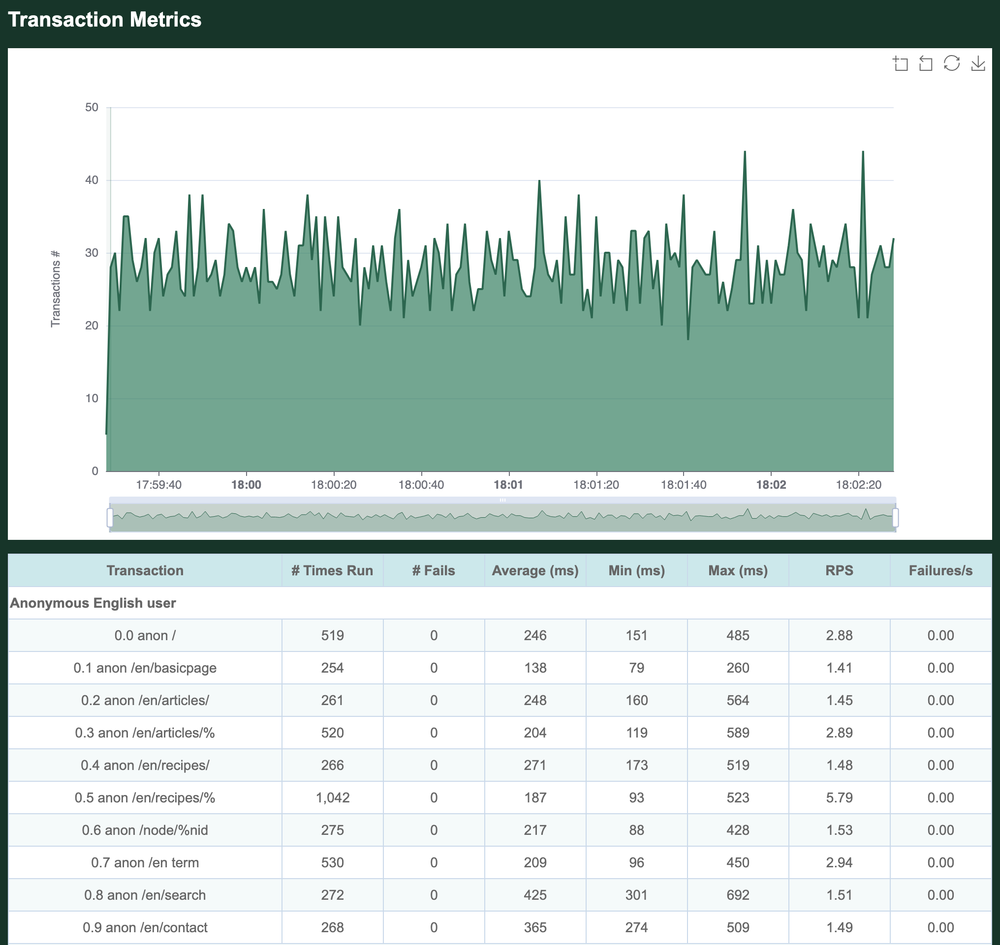
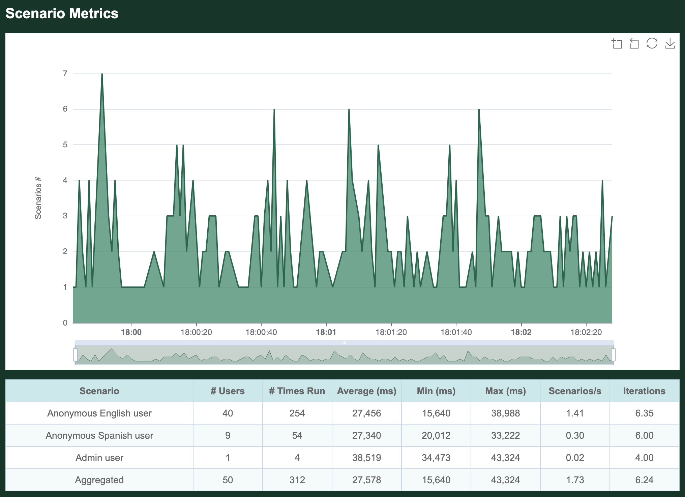
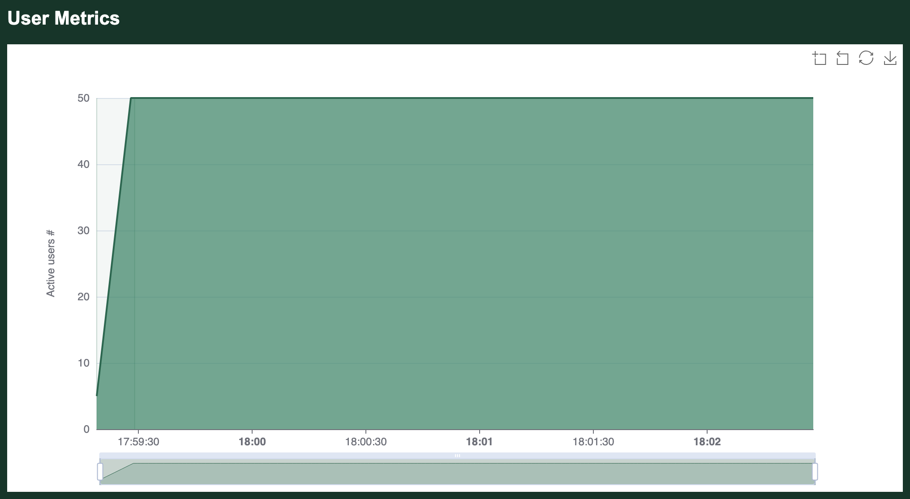

# Metrics

Goose can show a load test's results six ways. The dashboard and the PDF need a Cargo feature as well as an option; the HTML, Markdown and JSON reports take one option each; the console metrics, like the log lines, need no flag.

## Choosing a view {#report-formats}

| View | What it holds | Who it is for | How to get it |
|------|---------------|---------------|---------------|
| [Live dashboard](#the-live-dashboard) | Live charts and tables | You, while the run is going | The `dashboard` feature, then `--dashboard`, and open `http://127.0.0.1:5118/` |
| [PDF report](#pdf-reports) | The HTML report's sections in one tall, fixed page; its line graphs can stop short in this release | Someone who reads a finished run on screen or as an attachment | The `pdf-reports` feature and Chrome, which Goose downloads if it finds none, then `--report-file report.pdf`; for paper, or without the feature or Chrome, `--pdf-print-html print.html` and a browser's Print, which breaks the report into pages |
| [HTML report](#html-report) | The tables, graphs to zoom and filter, and the response time heatmap; the graphs load from a CDN when the report is opened | An engineer studying the run | `--report-file report.html` |
| [Markdown report](#markdown-report) | Tables only | An issue, a pull request or a wiki page | `--report-file report.md` |
| [JSON report](#json-report) | Every table's numbers, for programs | A script, a CI job, or a later run's [`--baseline-file`](common.md#comparing-against-a-baseline) | `--report-file report.json` |
| [Console metrics](#ascii-metrics) | Text tables | A quick look in the terminal, or a CI log | Printed at the end of every run, unless `--no-print-metrics` or `--no-metrics` |

A feature is turned on for the `goose` dependency in your load test's `Cargo.toml`, as in `goose = { version = "^0.19", features = ["dashboard", "pdf-reports"] }`; the command below runs an example in the Goose repository, so it uses `--features`. A report's type comes from the extension of its `--report-file`, so repeat the option for each report you want. If you keep the JSON report, `--render-report` can write any of the other reports from it later, without running the load test, as in `--render-report report.json --report-file report.pdf` (see [What a report holds](output-files.md#what-a-report-holds)). Without a JSON report, another report means running the load test again. So add `--report-file report.json --report-graph-data` to any run you may want to report on later: a report rendered from a JSON report has graphs only when the run had `--report-graph-data` or the dashboard's Include graph data switch on. Where reports go when no path is given is in [Output Files](output-files.md).

Every image and excerpt on this page comes from one run of the [Umami example](../example/umami.md) against a Drupal 11 site installed with the Umami demo profile, reached at `http://localhost:18888`. The site was changed as the example needs: search and contact enabled, a Website feedback contact form added, an alias added for one renamed article, image styles generated ahead of the run, and CSS and JS aggregation off, so each CSS and JS file is a static asset request of its own:

```bash
cargo run --release --features dashboard,pdf-reports --example umami -- \
  -H http://localhost:18888 --dashboard -u 50 -r 5 -t 3m \
  --report-file report.pdf --report-file report.html \
  --report-file report.md --report-file report.json
```

The run behind the images also moved the dashboard and telnet ports, with `--dashboard-port 5128 --telnet-port 5126`, which changes nothing shown here. No request failed. Goose launched 5 users a second up to 50, reset its metrics once all 50 were running, then ran for 3 minutes. The tables, and every graph but User Metrics, count from that reset.

## The live dashboard

The dashboard shows the run as it happens: users, requests and failures per second, the response time heatmap, and tables of scenarios, transactions, requests and errors, updated every second.



*The chart reads zero for the seconds the users were launching, because Goose clears it at the metrics reset; the summary under the chart gives the mean of the last 10 seconds, 502 requests a second.*

With `--dashboard` the dashboard's Save report switch starts on, so the run also writes its own `report.html` and `report.json` into the run's folder, named for the run's local start time, such as `goose-runs/20261028-175916/` (see [Output Files](output-files.md)). The `--report-file` reports go to the paths given, relative to where you ran the command. With its report saved and a dashboard tab open when the run ends on its own, Goose stays up so you can download its HTML, Markdown and JSON reports from the Runs panel; it exits on Ctrl-C, a Controller `shutdown`, or the dashboard's Quit button, which needs `--dashboard-control`. A threshold, the killswitch or Ctrl-C that stops the run ends Goose without waiting for the dashboard (see [When the run ends](../controller/dashboard.md#when-the-run-ends)). [Live Dashboard](../controller/dashboard.md) tours every panel, and the [Dashboard Reference](../controller/dashboard-reference.md) covers each in detail.

## PDF report {#pdf-reports}

The PDF report is the HTML report with print styling, rendered by Chrome into one tall page. It has the same sections as the HTML report, controls included, though they do nothing in a PDF. Chrome loads the graphs from the HTML report's CDN when it writes the PDF. In this release the line graphs, such as requests per second, can stop partway along their time axis, because Chrome prints them before they finish drawing; send the HTML report when the graphs matter.



*The PDF is laid out as the HTML report is, in one tall page: the header, then the plan overview, then each section below them.*

Name a `.pdf` file with `--report-file report.pdf`. `--pdf-scale` and `--pdf-timeout` tune how Chrome renders it; see the [PDF report example](common.md#pdf-report-example). Without Chrome, `--pdf-print-html` writes the report laid out for printing from any browser; see the [printer-friendly HTML report example](common.md#printer-friendly-html-report-example).

### Chrome {#system-requirements}

[Requirements](../requirements.md#chrome-for-pdf-reports) gives the order in which Goose looks for a browser; a Chrome for Testing headless shell it downloaded earlier is used before a new download. When the `CHROME` environment variable is set and not empty, Goose uses that binary and never downloads one. It must name an executable file: if it names a macOS app bundle such as `/Applications/Google Chrome.app`, Goose stops with an error that names the binary inside it, `Contents/MacOS/Google Chrome`.

Before the load test starts, Goose finds the browser, downloading it if needed, and renders a small test page, which must finish within `--pdf-timeout`. If that fails, the load test does not start, so a Chrome problem never costs a finished run. The log names the browser it will use:

```text
16:59:19 [INFO] PDF reports will use Chrome 156.0.8078.48 at /Applications/Google Chrome.app/Contents/MacOS/Google Chrome (installed); checked in 3.0s
```

A downloaded browser is kept in `goose/chrome` under the user cache directory: `~/.cache` (or `$XDG_CACHE_HOME`) on Linux, `~/Library/Caches` on macOS, and `%LOCALAPPDATA%` on Windows. Once a week Goose checks for a newer stable Chrome for Testing; when there is one, it downloads it and removes the older ones, and when the check fails it logs a warning and uses the one it has. Goose never updates or removes an installed browser or the one `CHROME` names. Goose built for musl, such as on Alpine, never downloads Chrome, because Chrome for Testing needs glibc: install Chromium (`apk add chromium`) or set `CHROME`.

### Troubleshooting PDF reports

- Without a browser, Goose needs network access to download one, and `unzip` on `PATH` (`tar` on Windows). If a firewall blocks the download, or `unzip` is missing, install Chrome or Chromium or set `CHROME`.
- On Linux, a downloaded headless shell needs the shared libraries Chrome uses, such as `libnss3`. Installing Chromium from your distribution brings them in.
- When Chrome won't start, the error names the binary and how Goose found it. On Linux it also says when the binary's ELF interpreter is missing, usually a glibc binary on a musl system, and lists the shared libraries `ldd` can't find. An "Exec format error" means the binary was built for another architecture.
- If the PDF fails at the end of a run, the other reports are still written, and the empty PDF file is removed.

## HTML report {#html-report}

`--report-file report.html` writes the HTML report, one file of about 730 KB for this run. Its graphs use the [ECharts](https://echarts.apache.org) library, loaded from a CDN when the report is opened, so they appear only where the CDN can be reached. Click a name in a graph's legend to hide or show its line, and drag the handles under a graph to zoom.

**Header and plan overview.** The report opens with any `--notes`, then the number of users, the target host and the Goose version, then the plan overview: each step of the run, when it started and stopped, how long it took, and how many users were running. The PDF image above shows both.

**Sections that depend on the run and its options.** Thresholds follows the plan overview when [`--threshold`](thresholds.md) is set. When [coordinated omission](../coordinated-omission/metrics.md) mitigation added synthetic times, an adjusted table follows Request Metrics and another follows Response Time Metrics. With mitigation on, the report ends with Coordinated Omission Event Metrics. Errors and Transaction Errors follow User Metrics when a request failed or a transaction returned an error that is not a request error. `--no-error-summary` leaves them out, and `--no-status-codes`, `--no-transaction-metrics` and `--no-scenario-metrics` leave out Status Code, Transaction and Scenario Metrics. With [`--baseline-file`](common.md#comparing-against-a-baseline), each number in the request, response time, transaction, scenario and error tables is followed by its change from the earlier run. With mitigation on, the request counts and rates and the status code counts include the synthetic requests (see [Reading the event summary](../coordinated-omission/metrics.md#co-event-metrics-display)).

### Request Metrics {#requests}

A graph of requests per second, with a line for all requests and one for each request, then a table of each request: how many were made and failed, the average, minimum and maximum response time, and requests and failures per second. `--no-granular-report` draws only the totals, in this graph and in every other line graph of the report; the heatmap keeps its menu of request names.



*Most of the 500 requests a second were static assets, the line just under the total; the page requests are the thin lines near zero.*

#### Response time breakdowns by status code

When one request name gets more than one status code, such as some `200` and some `500` responses, a row for each status code follows its row, starting `└─`. In the PDF, HTML and Markdown reports the row gives that code's count, share of the responses, and average, minimum and maximum times; in the console metrics it follows the request in the table of times, with the share in its name and `-` for Median, because Goose keeps only those figures for each code. A request that got no response, such as one that could not connect, counts under status code `0`. The rows hold measured times only, never coordinated omission synthetic ones. They are in the PDF, HTML and Markdown reports, in the JSON report as each request's `status_code_timings`, and in the console metrics.

### Response Time Metrics {#response-time-metrics}

A graph of the average response time each second, then the response time heatmap of the run since the metrics reset, then a table of percentiles from 50% to 100%: the 95%ile column is the slowest of the fastest 95% of each request's responses. The console metrics use other percentiles, from 50% to 99.99%.



*The p50 line holds near 9 ms throughout; the p95 line sits near 80 ms for the first half minute, then near 25 ms with spikes to 80 ms and more.*

The heatmap uses the [dashboard's](../controller/dashboard-reference.md#the-response-time-heatmap) rows and percentiles, with p50, p95 and p99 drawn as colored lines, but covers the whole run since the metrics reset, while the dashboard's heatmap shows the last 5 minutes. A column starts one second wide. Once a series holds 600 columns for all requests, or 60 for one request name, adjacent pairs merge, and the heatmap says how wide each column is. This 3 minute run kept one second columns for all requests, while each request name's columns merged to 4 seconds. A menu picks all requests or one of the first 100 request names Goose recorded. `--no-percentiles-over-time` leaves the heatmap out.

### Status Code Metrics

A table of every status code each request received.



*Every request in this run got `200`; a request that also got other codes lists each with its count.*

### Transaction Metrics

A graph of transactions per second and a table of each transaction, grouped by scenario. A transaction fails only when its code returns an error, so a transaction can succeed while a request it made failed; [Transaction Log](../logging/transactions.md) explains which errors are counted where. Scenarios and transactions are numbered from 1 on the dashboard, in every report's transaction errors table (the JSON report's `transaction_errors` too) and in the console metrics. The transaction tables of the PDF, HTML, Markdown and JSON reports number them from 0, as `0.0`. So transaction `0.2` in those tables is `1.3` on the dashboard and in the transaction errors tables, and transaction `3` under scenario `1` in the console metrics.



*Each transaction loads a page and its static assets, and each form transaction also loads a second page, so about 30 transactions a second carried the 500 requests a second above.*

### Scenario Metrics {#scenarios}

A graph of scenarios per second and a table of each scenario. `# Users` is how many users ran the scenario since the metrics reset, or since the start in a run with no reset, whether or not they finished an [iteration](../glossary.md#iteration). `# Times Run` counts finished iterations, and the times are how long one iteration took. `Iterations` is `# Times Run` divided by `# Users`, in the Aggregated row too. A scenario no user ran shows an average and Iterations of 0.



*The one Admin user took 34 to 43 seconds for each iteration, so it finished 4 in the 3 minutes, while the 40 Anonymous English users finished 254.*

### User Metrics {#users}

A graph of how many users were running.



*This is the only graph that shows the ramp up; the others count from the metrics reset.*

## Markdown report {#markdown-report}

`--report-file report.md` writes the Markdown report: the HTML report's tables, as Markdown tables, in the same order. It has no graphs or heatmap, no header lines for the user count, host or version, and no coordinated omission adjusted tables. Its error sections are headed Error Metrics and Transaction Error Metrics. Its coordinated omission section, Coordinated Omission Metrics, adds tables of events by user and by scenario when there are events; see [Coordinated Omission metrics](../coordinated-omission/metrics.md). Its scenario table's first column is headed Scenario, as in the HTML report. The start of its Request Metrics:

```markdown
## Request Metrics

| Method | Name | # Requests | # Fails | Average (ms) | Min (ms) | Max (ms) | RPS | Failures/s |
| ------ | ---- | ---------: | ------: | -----------: | -------: | -------: | --: | ---------: |
| GET | / | 528 | 0 | 32 | 8.55 | 267 | 2.93 | 0.00 |
| GET | /en/about-umami | 254 | 0 | 27 | 9.15 | 107 | 1.41 | 0.00 |
| GET | /en/articles/ | 265 | 0 | 39 | 10 | 256 | 1.47 | 0.00 |
```

## JSON report {#json-report}

`--report-file report.json` writes the JSON report: every table the other reports show, as indented JSON (383 KB for this run), with the graph data only when asked for (below). Its top level, with each array and object shown by its size:

```bash
jq 'map_values(if type == "array" then "\(length) rows" elif type == "object" then "{\(keys | length) keys}" else . end)' report.json
```

```json
{
  "goose_version": "0.19.0",
  "test": "umami",
  "started": "2026-10-28T16:59:19Z",
  "ended": "2026-10-28T17:02:30Z",
  "ended_by": "completed",
  "in_progress": false,
  "raw_metrics": "{14 keys}",
  "raw_request_metrics": "143 rows",
  "raw_response_metrics": "143 rows",
  "co_request_metrics": null,
  "co_response_metrics": null,
  "scenario_metrics": "4 rows",
  "transaction_metrics": "27 rows",
  "status_code_metrics": "143 rows",
  "errors": null,
  "coordinated_omission_metrics": null
}
```

The JSON report's times, which end `Z`, are UTC, as are the log's; the run's folder and the plan overview in the other reports and the console metrics use local time, an hour ahead here, as in [Running A Load Test](running.md#what-the-run-produced).

- `raw_metrics` is Goose's own record of the run, [`GooseMetrics`](https://docs.rs/goose/latest/goose/metrics/struct.GooseMetrics.html), with the test plan steps the run went through, in `history`, and each `--threshold` result. Each transaction's `transaction_name` there is an object that says how it was named, such as `{"TransactionOnly":"anon /"}`.
- `raw_request_metrics`, `raw_response_metrics`, `scenario_metrics`, `transaction_metrics` and `status_code_metrics` are the tables the other reports show; `raw_request_metrics` has a row for each request and the Aggregated row, and each request in `raw_metrics` holds `status_code_timings` in place of the `└─` breakdown rows.
- `errors` is `null` without errors, and `transaction_errors` appears only when a transaction returned an error that is not a request error.
- The `co_` keys are `null` until coordinated omission mitigation adds synthetic times, and `coordinated_omission_metrics` is `null` with mitigation off.
- `graphs`, with the per second data behind the graphs and the heatmap, appears only when the run had `--report-graph-data` or the dashboard's Include graph data switch on.

Each minimum, maximum and percentile in `raw_request_metrics`, `raw_response_metrics` and the other tables is written twice: in whole milliseconds, truncated, as Goose has always written it, so a 37.999 ms time is `37` and a 0.59 ms time is `0`, and in microseconds, in the field of the same name ending `_us`, such as `percentile_50_us` beside `percentile_50` and `response_time_minimum_us` beside `response_time_minimum`, so 37,999 and 590. Read the `_us` fields for the times the other reports show; a report from Goose 0.19.0 or earlier has only the whole milliseconds. Averages keep their fraction of a millisecond, as `31.861234848484848` for `GET /`. A request or scenario average with no times to average is `0`, and each scenario's heading row in `transaction_metrics` has `null` averages and rates. The raw timing data keeps microseconds, in fields ending `_us`. A JSON report loads as a baseline with [`--baseline-file`](common.md#comparing-against-a-baseline) (see [Baselines from older Goose releases](common.md#baselines-from-older-goose-releases)), and `--render-report` writes the other reports from it.

The whole millisecond row fields, `percentile_*`, `response_time_minimum` and `response_time_maximum` without `_us`, are deprecated from Goose 0.19.1 and kept only for older readers: they truncate, so read the `_us` fields instead. Goose 0.20 will stop writing them and write the row times only in the `_us` fields. Goose 0.20 will not load a report from Goose 0.18 as a baseline, and Goose 0.19 will not load a report from Goose 0.20 as one. Reports from 0.19 hold their raw timing data in microseconds, and 0.20 rebuilds their rows from it, as 0.19 does.

### Converting older reports

To keep a Goose 0.18 report as history in the current form, render it to a new JSON report with any Goose 0.19.1 or later load test, such as `cargo run --example simple -- --render-report report-0.18.json --report-file report-converted.json`. Nothing is sent to a host. The converted report has a `_us` field beside every whole millisecond row field and its raw timing data in `times_us`, and loads as a baseline. Its times are still only as precise as the old report: each `_us` value is the old whole milliseconds times 1,000, and the percentiles 0.18 rounded above 100 ms stay rounded.

## Console metrics {#ascii-metrics}

While the load test runs, Goose logs what it is doing; [Running A Load Test](running.md) walks through those log lines. Once every user has started, it prints the tables so far and [resets its metrics](../glossary.md#metrics-reset), after which every table, errors included, counts from zero. A run with `--iterations` or a test plan never resets, and `--no-reset-metrics` keeps the ramp up in the tables. With `--running-metrics N` it prints the tables again every N seconds, ramp up included. During the ramp up it also prints them each time a user starts at least N milliseconds after the last print, because in Goose 0.19 the user launch code reads N as milliseconds. When the run ends, it prints the final metrics in this order: scenarios, with their times; transactions, with their times; requests, with their response times, percentiles and status codes; errors, transaction errors and thresholds, when there are any; the coordinated omission event summary, whenever mitigation is on; and last the [plan overview](../glossary.md#plan-overview), as [Running A Load Test](running.md#what-the-run-produced) shows. From this run, up to the plan overview, with `...` for the rows and tables left out:

```text
 === PER SCENARIO METRICS ===
 ------------------------------------------------------------------------------
 Name                     |  # users |  # times run | scenarios/s | iterations
 ------------------------------------------------------------------------------
 1: Anonymous English u.. |       40 |          254 |        1.41 |       6.35
 2: Anonymous Spanish u.. |        9 |           54 |        0.30 |       6.00
 3: Admin user            |        1 |            4 |        0.02 |       4.00
 -------------------------+----------+--------------+-------------+------------
 Aggregated               |       50 |          312 |        1.73 |       6.24
 ...

 === PER TRANSACTION METRICS ===
 ------------------------------------------------------------------------------
 Name                     |   # times run |        # fails |  trans/s |  fail/s
 ------------------------------------------------------------------------------
 1: Anonymous English user
   1: anon /              |           519 |         0 (0%) |     2.88 |    0.00
   2: anon /en/basicpage  |           254 |         0 (0%) |     1.41 |    0.00
 ...
 -------------------------+---------------+----------------+----------+--------
 Aggregated               |         5,124 |         0 (0%) |    28.47 |    0.00
 ...

 === PER REQUEST METRICS ===
 ------------------------------------------------------------------------------
 Name                     |        # reqs |        # fails |    req/s |  fail/s
 ------------------------------------------------------------------------------
 GET /                    |           528 |         0 (0%) |     2.93 |    0.00
 ...
 GET static asset         |        85,825 |         0 (0%) |   476.81 |    0.00
 ...
 -------------------------+---------------+----------------+----------+--------
 Aggregated               |        91,625 |         0 (0%) |   509.03 |    0.00
 ------------------------------------------------------------------------------
 Name                     |    Avg (ms) |        Min |         Max |     Median
 ------------------------------------------------------------------------------
 GET /                    |          32 |       8.55 |         267 |         20
 ...
 GET static asset         |          11 |       3.81 |         401 |       8.26
 ...
 -------------------------+-------------+------------+-------------+-----------
 Aggregated               |          14 |       3.81 |         438 |       8.51
 ------------------------------------------------------------------------------
 Slowest page load within specified percentile of requests (in ms):
 ------------------------------------------------------------------------------
 Name                     |    50% |    75% |    98% |    99% |  99.9% | 99.99%
 ------------------------------------------------------------------------------
 GET /                    |     20 |     26 |    148 |    163 |    210 |    267
 ...
 GET static asset         |   8.26 |     10 |     74 |     78 |     92 |    281
 ...
 -------------------------+--------+--------+--------+--------+--------+-------
 Aggregated               |   8.51 |     11 |     87 |    138 |    230 |    338
 ------------------------------------------------------------------------------
 Name                     |                                        Status codes 
 ------------------------------------------------------------------------------
 GET /                    |                                           528 [200]
 ...
 GET static asset         |                                        85,825 [200]
 ...
 -------------------------+----------------------------------------------------
 Aggregated               |                                        91,625 [200] 
```

`--no-print-metrics` leaves out every table the console prints, at the reset, with `--running-metrics` and at the end; the reports are still written.

## How Goose measures response times {#response-times}

Goose measures time to first byte: from sending a request until its response headers arrive, including connecting and following redirects, but not reading the body. Every request Goose sends is timed this way. A load test that needs the time to the last byte reads the body and times it; see [Measuring complete download time](#measuring-complete-download-time).

Goose keeps request, transaction and scenario times to the microsecond. The tables of the dashboard, the PDF, HTML and Markdown reports and the console metrics show times under 10 ms to the hundredth of a millisecond and longer times in whole milliseconds, rounded half up. The heatmap labels truncate instead, as the [Dashboard Reference](../controller/dashboard-reference.md#the-response-time-heatmap) explains, and so do the whole millisecond minimums, maximums and percentiles of the [JSON report](#json-report), which keeps each in microseconds as well, in a field ending `_us`. Percentiles come from buckets never more than 0.78% off the times they hold, so 2.2 ms and 2.5 ms are told apart, and the fastest and slowest times are kept exactly.

### Measuring complete download time {#measuring-complete-download-time}

To measure the time to the last byte, read the body yourself and record the time it took with `record_custom_request_duration`, which records it as a request of its own:

```rust
use goose::prelude::*;
use std::time::Instant;

async fn measure_full_download(user: &mut GooseUser) -> TransactionResult {
    let started = Instant::now();
    let goose = user.get("/large-file").await?;

    // Read the entire response body.
    let success = match goose.response {
        Ok(response) => response.bytes().await.is_ok(),
        Err(_) => false,
    };

    // Record the time to the last byte as a request of its own.
    user.record_custom_request_duration(
        "DOWNLOAD",
        "/large-file",
        started.elapsed(),
        success,
        None,
        None,
    )
    .await?;

    Ok(())
}
```

The `GET /large-file` row then holds the time to the first byte, and the `DOWNLOAD /large-file` row the time to the last. A custom request is counted like any other, in its own row and in the Aggregated row; with no status code given, the status code table shows it under `[0]`, as in the [TCP example](../example/tcp.md). Reading whole bodies uses more memory and can lower the load one Goose process generates.

Developer documentation on how metrics are collected and stored is in the [`goose::metrics` module](https://docs.rs/goose/latest/goose/metrics/index.html).
