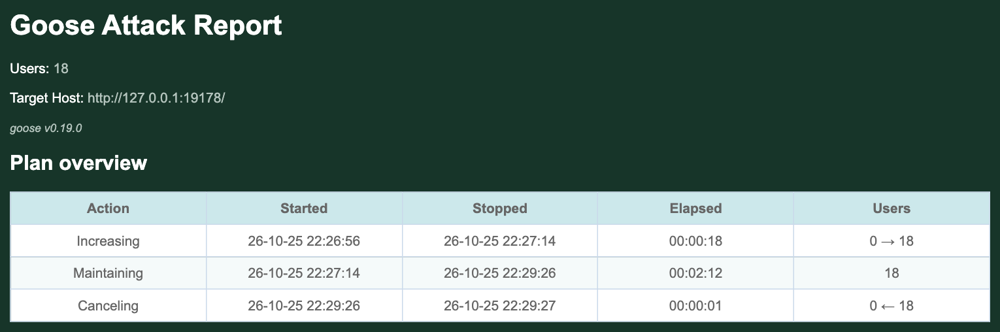
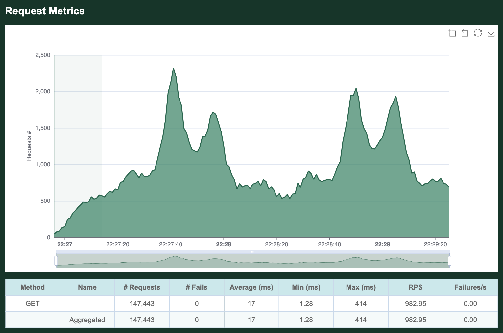
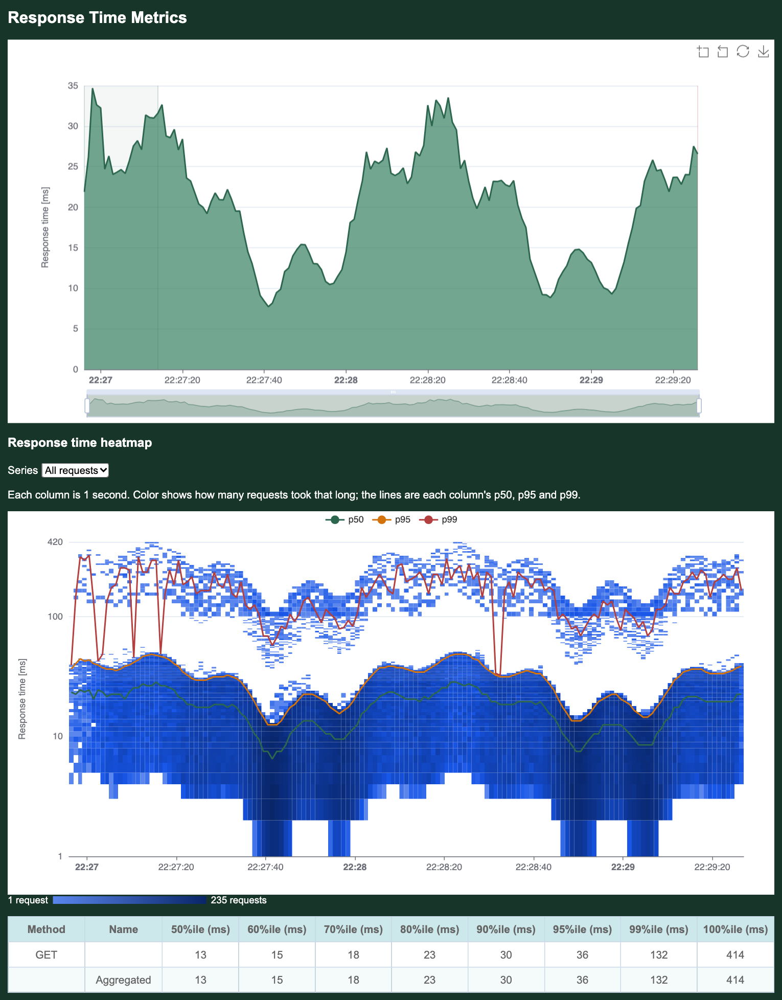
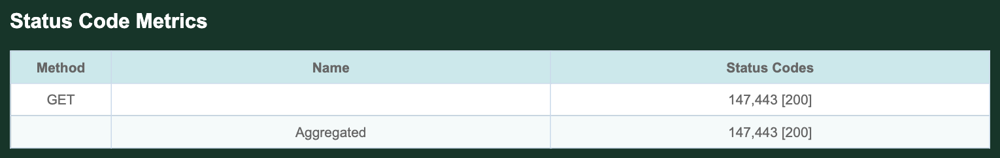
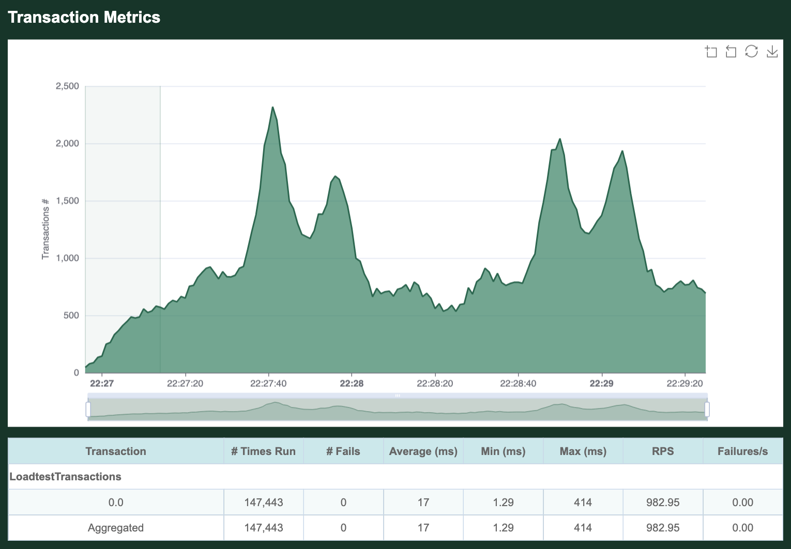
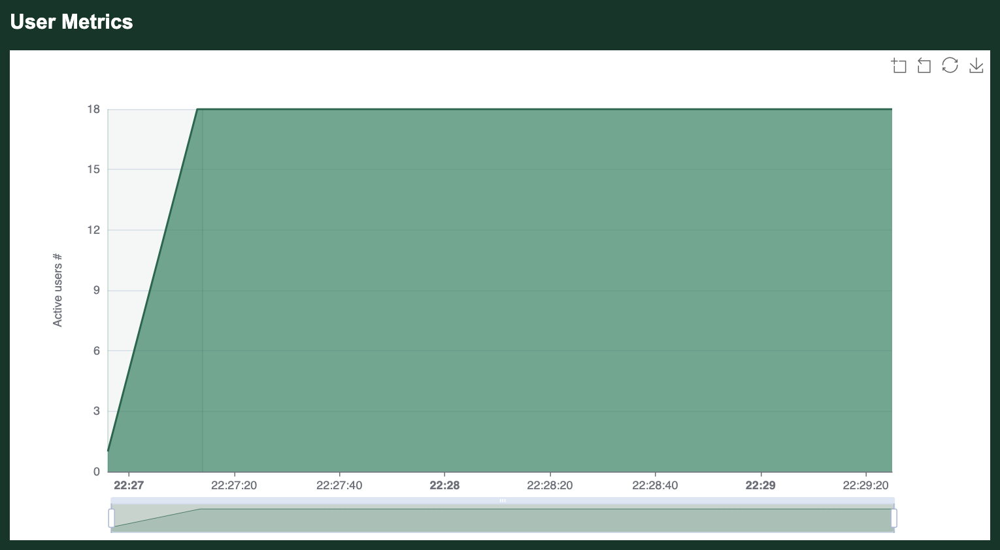

# Running A Load Test

We will use Cargo to run our example load test application. It's best to get in the habit of setting the `--release` option whenever compiling or running load tests.

```bash
$ cargo run --release
    Finished `release` profile [optimized] target(s) in 0.08s
     Running `target/release/loadtest`
20:57:04 [INFO] Output verbosity level: INFO
20:57:04 [INFO] Logfile verbosity level: WARN
20:57:04 [INFO] users defaulted to number of CPUs = 18
Error: InvalidOption { option: "--host", value: "", detail: "A host must be defined via the --host option, the GooseAttack.set_default() function, or the Scenario.set_host() function (no host defined for LoadtestTransactions)." }
```

The load test fails with an error as it hasn't been told the host you want to load test.

So, let's try again, this time passing in the `--host` flag. We will also add the `--report-file` flag with a `.html` file extension, [which will generate an HTML report](common.html#writing-an-html-formatted-report), and `--no-reset-metrics` to preserve all information including the load test startup. The same information will also [be printed to the command line](metrics.md) (without graphs). After running for a few seconds, press `ctrl-c` one time to gracefully stop the load test:

```bash
% cargo run --release -- --host http://localhost:8080 --report-file=report.html --no-reset-metrics
    Finished `release` profile [optimized] target(s) in 0.13s
     Running `target/release/loadtest --host 'http://localhost:8080' --report-file=report.html --no-reset-metrics`
21:07:31 [INFO] Output verbosity level: INFO
21:07:31 [INFO] Logfile verbosity level: WARN
21:07:31 [INFO] users defaulted to number of CPUs = 18
21:07:31 [INFO] no_reset_metrics = true
21:07:31 [INFO] report_file = ["report.html"]
21:07:31 [INFO] global host configured: http://localhost:8080
21:07:31 [INFO] [scheduler]: allocating transactions and scenarios with RoundRobin scheduler
21:07:31 [INFO] [scheduler]: initializing 18 user states...
21:07:31 [INFO] [controller]: Telnet listening on: 127.0.0.1:5116
21:07:31 [INFO] entering GooseAttack phase: Increase
21:07:31 [INFO] [user 1]: launching user from LoadtestTransactions
21:07:32 [INFO] [user 2]: launching user from LoadtestTransactions
21:07:33 [INFO] [user 3]: launching user from LoadtestTransactions
...
21:07:47 [INFO] [user 17]: launching user from LoadtestTransactions
21:07:48 [INFO] [user 18]: launching user from LoadtestTransactions
All 18 users launched.

21:07:49 [INFO] entering GooseAttack phase: Maintain
^C21:07:57 [WARN] caught ctrl-c, stopping...
21:07:57 [INFO] Killswitch triggered: SIGINT received
21:07:57 [INFO] entering GooseAttack phase: Decrease
21:07:57 [INFO] [user 12]: exiting from LoadtestTransactions
21:07:57 [INFO] [user 10]: exiting from LoadtestTransactions
...
21:07:57 [INFO] html report file written to: report.html
21:07:57 [INFO] entering GooseAttack phase: Shutdown
21:07:57 [INFO] printing final metrics after 26 seconds...
```

As of Goose 0.16.0, by default all `INFO` and higher level log messages are displayed on the console while the load test runs. You can disable these messages with the `-q` (`--quiet`) flag. Or, you can display low-level debug with the `-v` (`--verbose`) flag.

## HTML report

When the load test finishes shutting down, it will display some [ASCII metrics](metrics.html#ascii-metrics) on the CLI and an HTML report will be created in the local directory named `report.html` as was configured above. The graphs and tables found in the HTML report are what are demonstrated below. The screenshots come from a longer run of the same load test, stopped with `ctrl-c` after about two and a half minutes.



The report opens with the number of users, the target host and the Goose version, followed by the plan overview: a table of each phase of the load test, when it started and stopped, how long it took, and how many users were running. Because we stopped this load test with `ctrl-c`, its last phase is listed as `Canceling`.

By default, Goose will launch 1 `GooseUser` per second, up to the number of CPU cores available on the server used for load testing. In the above example, the load test was run from a computer with 18 CPU cores, so it took 18 seconds to launch all users.

By default, after all users are launched Goose will flush all metrics collected during the launching process (we used the `--no-reset-metrics` flag to disable this behavior) so the summary metrics are collected with all users running. If we'd not used `--no-reset-metrics`, before flushing the metrics they would have been displayed to the console so the data is not lost.

## Request metrics



The per-request metrics are displayed first, below a graph of requests per second over the course of the load test. Our single transaction makes a `GET` request for the empty `""` path, so it shows up in the metrics with the method `GET` and an empty name. The table in this section displays the total number of requests made, the number that failed, the average, minimum and maximum time to load a page in milliseconds, the average number of requests per second, and the average number of failed requests per second.

If a request receives more than one status code, such as some `200 OK` and some `500 Internal Server Error` responses, an indented row follows it for each status code, with the share of responses that received it and their average, minimum and maximum times; see [response time breakdowns by status code](metrics.md#response-time-breakdowns-by-status-code). A request that always receives the same status code has no such rows.

The Aggregated line at the bottom of this section shows totals and averages of all requests together. Because we only make a single request, this row is identical to the per-request metrics.

## Response time metrics



The second section is about response times. A graph shows the average response time each second, and below it a [response time heatmap](metrics.md#response-times) shows how response times were spread over the whole run, with lines for each moment's p50, p95 and p99. The table in this section is showing the slowest page load time for a range of percentiles: the 50%ile column is the slowest of the fastest 50% of page loads, the 70%ile column the slowest of the fastest 70%, and so on.

**Note:** Response time measurements in all Goose reports refer to Time to First Byte (TTFB), not complete download time.

## Status code metrics



The third section is a table showing all response codes received for each request. In this simple example, every request received a `200 OK` response.

## Transaction metrics



Next comes per-transaction metrics, a graph of transactions per second followed by a table, starting with the name of our Scenario, `LoadtestTransactions`. Individual transactions in the Scenario are then listed in the order they are defined in our load test. We did not name our transaction, so it shows up as `0.0`, the Scenario and transaction numbered from 0. The console tables number transactions from 1, so the same transaction shows there as `1:`. All defined transactions will be listed here, even if they did not run, so this can be useful to confirm everything in your load test is running as expected. Comparing the transaction metrics collected for `0.0` to the per-request metrics collected for `GET`, you can see that they ran the same number of times. This is because in our simple example, our single transaction only makes one request.

In real load tests, you'll most likely have multiple scenarios each with multiple transactions, and Goose will show you metrics for each along with an aggregate of them all together.

## Scenario metrics

[Per-scenario metrics](metrics.html#scenarios) follow the per-transaction metrics: a graph of scenarios per second, then a table of how many users ran each scenario, how many times it ran, how long it took, how many times it ran per second, and how many iterations each user completed on average.

## User metrics



Finally comes a chart showing how many users were running during the load test. You can see the users starting 1 per second at the start of the load test. The run was stopped with `ctrl-c`, and the line stays at 18 users to its last point.

Some sections appear only when they have something to show: thresholds, when `--threshold` is set; request and response time metrics adjusted for coordinated omission, when mitigation recorded any synthetic times; coordinated omission events, whenever mitigation is on; errors, when any request failed; and transaction errors, when any transaction returned an error that is not a request error. The Transaction Errors section follows the Errors section and counts each transaction's errors by scenario, transaction and error, most frequent first. `--no-error-summary` leaves both out of the report, not out of the [error log](../logging/errors.md).

## Comparing against a baseline

When the load test is run with [`--baseline-file`](common.html#comparing-against-a-baseline), the numbers in the request, response time, transaction, scenario and error tables are followed by their change from the earlier run, such as `21,137 (+933)` requests or `0.94 (-0.05)` milliseconds.

## Printer-friendly HTML

If you want a printer-friendly version of your HTML report for PDF conversion, use the `--pdf-print-html` option:

```bash
% cargo run --release -- --host http://localhost:8080 --report-file=report.html --pdf-print-html=print-report.html --no-reset-metrics
```

This writes the HTML report with CSS laid out for printing, which you can convert to PDF with your browser's "Print to PDF" function or print on paper. It needs neither Chrome nor the `pdf-reports` feature, nor a `--report-file`: the print-ready file has the same graphs and heatmap either way.

Refer to the [examples](../example/overview.html) included with Goose for more complicated and useful load test examples.
