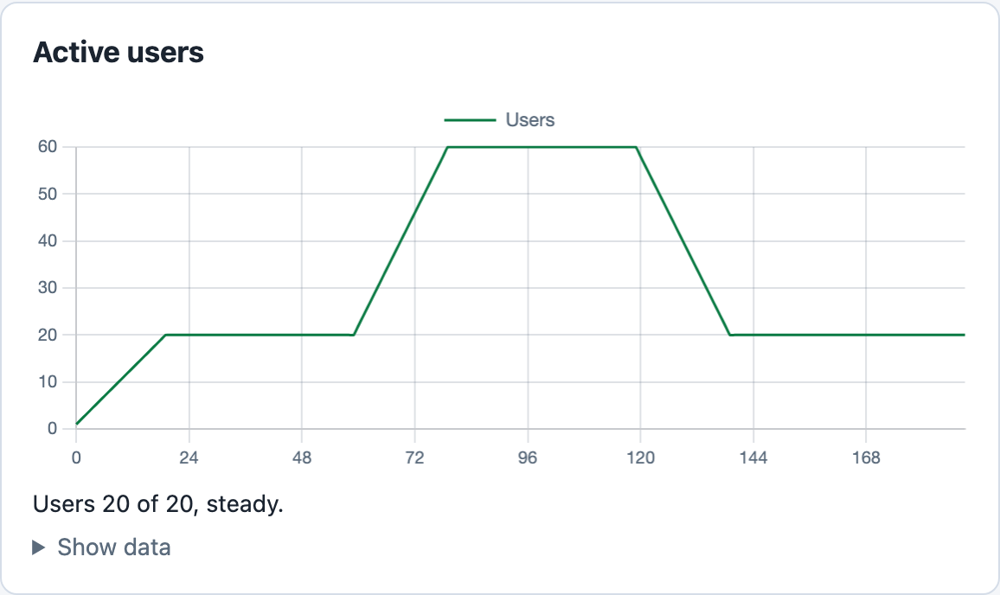

# Test Plan

A load test that ramps up to full strength and then runs for a set amount of time can be configured by combining the `--increase-time` or `--increase-rate` options together with the `--users` and `--run-time` options. To also configure a ramp-down, use `--decrease-time` or `--decrease-rate`. For more complex load patterns you must instead use the `--test-plan` option.

A test plan is defined as a series of numerical pairs that each defines a number of users, and the amount of time to ramp to this number of users. For example, `10,60s` means "launch 10 users over 60 seconds". By stringing together multiple pairs separated by a semicolon you can define more complex test plans. For example, `10,1m;10,5m;0,0s` means "launch 10 users over 1 minute, continue with 10 users for 5 minutes, then shut down the load test as quickly as possible".

The amount of time can be defined in seconds (e.g. `10,5s`), minutes (e.g. `10,15m`) or hours (e.g. `10,1h`), or a mix of them in that order (e.g. `10,1h30m`). A bare number is seconds (e.g. `10,90`), and a step with no time (e.g. `0,`) takes 0 seconds. The units take either case, and nothing else is allowed, so `10,15mins` is refused. White space around each number is ignored.

A test plan sets every user count and time itself, so `--test-plan` is not allowed with `--users`, `--increase-rate`, `--increase-time`, `--decrease-rate`, `--decrease-time`, `--run-time` or `--iterations`. A test plan never resets metrics, so `--no-reset-metrics` is refused with it too. Goose refuses a test plan before any user starts when a step does not parse, when the plan never starts a user (such as `0,10s`), when its users add up to more than fit in a `usize`, or when a time is too long to count in milliseconds. This sample runs the `simple` example from a Goose checkout:

```bash
% cargo run --release --example simple -- --test-plan "0,10s"
ERROR: invalid `configuration.test_plan` value: '0,10s': `configuration.test_plan` must start at least one user, and no more than fit in a usize.
error: invalid value '0,10s' for '--test-plan <PLAN>': GooseError: invalid option or value specified

For more information, try '--help'.
```

A test plan can also be set in code with `GooseDefault::TestPlan`, which refuses the same plans. [Thresholds](thresholds.md#when-checking-starts-and-stops) are checked from the first step that holds its users steady, then in every later step except a ramp down.

## Running A Test Plan From The Dashboard Or A Controller

The live dashboard and both [Controllers](../controller/overview.md) show a running test plan and can set one: the dashboard through its control API, the Controllers with a command.

### The live dashboard

With [`--dashboard`](../controller/dashboard.md), the Active users chart draws each step of the plan as it runs. This run used `--test-plan "20,20s;20,40s;60,20s;60,40s;20,20s;20,60s;0,0s"`:



*Each step with users shows as a ramp or a hold: to 20 over 20 seconds, 20 for 40, to 60 over 20, 60 for 40, down to 20 over 20, then 20 for 60, the step still running when the image was taken at 190 seconds; the plan's last step, `0,0s`, would stop every user at 200 seconds.*

With control off, the header names the plan: `test plan: 7 steps, peak 60 users, 3 min 20 s total`.

With control on, the Control card's summary names the host, then the plan, and the Target row is read only while the plan runs, with the reason `The test plan sets users; edit the plan, or stop and switch mode`. To switch mode, stop the run and set a user count: that replaces the plan with a users ramp. The settings form has no test plan field. To set a plan, send it as `test_plan` to `POST /api/v1/control/settings`, or to `POST /api/v1/control/start` to set it and start in one step. If Goose was started with `-H http://localhost:18888 --no-autostart --dashboard --dashboard-control --dashboard-no-auth`, this sets a plan and starts it:

```bash
curl -X POST -H 'Content-Type: application/json' \
  -d '{"test_plan":"10,10s;10,20s;0,0s"}' \
  http://127.0.0.1:5118/api/v1/control/start
```

```json
{"ok":true,"command":"start","message":"load test started","phase":"increase","active_users":0,"target_users":10,"settings":{"host":"http://localhost:18888","hosts":["http://localhost:18888/"],"users":null,"increase_rate":null,"increase_time_secs":null,"decrease_rate":null,"decrease_time_secs":null,"run_time_secs":null,"test_plan":"10,10;10,20;0,0","hold_ends_in_secs":null,"stage":"test_plan"}}
```

The reply names the plan in canonical form, each step's time in whole seconds. [Run settings](../controller/dashboard-reference.md#run-settings) gives the rules for a plan sent to a running test.

### Telnet and WebSocket

The `test-plan` command sets a plan, and `start` runs it. Here Goose runs with `-H http://localhost:18888 --no-autostart`, `-H` naming the target, which a `start` needs when the load test sets no default host. `users` is refused while the plan runs:

```bash
% telnet localhost 5116
goose> test-plan 10,10s;10,20s;0,0s
test-plan configured
goose> start
load test started
goose> users 20
failed to reconfigure users, the test plan sets users: edit the plan, or stop and switch mode
goose> stop
load test stopped
goose> shutdown
load test shut down
```

The WebSocket Controller takes the same command as JSON:

```json
{"request":"test-plan 10,10s;10,20s;0,0s"}
{"response":"test-plan configured","success":true}
```

`config` and `config-json` show the plan Goose is running, each step's time in milliseconds: on telnet `config` in Rust's debug form, `TestPlan { steps: [(10, 10000), (10, 20000), (0, 0)], current: 0 }` over several lines, and `config-json`, and both commands on WebSocket, as `"test_plan":{"steps":[[10,10000],[10,20000],[0,0]],"current":0}`. A plan sent to a running test replaces the one running, starting from its first step at the current user count. The [Controller commands](../controller/telnet.md#controller-commands) give the bounds a plan must keep.

## Simple Example

The following command tells Goose to start 10 users over 60 seconds and then to run for 5 minutes before shutting down:

```bash
$ cargo run --release -- -H http://local.dev/ --increase-time 1m --users 10 --run-time 5m --no-reset-metrics
```

The exact same behaviour can be defined with the following test plan:

```bash
$ cargo run --release -- -H http://local.dev/ --test-plan "10,1m;10,5m;0,0s"
```


## Ramp Down Example

Unless `--decrease-rate` or `--decrease-time` is set, Goose stops a load test as quickly as it can when the specified `--run-time` completes. A test plan can also ramp down slowly. In the following example, Goose starts 1000 users in 2 minutes and then slowly stops them over 500 seconds (stopping 2 users per second):

```bash
$ cargo run --release -- -H http://local.dev/ --test-plan "1000,2m;0,500s"
```


## Load Spike Example

Another possibility when specifying a test plan is to add load spikes into otherwise steady load. For example, in the following example Goose starts 500 users over 5 minutes and lets it run with a couple of traffic spikes to 2,500 users:

```bash
$ cargo run --release -- -H http://local.dev/ --test-plan "500,5m;500,5m;2500,45s;500,45s;500,5m;2500,45s;500,45s;500,5m;0,0s"
```


This graph comes from the `simple` example run with that test plan against a local server. Each step took the time it names: the first step started a user every 600 milliseconds and reached 500 users after 5 minutes (see [Specifying the increase rate](./common.html#specifying-the-increase-rate)).

## Internals

Internally, Goose converts the test plan into a vector of usize tuples, `Vec<(usize, usize)>`, where the first integer reflects the number of users to be running and the second integer reflects the time in milliseconds. You can see the internal representation when you start a load test, for example as follows. With `--no-autostart` the load test waits to be started, so press `ctrl-c` once the line is printed:

```bash
% cargo run --release --example simple -- --no-autostart --test-plan "100,30s;100,1h" | grep test_plan
21:00:10 [INFO] test_plan = TestPlan { steps: [(100, 30000), (100, 3600000)], current: 0 }
```
