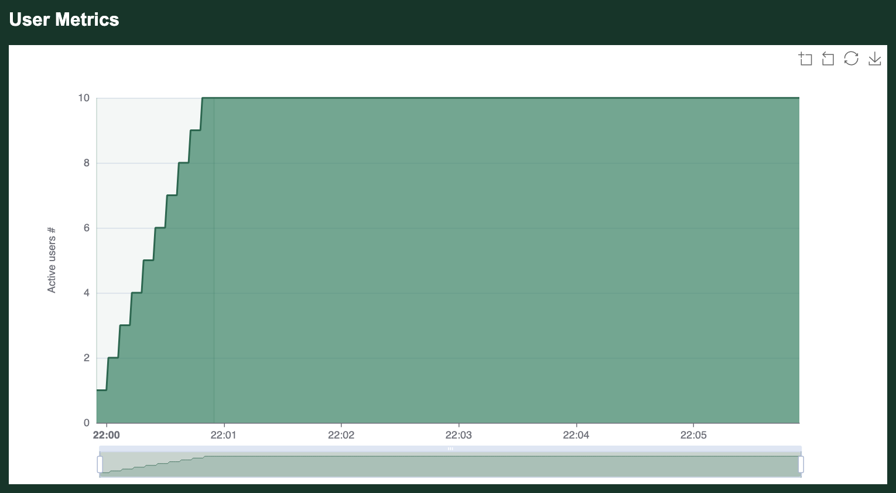
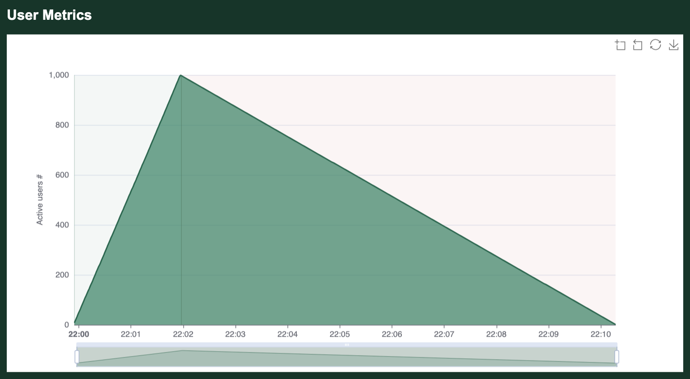
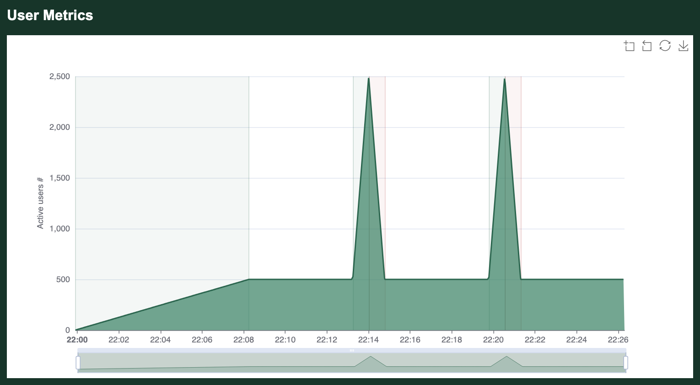

# Test Plan

A load test that ramps up to full strength and then runs for a set amount of time can be configured by combining the `--increase-time` or `--increase-rate` options together with the `--users` and `--run-time` options. To also configure a ramp-down, use `--decrease-time` or `--decrease-rate`. For more complex load patterns you must instead use the `--test-plan` option.

A test plan is defined as a series of numerical pairs that each defines a number of users, and the amount of time to ramp to this number of users. For example, `10,60s` means "launch 10 users over 60 seconds". By stringing together multiple pairs separated by a semicolon you can define more complex test plans. For example, `10,1m;10,5m;0,0s` means "launch 10 users over 1 minute, continue with 10 users for 5 minutes, then shut down the load test as quickly as possible".

The amount of time can be defined in seconds (e.g. `10,5s`), minutes (e.g. `10,15m`) or hours (e.g. `10,1h`), or a mix of them in that order (e.g. `10,1h30m`). A bare number is seconds (e.g. `10,90`). White space around each number is ignored.

A test plan sets every user count and time itself, so `--test-plan` is not allowed with `--users`, `--increase-rate`, `--increase-time`, `--decrease-rate`, `--decrease-time`, `--run-time`, `--iterations` or `--no-reset-metrics`. Goose refuses a test plan before any user starts when a step does not parse, when the plan never starts a user (such as `0,10s`), when its users add up to more than fit in a `usize`, or when a time is too long to count in milliseconds. These samples run the `simple` example from a Goose checkout:

```bash
% cargo run --release --example simple -- --test-plan "0,10s"
ERROR: invalid `configuration.test_plan` value: '0,10s': `configuration.test_plan` must start at least one user, and no more than fit in a usize.
error: invalid value '0,10s' for '--test-plan <PLAN>': GooseError: invalid option or value specified

For more information, try '--help'.
```

A test plan can also be set in code with `GooseDefault::TestPlan`, which refuses the same plans. [Thresholds](thresholds.md#when-checking-starts-and-stops) are checked only while a test plan holds its users steady.

## Simple Example

The following command tells Goose to start 10 users over 60 seconds and then to run for 5 minutes before shutting down:

```bash
$ cargo run --release -- -H http://local.dev/ --increase-time 1m --users 10 --run-time 5m --no-reset-metrics
```

The exact same behaviour can be defined with the following test plan:

```bash
$ cargo run --release -- -H http://local.dev/ --test-plan "10,1m;10,5m;0,0s"
```



## Ramp Down Example

Unless `--decrease-rate` or `--decrease-time` is set, Goose stops a load test as quickly as it can when the specified `--run-time` completes. A test plan can also ramp down slowly. In the following example, Goose starts 1000 users in 2 minutes and then slowly stops them over 500 seconds (stopping 2 users per second):

```bash
$ cargo run --release -- -H http://local.dev/ --test-plan "1000,2m;0,500s"
```



## Load Spike Example

Another possibility when specifying a test plan is to add load spikes into otherwise steady load. For example, in the following example Goose starts 500 users over 5 minutes and lets it run with a couple of traffic spikes to 2,500 users:

```bash
$ cargo run --release -- -H http://local.dev/ --test-plan "500,5m;500,5m;2500,45s;500,45s;500,5m;2500,45s;500,45s;500,5m;0,0s"
```



In this run the first step took 8 minutes 20 seconds rather than 5 minutes: 500 users in 5 minutes is one user every 600 milliseconds, which Goose rounds up to one a second (see [Specifying the increase rate](./common.html#specifying-the-increase-rate)).

## Internals

Internally, Goose converts the test plan into a vector of usize tuples, `Vec<(usize, usize)>`, where the first integer reflects the number of users to be running and the second integer reflects the time in milliseconds. You can see the internal representation when you start a load test, for example as follows. With `--no-autostart` the load test waits to be started, so press `ctrl-c` once the line is printed:

```bash
% cargo run --release --example simple -- --no-autostart --test-plan "100,30s;100,1h" | grep test_plan
21:00:10 [INFO] test_plan = TestPlan { steps: [(100, 30000), (100, 3600000)], current: 0 }
```
