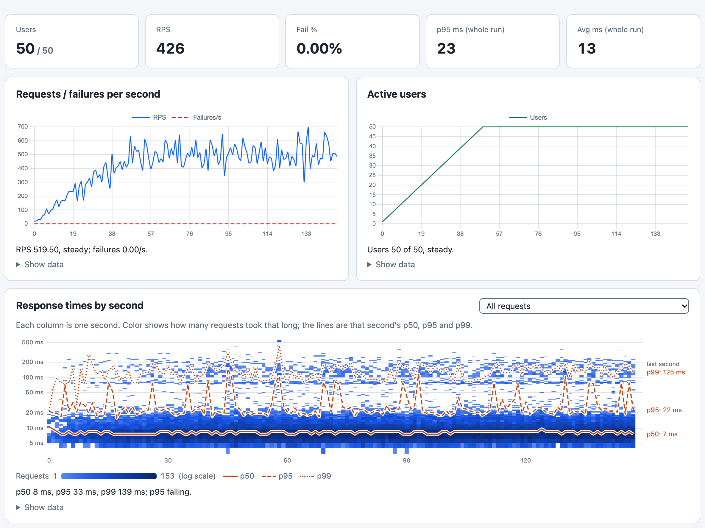
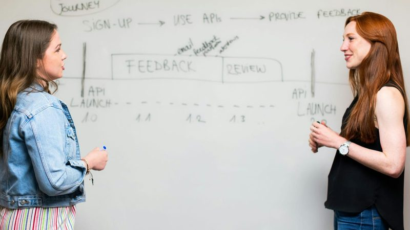

<section class="gb-band gb-band-navy gb-hero" id="what-is-goose">

<h1 class="t1-eyebrow" id="the-goose-book" aria-label="The Goose Book, open source load testing in Rust">The Goose Book · open source load testing in Rust</h1>

Have you ever been attacked by a goose?

<!-- The proof line quotes the benchmark in the latest Goose release post on the Tag1 blog.
     When a new post publishes new numbers, update the figures and the link together. -->

<strong>Looks harmless, hits hard:</strong> given the same two cores and 1,000 users over HTTPS, Goose sent <a href="https://www.tag1.com/blog/goose-0-19-watch-your-load-test-while-it-runs/#compared-with-k6-and-locust">21,400&nbsp;requests per&nbsp;second</a>, against 15,800 for k6 and 8,400 for Locust.

<a href="https://docs.rs/goose">Goose</a> is a load testing tool written in <a href="https://www.rust-lang.org/">Rust</a>. A load test is a small Rust program that depends on the <a class="gb-nw" href="https://crates.io/crates/goose"><code>goose</code> crate</a>: you build it with Cargo and run it against a host, choosing the users and the run time on the command line.

<a class="gb-btn" href="./getting-started/overview.html">Get started</a>
<a class="gb-link" href="./getting-started/upgrading.html">Upgrading From 0.18</a>

Goose, a <svg viewBox="0 0 288 80" class="gb-tag1" role="img" aria-label="Tag1" focusable="false"><polygon points="4.5,18.8 26.3,18.8 26.3,74.4 52.2,74.4 56.5,60.2 42.7,60.2 42.7,18.8 64,18.8 64,5.2 4.5,5.2"/><polygon points="67.3,74.5 84.2,74.5 103.7,5.2 86.8,5.2"/><polygon points="104.9,5.2 124.2,74.5 141.1,74.5 121.9,5.2"/><polygon points="261.4,60.8 261.4,5.2 235.4,5.2 231.2,19.4 245,19.4 245,60.8 223.7,60.8 223.7,74.4 283.2,74.4 283.2,60.8"/><path d="M185.7,48.6H200v9.7c-4.6,2.3-9.7,3.3-14.8,3.1c-14.4,0-22.6-9.3-22.6-22.3c0-12.2,7.5-21.4,19.5-21.5c5.1-0.3,10.1,1.5,13.9,4.9l6-14.8c-6.1-3.3-13-4.9-19.9-4.7c-21.4,0-36.4,15.1-36.4,36.2c0,22.1,15.3,36.7,39.2,36.7c16.7,0,27.4-6.4,31.3-9.9V34.9h-24.8L185.7,48.6z"/></svg> Innovation

<figure class="gb-shot gb-hero-shot">

Goose Dashboard127.0.0.1:5118
Opens the full size image

<figcaption>A 50 user run against a Drupal Umami demo site.</figcaption>
</figure>

</section>
<section class="gb-band gb-band-blue">

<h2 id="run-it-yourself">Run It Yourself</h2>

In the run above, users start one a second: the requests per second climb with them and level off, the tiles other than Users cover the whole run, and each column of the heatmap is one second of response times.

That run came from the <a href="./example/umami.html">Umami example</a> in a checkout of Goose, against a copy of the Drupal Umami demo site, with its admin password in the <code>ADMIN_PASSWORD</code> environment variable. <code>--no-reset-metrics</code> keeps the ramp up in its numbers; without it, Goose clears the metrics when the ramp up ends:

<pre><code class="language-bash">cargo run --release --features dashboard \
  --example umami -- \
  --dashboard -H http://umami.example.com \
  -u 50 -r 1 -t 3m --no-reset-metrics</code></pre>

</section>
<section class="gb-band gb-band-white">

<h2 id="why-use-goose">Why Use Goose</h2>

Goose is inspired by <a href="https://locust.io/">Locust</a>. Where Locust has a user class with tasks, Goose has a <a href="./glossary.html#scenario">scenario</a> with <a href="./glossary.html#transaction">transactions</a>. HTTP requests go through the <a href="https://docs.rs/reqwest">Reqwest</a> client. A load test of another protocol, such as <a href="./example/tcp.html">raw TCP</a>, times each operation itself and records it in Goose's metrics.

<h3 id="one-process-uses-every-cpu-core">One Process Uses Every CPU Core</h3>

A Goose load test runs its users as async tasks on Tokio's <a href="https://docs.rs/tokio/latest/tokio/attr.main.html">multi-threaded runtime</a>, which spreads them across a server's cores. Locust needs <a href="https://docs.locust.io/en/stable/running-distributed.html">a process per core</a> to do the same.

<h3 id="fills-a-servers-uplink">Fills A Server's Uplink</h3>

In Tag1's <a href="https://www.tag1.com/blog/goose-clouds-load-testing-scale/">A Goose In The Clouds</a> (2021, an earlier Goose release), one 8&nbsp;core server simulated 2,000 users at a sustained 2.5&nbsp;Gbps, limited by its network uplink, and one 32&nbsp;core server filled its 9&nbsp;Gbps uplink.

<h3 id="load-tests-are-rust-code">Load Tests Are Rust Code</h3>

A load test can use any crate and builds to one binary, to run in CI or a container. See <a href="./getting-started/creating.html">Creating A Load Test</a>.

<h3 id="results-a-pipeline-can-act-on">Results A Pipeline Can Act On</h3>

<a href="./getting-started/thresholds.html">Thresholds</a> fail a run on its metrics, and with a <a href="./getting-started/common.html#comparing-against-a-baseline">baseline</a> the PDF, HTML and Markdown reports show each number's change since an earlier run.

</section>
<section class="gb-band gb-band-navy">

<h2 id="watching-a-run-and-its-reports">Watching A Run And Its Reports</h2>

<h3 id="while-it-runs">While It Runs</h3>

The <a href="./controller/dashboard.html">live dashboard</a> needs the <code>dashboard</code> feature, which is off by default; <a href="./getting-started/common.html#watching-a-run">Watching a run</a> shows how to turn it on. Goose then serves it at <code>http://127.0.0.1:5118/</code> while a load test runs with <code>--dashboard</code>, and saves the run's report when it ends. With <code>--dashboard-control</code> and a <a href="./glossary.html#dashboard-token">dashboard token</a>, the dashboard can also start and stop the test and change its users and settings; <a href="./controller/dashboard.html#turning-it-on">Turning it on</a> explains the token, and <code>--dashboard-no-auth</code>, which turns authentication off.

<h3 id="when-it-ends">When It Ends</h3>

Each <code>--report-file &lt;FILE&gt;</code> writes one report, its type set by the file's extension: PDF (from a build with the <code>pdf-reports</code> feature), HTML, Markdown or JSON. <a href="./getting-started/common.html#writing-an-html-formatted-report">Writing reports</a> shows each. Goose also prints its metrics to the console.

Goose 0.19 runs on one server: <a href="./gaggle/overview.html">Gaggle</a>, the distributed load test, was removed in Goose 0.17.0 and will be restored in Goose 0.20, before the 1.0 release. For a distributed load test today, use Goose 0.16.4.

</section>
<section class="gb-band gb-band-cream">

<h2 class="t1-eyebrow" id="brought-to-you-by">Brought To You By</h2>

Goose is made by <a href="https://www.tag1.com/goose/">Tag1&nbsp;Consulting</a> and led by <a href="https://github.com/jeremyandrews">Jeremy Andrews</a>, Tag1's CEO, with many <a href="https://github.com/tag1consulting/goose/graphs/contributors">community contributions</a>. Tag1 is a <a href="https://www.tag1.com/blog/tag1-joins-rust-foundation-first-silver-member/">member of the Rust Foundation</a>.

<h2 class="t1-eyebrow" id="more-documentation">More Documentation</h2>
<a class="gb-read t1-frame" href="./getting-started/overview.html"><strong>Getting Started</strong>Build and run a first load test.</a>
<a class="gb-read t1-frame" href="https://docs.rs/goose/"><strong>Developer Documentation</strong>The API reference on docs.rs.</a>

<h2 class="t1-eyebrow gb-posts-head" id="from-the-tag1-blog">From The Tag1 Blog</h2>
<!-- Tag1 blog posts for Goose readers, newest first. When a new post comes out, add it first
     as the gb-post-lead card with a short gb-post-sum summary. On the old lead, remove
     the gb-post-lead class and its gb-post-sum span so it becomes one of the four smaller
     cards, then delete the last (oldest) card. Images are 800x450 JPEG crops of the post's
     header image (decorativeLandscapeImage in the tag1.com site repository), saved in
     src/images/blog/ and named after the post's URL slug. At some widths the cards crop
     their images to fit, so keep each image's subject centered. -->

<a class="gb-post gb-post-lead t1-frame" href="https://www.tag1.com/blog/goose-0-19-watch-your-load-test-while-it-runs/"><strong>Goose 0.19: Watch Your Load Test While It Runs</strong>November 2026 · Jeremy AndrewsThe live dashboard, thresholds that can fail a CI build, response times to the microsecond, and peak memory cut to a quarter or less, plus benchmarks against k6 and Locust.</a>
<a class="gb-post t1-frame" href="https://www.tag1.com/blog/from-malloc-to-match-part-2/"><strong>From Malloc to Match (Part 2): The Evolution of PHP Through the Lens of a Systems Programmer</strong>November 2026 · Jeremy Andrews</a>
<a class="gb-post t1-frame" href="https://www.tag1.com/blog/enhancing-goose-load-testing-with-ai/"><strong>Enhancing Goose Load Testing with an AI-Powered Killswitch</strong>November 2025 · Alec Smrekar</a>
<a class="gb-post t1-frame" href="https://www.tag1.com/blog/beyond-code-generation-how-ai-enhanced-our-load-testing-workflow-and-documentation/"><strong>Beyond Code Generation: How AI Enhanced Our Load Testing Workflow and Documentation</strong>September 2025 · Jeremy Andrews</a>
<a class="gb-post t1-frame" href="https://www.tag1.com/blog/tag1-joins-rust-foundation-first-silver-member/"><strong>Tag1 Joins the Rust Foundation as the First Silver Member</strong>July 2021 · Lynette Miles</a>

</section>
<section class="gb-band gb-band-purple">

<h2 id="coming-from-goose-018">Coming From Goose 0.18?</h2>

Change the dependency to <code>goose = "^0.19"</code>, then work through the changes that can break a Goose 0.18 load test or alter what it does.

<a class="gb-btn" href="./getting-started/upgrading.html">Upgrading From 0.18</a>

</section>
<footer class="gb-foot">

Goose is an open source innovation from <a href="https://www.tag1.com/goose/">Tag1&nbsp;Consulting</a>.

<a href="https://github.com/tag1consulting/goose/blob/main/LICENSE">Apache 2.0 license</a>&nbsp;·&#32;<a href="https://github.com/tag1consulting/goose">Source on GitHub</a>&nbsp;·&#32;<a href="https://crates.io/crates/goose">crates.io</a>

</footer>

